# 03 — AUTHORITATIVE DATABASE SCHEMA & ERD SPECIFICATION
**Project:** 5TOT Đà Nẵng  
**Phase:** BE0-R2 — Final Design Closure  
**Source of Truth:** `prisma/schema.prisma` (29 Models, 21 Enums)  
**Cross-References:** `02_DOMAIN_MODEL.md`, `09_QUERY_AND_INDEX_STRATEGY.md`, `11_TRANSACTIONS_AND_CONCURRENCY.md`

---

## 1. ENTITY-RELATIONSHIP DIAGRAM (MERMAID ERD)

```mermaid
erDiagram
    Institution ||--o{ SchoolReviewUnit : "has"
    Institution ||--o{ FacultyDepartment : "has"
    Institution ||--o{ User : "affiliates"
    SchoolReviewUnit ||--o{ FacultyDepartment : "oversees"
    FacultyDepartment ||--o{ AcademicClass : "contains"
    SchoolReviewUnit ||--o{ CollectiveUnit : "affiliates"

    User ||--o{ AuthSession : "maintains"
    User ||--o{ UserRoleAssignment : "holds"
    SchoolReviewUnit ||--o{ UserRoleAssignment : "scopes"
    User ||--o{ CollectivePreparerAuthorization : "granted"
    CollectiveUnit ||--o{ CollectivePreparerAuthorization : "authorizes"
    AwardSeason ||--o{ CollectivePreparerAuthorization : "for_season"

    AwardSeason ||--o{ CriterionGroupDefinition : "defines"
    CriterionGroupDefinition ||--o{ RequirementDefinition : "contains"

    AwardSeason ||--o{ IndividualApplication : "receives"
    User ||--o{ IndividualApplication : "submits"
    SchoolReviewUnit ||--o{ IndividualApplication : "reviews_at_school"
    IndividualApplication ||--o{ IndividualCriterionSubmission : "aggregates"
    IndividualCriterionSubmission ||--o{ IndividualDeclarationItem : "contains"
    IndividualApplication ||--o{ SchoolCriterionReviewJudgment : "school_judgments"
    IndividualApplication ||--o{ CityCriterionReviewJudgment : "city_judgments"

    AwardSeason ||--o{ CollectiveApplication : "receives"
    CollectiveUnit ||--o{ CollectiveApplication : "applies_as"
    User ||--o{ CollectiveApplication : "prepares"
    CollectiveApplication ||--o{ CollectiveRequirementRecord : "tt01_to_tt04"
    CollectiveApplication ||--o{ CollectiveMemberRosterEntry : "roster"
    CollectiveApplication ||--o{ CollectiveCityRequirementJudgment : "city_judgments"
    CollectiveCityRequirementJudgment ||--o{ CollectiveCityRequirementJudgmentHistory : "revisions"

    IndividualDeclarationItem ||--o{ ApplicationEvidenceLink : "attaches"
    CollectiveRequirementRecord ||--o{ ApplicationEvidenceLink : "attaches"
    EvidenceObject ||--o{ EvidenceObjectVersion : "versions"
    EvidenceObject ||--o{ ApplicationEvidenceLink : "linked_via"
    ApplicationEvidenceLink ||--o{ EvidenceReviewJudgment : "evaluated_by"

    IndividualApplication ||--o{ OfficerAssignmentHistory : "assignment_log"
    CollectiveApplication ||--o{ OfficerAssignmentHistory : "assignment_log"
    IndividualApplication ||--o{ SupplementRequest : "supplements"
    CollectiveApplication ||--o{ SupplementRequest : "supplements"
    SupplementRequest ||--o{ SupplementResponse : "responses"

    IndividualApplication ||--o{ CommitteeDecisionRecord : "committee_decisions"
    CollectiveApplication ||--o{ CommitteeDecisionRecord : "committee_decisions"
    IndividualApplication ||--o| ApplicationFinalResult : "authoritative_result"
    CollectiveApplication ||--o| ApplicationFinalResult : "authoritative_result"
    RecognitionDecisionBatch ||--o{ ApplicationFinalResult : "publishes"
```

---

## 2. MODEL-BY-MODEL SPECIFICATION MATRIX (ALL 29 MODELS)

| # | Model Name | PK | Foreign Keys & Nullable Relations | Unique Constraints | Indexes | Ownership & Delete Behavior | Versioning / Mutability |
| :- | :--- | :--- | :--- | :--- | :--- | :--- | :--- |
| 1 | `Institution` | `id` (cuid) | None | `code` | `[group, isActive]` | Admin-owned; `Restrict` on child units/apps | Mutable (`updatedAt`) |
| 2 | `SchoolReviewUnit` | `id` (string) | `institutionId` (FK -> `Institution`) | `code` | `[institutionId, isActive]` | Admin-owned; `Restrict` on apps/roles | Mutable (`updatedAt`) |
| 3 | `FacultyDepartment` | `id` (cuid) | `institutionId`, `schoolReviewUnitId` | `[institutionId, code]` | `[schoolReviewUnitId, isActive]` | Admin-owned; `Restrict` | Mutable (`updatedAt`) |
| 4 | `AcademicClass` | `id` (cuid) | `facultyDepartmentId` | `[facultyDepartmentId, code]` | Unique index covers FK | Admin-owned; `Restrict` | Mutable |
| 5 | `User` | `id` (cuid) | `institutionId?`, `facultyDepartmentId?`, `academicClassId?` | `email`, `ssoSubjectId`, `studentCode` | `[institutionId, status]`, `[studentCode]` | System/Auth-owned; `SetNull` on institution delete | Mutable (`updatedAt`) |
| 6 | `UserRoleAssignment` | `id` (cuid) | `userId`, `schoolReviewUnitId?` (required for `SCHOOL_OFFICER`) | None (history preserved via `revokedAt`) | `[userId, isActive]`, `[roleCode, schoolReviewUnitId, isActive]` | Admin-owned; `Cascade` on User delete | Soft-revoked (`isActive`, `revokedAt`) |
| 7 | `AuthSession` | `id` (cuid) | `userId` | `refreshTokenHash` | `[userId, expiresAt]`, `[tokenFamilyId]` | Auth-owned; `Cascade` on User delete | Rotating token hash; soft-revoked (`revokedAt`) |
| 8 | `AwardSeason` | `id` (cuid) | None | `code` | `[isActive, code]` | Admin-owned; `Restrict` on apps/results | Mutable (`updatedAt`) |
| 9 | `CriterionGroupDefinition` | `id` (cuid) | `seasonId` | `[seasonId, track, code]` | `[seasonId, track, displayOrder]` | Admin/Season-owned; `Cascade` from Season | Versioned per `AwardSeason` |
| 10 | `RequirementDefinition` | `id` (cuid) | `criterionGroupId` | `[criterionGroupId, code]` | Unique index covers FK | Admin/Season-owned; `Cascade` | Versioned per `AwardSeason` |
| 11 | `IndividualApplication` | `id` (cuid) | `seasonId`, `applicantUserId`, `institutionId`, `schoolReviewUnitId`, `assignedCityOfficerId?` | `applicationCode`, `[seasonId, applicantUserId]` | 4 composite queue indexes (see `09_QUERY_AND_INDEX_STRATEGY.md`) | Student-created; `Restrict` on Season/User/Unit | Optimistic lock (`version Int @default(1)`) |
| 12 | `IndividualCriterionSubmission` | `id` (cuid) | `individualApplicationId` | `[individualApplicationId, criterionCode]` | Unique index covers FK | Student-owned; `Cascade` from Application | Mutable while application editable |
| 13 | `IndividualDeclarationItem` | `id` (cuid) | `individualApplicationId`, `criterionSubmissionId` | None (multiple declarations per requirement allowed) | `[individualApplicationId, criterionCode, requirementCode]`, `[criterionSubmissionId]` | Student-owned; `Cascade` from Application | Mutable while application editable |
| 14 | `SchoolCriterionReviewJudgment` | `id` (cuid) | `individualApplicationId` | `[individualApplicationId, criterionCode]` | `[reviewerUserId, reviewedAt DESC]` | School Officer-owned; `Cascade` from Application | Increments `revisionNumber`; immutable after Forward-to-City |
| 15 | `CityCriterionReviewJudgment` | `id` (cuid) | `individualApplicationId` | `[individualApplicationId, criterionCode]` | `[reviewerUserId, reviewedAt DESC]` | Assigned City Officer-owned; `Cascade` | Increments `revisionNumber`; frozen after Committee finalization |
| 16 | `CollectiveUnit` | `id` (string) | `institutionId`, `schoolReviewUnitId`, `facultyDepartmentId?` | `code` | `[institutionId, schoolReviewUnitId, isActive]` | Admin-owned; `Restrict` on Applications | Mutable (`updatedAt`) |
| 17 | `CollectivePreparerAuthorization` | `id` (cuid) | `collectiveUnitId`, `userId`, `seasonId` | `[collectiveUnitId, userId, seasonId]` | `[userId, seasonId, isActive]` | Admin-owned; `Restrict` on Unit, `Cascade` on User | Soft-revoked (`isActive`, `revokedAt`) |
| 18 | `CollectiveApplication` | `id` (cuid) | `seasonId`, `collectiveUnitId`, `institutionId`, `schoolReviewUnitId`, `preparerUserId`, `assignedCityOfficerId?` | `applicationCode`, `[seasonId, collectiveUnitId]` | 4 composite queue/analytics indexes | Preparer-created; `Restrict` on Unit/Season/Preparer | Optimistic lock (`version Int @default(1)`) |
| 19 | `CollectiveRequirementRecord` | `id` (cuid) | `collectiveApplicationId` | `[collectiveApplicationId, requirementCode]` | Unique index covers FK | Preparer-owned; `Cascade` from Application | Normalized TT01–TT04 columns |
| 20 | `CollectiveMemberRosterEntry` | `id` (cuid) | `collectiveApplicationId` | `[collectiveApplicationId, studentCode]` | `[collectiveApplicationId, isParticipatingMovement, isSchoolSv5tRecognized]` | Preparer-owned; `Cascade` from Application | Synced transactionally with `CollectiveApplication.totalMembers` |
| 21 | `CollectiveCityRequirementJudgment` | `id` (cuid) | `collectiveApplicationId` | `[collectiveApplicationId, requirementCode]` | `[reviewerUserId, reviewedAt DESC]` | Assigned City Officer-owned; `Cascade` | Increments `revisionNumber` + writes history row |
| 22 | `CollectiveCityRequirementJudgmentHistory` | `id` (cuid) | `judgmentId` | None | `[judgmentId, recordedAt DESC]` | System/Officer-owned; `Cascade` | Append-only immutable revision log |
| 23 | `OfficerAssignmentHistory` | `id` (cuid) | `individualApplicationId?`, `collectiveApplicationId?` | None | `[individualApplicationId, assignedAt DESC]`, `[collectiveApplicationId, assignedAt DESC]`, `[assignedOfficerUserId, assignedAt DESC]` | City Manager-owned; `Cascade` | Append-only immutable assignment log |
| 24 | `SupplementRequest` | `id` (cuid) | `individualApplicationId?`, `collectiveApplicationId?` | None | `[individualApplicationId, status, requestedAt DESC]`, `[collectiveApplicationId, status, requestedAt DESC]`, `[track, stage, status, deadlineAt]` | School/City Officer-owned; `Cascade` | State-tracked (`OPEN -> RESUBMITTED -> RESOLVED_*`) |
| 25 | `SupplementResponse` | `id` (cuid) | `supplementRequestId` | None | `[supplementRequestId, respondedAt DESC]` | Applicant-owned; `Cascade` | Append-only response record |
| 26 | `CommitteeDecisionRecord` | `id` (cuid) | `individualApplicationId?`, `collectiveApplicationId?` | None | `[individualApplicationId, isCurrentActive, decidedAt DESC]`, `[collectiveApplicationId, isCurrentActive, decidedAt DESC]` | Committee-owned; `Cascade` | Append-only; prior active row marked `isCurrentActive = false` on reopen |
| 27 | `RecognitionDecisionBatch` | `id` (cuid) | `seasonId` | `decisionNumber` | `[seasonId, track, status]` | Admin/Committee-owned; `Restrict` | Immutable after `PUBLISHED` |
| 28 | `ApplicationFinalResult` | `id` (cuid) | `seasonId`, `individualApplicationId?`, `collectiveApplicationId?`, `decisionBatchId?` | `individualApplicationId`, `collectiveApplicationId`, `certificateSerialNumber` | `[seasonId, track, isPublished, outcome]`, `[decisionBatchId]` | Committee/Admin-owned; `Restrict` on DecisionBatch | 1:1 authoritative outcome per application; immutable once `isPublished = true` |
| 29 | `EvidenceObject` + `EvidenceObjectVersion` + `ApplicationEvidenceLink` + `EvidenceReviewJudgment` + `Notification` + `TransactionalOutboxEvent` + `AuditLogEvent` | `id` (cuid) | Linked to owners & applications | `objectKey`, `[evidenceObjectId, versionNumber]`, `[evidenceLinkId, stage]` | Composite indexes per table | System/Owner-owned | `EvidenceObjectVersion` and `AuditLogEvent` are strictly append-only |

---

## 3. JSON FIELD GOVERNANCE & NORMALIZATION JUSTIFICATION

Unstable JSON blobs are **eliminated** for any data used in relational filtering, queue sorting, eligibility thresholds, or review states:
- **Normalized to Relational Columns:**
  - Individual GPA (`gpaScale4`, `gpaScale10`), `conductScore`, stage/workflow enums, and reviewer judgments (`SchoolCriterionReviewJudgment`, `CityCriterionReviewJudgment`).
  - Collective shared membership denominator (`totalMembers`, `participatingMembers`, `recognizedMembers`), threshold flags (`tt01IsSchoolRecognized`, `tt02MeetsThreshold`, `tt03MeetsThreshold`, `tt04ViolationStatus`), and `CollectiveRequirementRecord` structured fields (`tt01DecisionNumber`, `tt02CensusDate`, `tt03IssuingInstitutionName`, `tt04ConfirmationDocNumber`, etc.).
  - Authoritative per-application outcome (`ApplicationFinalResult`) separated from administrative `RecognitionDecisionBatch`.
- **Justified JSON Columns (3 places only):**
  1. `CriterionGroupDefinition.ruleConfig` & `RequirementDefinition.inputSchema`: Read-only season catalog configuration validated by Zod on admin write.
  2. `IndividualDeclarationItem.structuredAttributes`: Requirement-specific extension attributes (e.g., contest name, blood donation count, volunteer campaign dates) while common searchable columns (`title`, `issuingAuthority`, `certificateOrRefCode`, `numericValue`) are relational columns.
  3. `AuditLogEvent.previousState` / `nextState` / `metadata` & `TransactionalOutboxEvent.payload`: Immutable event snapshots.
