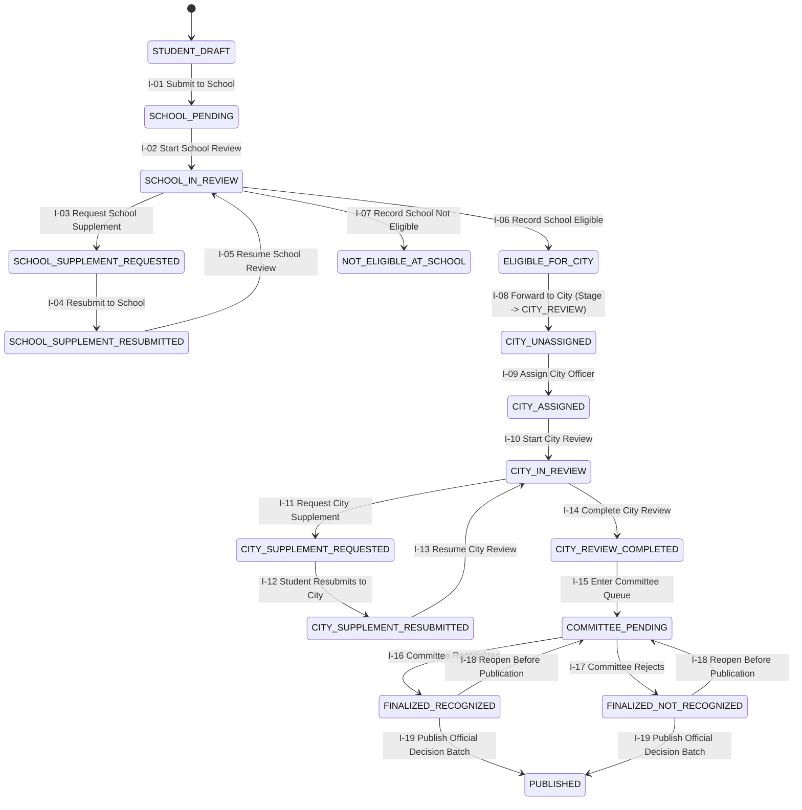
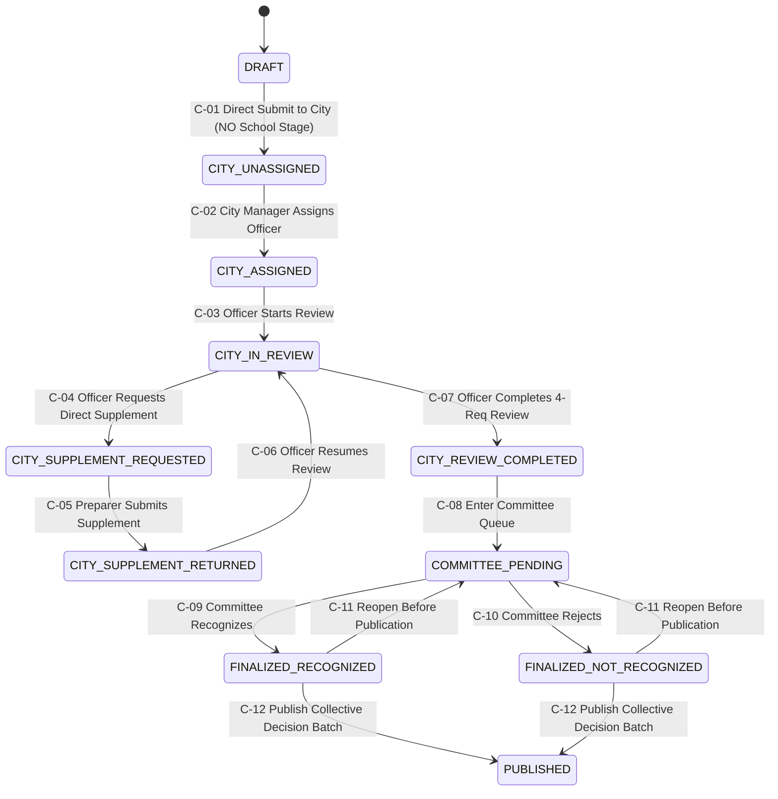

# 04 — AUTHORITATIVE STATE MACHINES & WORKFLOW TRANSITIONS
**Project:** 5TOT Đà Nẵng  
**Phase:** BE0-R2 — Final Design Closure  
**Cross-References:** `02_DOMAIN_MODEL.md`, `06_AUTH_AND_RBAC.md`, `11_TRANSACTIONS_AND_CONCURRENCY.md`

---

## 1. GLOBAL WORKFLOW INVARIANTS

1. **No Automatic Recognition:** Completing Officer review (`CITY_REVIEW_COMPLETED`) never auto-recognizes an application. Every application must be explicitly decided by `CITY_COMMITTEE` (`CommitteeDecisionRecord`) and published via `ApplicationFinalResult` + `RecognitionDecisionBatch`.
2. **No Bypass of School Stage for Individual Applications:** Individual dossiers must pass `STUDENT_DRAFT -> SCHOOL_PRELIMINARY -> CITY_REVIEW`. Direct student-to-City submission is prohibited (`422 INVALID_WORKFLOW_TRANSITION`).
3. **No School Stage for Collective Applications:** Collective dossiers transition `DRAFT -> CITY_UNASSIGNED` directly upon submission by an authorized `COLLECTIVE_PREPARER`. Any attempt to route a Collective dossier to a School queue is rejected (`422 COLLECTIVE_BYPASSES_SCHOOL_STAGE`).
4. **Immutability After Publication:** Once `ApplicationFinalResult.isPublished === true` (`PUBLISHED`), all declaration, evidence, review, supplement, and committee reopen transitions are permanently locked (`409 APPLICATION_ALREADY_PUBLISHED`).

---

## 2. INDIVIDUAL APPLICATION STATE MACHINE

### 2.1 State Diagram

### 2.2 Individual State Transition Matrix

| ID | Transition | Source Stage / Status | Target Stage / Status | Actor & Required Capability | Resource Scope (ABAC) | Preconditions & Business Invariants | Transaction & Audit Event | Idempotency & Conflict Behavior |
| :- | :--- | :--- | :--- | :--- | :--- | :--- | :--- | :--- |
| **I-01** | Submit Individual Dossier to School | `STUDENT_DRAFT` / `NOT_SUBMITTED` | `SCHOOL_PRELIMINARY` / `PENDING_SCHOOL_REVIEW` | `STUDENT` (`SUBMIT_OWN_APPLICATION`) | `applicantUserId === actor.id` | Active season window open; all 5 criteria have `declarationCount >= 1`; `gpaScale4` & `conductScore` populated. | Updates `IndividualApplication`, increments `version`, initializes 5 `SchoolCriterionReviewJudgment` (`NOT_REVIEWED`), emits `INDIVIDUAL_SUBMITTED_TO_SCHOOL`. | Same `Idempotency-Key` returns `200` with existing submission; stale `version` returns `409`. |
| **I-02** | Start School Review | `SCHOOL_PRELIMINARY` / `PENDING_SCHOOL_REVIEW` | `SCHOOL_PRELIMINARY` / `SCHOOL_IN_REVIEW` | `SCHOOL_OFFICER` (`REVIEW_SCHOOL_APPLICATIONS`) | `app.schoolReviewUnitId === actor.schoolReviewUnitId` | Application is in School stage. | Updates `schoolPreliminaryStatus`, `schoolReviewedByUserId`, increments `version`, emits `SCHOOL_REVIEW_STARTED`. | Idempotent if already `SCHOOL_IN_REVIEW` by same unit. |
| **I-03** | Request School Supplement | `SCHOOL_IN_REVIEW` | `SCHOOL_SUPPLEMENT_REQUESTED` | `SCHOOL_OFFICER` (`REQUEST_SCHOOL_SUPPLEMENT`) | `app.schoolReviewUnitId === actor.schoolReviewUnitId` | Non-empty `requestReason` and `criterionOrReqCode`. | Inserts `SupplementRequest(stage='SCHOOL', status='OPEN')`, increments `openSupplementCount` & `version`, queues `Notification`, emits `SCHOOL_SUPPLEMENT_REQUESTED`. | Duplicate `Idempotency-Key` returns existing `SupplementRequest`. |
| **I-04** | Student Resubmits School Supplement | `SCHOOL_SUPPLEMENT_REQUESTED` | `SCHOOL_SUPPLEMENT_RESUBMITTED` | `STUDENT` (`RESPOND_OWN_SUPPLEMENT`) | `app.applicantUserId === actor.id` | All `OPEN` School supplement requests have a `SupplementResponse` with `explanationNote`. | Inserts `SupplementResponse`, sets `SupplementRequest.status = RESUBMITTED`, sets `openSupplementCount = 0`, increments `version`, emits `SCHOOL_SUPPLEMENT_RESUBMITTED`. | Returns `422` if any open request lacks response. |
| **I-06** | Conclude School Preliminary Review | `SCHOOL_IN_REVIEW` or `SCHOOL_SUPPLEMENT_RESUBMITTED` | `ELIGIBLE_FOR_CITY` or `NOT_ELIGIBLE_AT_SCHOOL` | `SCHOOL_OFFICER` (`CONCLUDE_SCHOOL_REVIEW`) | `app.schoolReviewUnitId === actor.schoolReviewUnitId` | All 5 `SchoolCriterionReviewJudgment` rows have status != `NOT_REVIEWED` & != `REVIEWING`; `openSupplementCount === 0`. | Updates `schoolPreliminaryStatus`, `schoolRecommendationNote`, `schoolReviewedAt`, increments `version`, emits `SCHOOL_REVIEW_CONCLUDED`. | `409` on version mismatch; `422` if any criterion is unreviewed. |
| **I-08** | Forward Eligible Dossier to City | `SCHOOL_PRELIMINARY` / `ELIGIBLE_FOR_CITY` | `CITY_REVIEW` / `FORWARDED_TO_CITY` + `CITY_UNASSIGNED` | `SCHOOL_OFFICER` (`FORWARD_SCHOOL_TO_CITY`) | `app.schoolReviewUnitId === actor.schoolReviewUnitId` | Must be `ELIGIBLE_FOR_CITY`; `openSupplementCount === 0`. | Sets `currentReviewStage = CITY_REVIEW`, `schoolPreliminaryStatus = FORWARDED_TO_CITY`, `cityWorkflowStatus = CITY_UNASSIGNED`, initializes 5 independent `CityCriterionReviewJudgment` (`NOT_REVIEWED`), emits `SCHOOL_FORWARDED_TO_CITY`. | Idempotent if already `FORWARDED_TO_CITY` (returns `200` with current record). |
| **I-09** | Assign / Reassign City Officer | `CITY_REVIEW` / `CITY_UNASSIGNED` (or `CITY_ASSIGNED`..`CITY_IN_REVIEW`) | `CITY_REVIEW` / `CITY_ASSIGNED` (preserves `CITY_IN_REVIEW` on reassign) | `CITY_MANAGER` (`ASSIGN_APPLICATIONS`) | City-wide scope | Target user holds active `CITY_OFFICER` role; if reassignment, `reassignmentReason` is mandatory. | Updates `assignedCityOfficerId`, `previousCityOfficerId`, inserts `OfficerAssignmentHistory`, increments `version`, emits `INDIVIDUAL_CITY_OFFICER_ASSIGNED`. | Idempotent if `assignedCityOfficerId === officerId` (`200` no-op). |
| **I-11** | Request City Supplement | `CITY_ASSIGNED` / `CITY_IN_REVIEW` / `CITY_SUPPLEMENT_RESUBMITTED` | `CITY_SUPPLEMENT_REQUESTED` | `CITY_OFFICER` (`REQUEST_SUPPLEMENT`) | `app.assignedCityOfficerId === actor.id` | Non-empty `requestReason` and target scope. | Inserts `SupplementRequest(stage='CITY', status='OPEN')`, updates `CityCriterionReviewJudgment` to `NEEDS_SUPPLEMENT`, increments `openSupplementCount` & `version`, emits `INDIVIDUAL_CITY_SUPPLEMENT_REQUESTED`. | `403` if caller is not the assigned officer. |
| **I-12** | Student Resubmits City Supplement | `CITY_SUPPLEMENT_REQUESTED` | `CITY_SUPPLEMENT_RESUBMITTED` | `STUDENT` (`RESPOND_OWN_SUPPLEMENT`) | `app.applicantUserId === actor.id` | All `OPEN` City supplement requests answered. | Inserts `SupplementResponse`, marks requests `RESUBMITTED`, sets `openSupplementCount = 0`, increments `version`, emits `INDIVIDUAL_CITY_SUPPLEMENT_RESUBMITTED`. | `422` if incomplete response. |
| **I-14** | Complete City Officer Review | `CITY_IN_REVIEW` or `CITY_SUPPLEMENT_RESUBMITTED` | `COMMITTEE_FINALIZATION` / `COMMITTEE_PENDING` | `CITY_OFFICER` (`COMPLETE_REVIEW`) | `app.assignedCityOfficerId === actor.id` | All 5 `CityCriterionReviewJudgment` rows are `SUITABLE`, `UNSUITABLE`, or `NEEDS_CONSIDERATION`; `openSupplementCount === 0`. | Sets `currentReviewStage = COMMITTEE_FINALIZATION`, `cityWorkflowStatus = COMMITTEE_PENDING`, `cityReviewCompletedAt = now()`, increments `version`, emits `INDIVIDUAL_CITY_REVIEW_COMPLETED`. | `422` if any criterion still `NOT_REVIEWED` or `NEEDS_SUPPLEMENT`. |
| **I-16/17** | Record Committee Decision | `COMMITTEE_FINALIZATION` / `COMMITTEE_PENDING` | `FINALIZED_RECOGNIZED` or `FINALIZED_NOT_RECOGNIZED` | `CITY_COMMITTEE` (`FINALIZE_RESULTS`) | City-wide Committee scope | `cityWorkflowStatus === COMMITTEE_PENDING`. | Inserts active `CommitteeDecisionRecord`, upserts unpublished `ApplicationFinalResult(isPublished=false, outcome)`, updates `cityWorkflowStatus`, increments `version`, emits `INDIVIDUAL_COMMITTEE_DECIDED`. | `409` on concurrent committee mutation. |
| **I-18** | Reopen Committee Decision | `FINALIZED_RECOGNIZED` or `FINALIZED_NOT_RECOGNIZED` | `COMMITTEE_PENDING` | `CITY_COMMITTEE` (`REOPEN_COMMITTEE_DECISION`) | City-wide Committee scope | `finalResult.isPublished === false`; mandatory `reopenReason`. | Marks prior `CommitteeDecisionRecord.isCurrentActive = false`, deletes/unsets draft `ApplicationFinalResult`, restores `COMMITTEE_PENDING`, increments `version`, emits `INDIVIDUAL_COMMITTEE_REOPENED`. | Blocked with `409` if already published. |
| **I-19** | Publish Official Decision Batch | `FINALIZED_RECOGNIZED` / `FINALIZED_NOT_RECOGNIZED` | `COMPLETED` / `PUBLISHED` | `ADMIN` or `CITY_COMMITTEE` (`PUBLISH_RESULTS`) | City-wide scope | Unique `decisionNumber`, valid `decisionDate`, signer info. | Creates `RecognitionDecisionBatch`, updates matching `ApplicationFinalResult(isPublished=true, decisionBatchId)`, sets `currentReviewStage = COMPLETED`, `cityWorkflowStatus = PUBLISHED`, emits `INDIVIDUAL_RESULTS_PUBLISHED`. | Idempotent on `Idempotency-Key`; `409` if `decisionNumber` already exists. |

---

## 3. COLLECTIVE APPLICATION STATE MACHINE (DIRECT TO CITY)

### 3.1 State Diagram

### 3.2 Collective State Transition Matrix

| ID | Transition | Source Status | Target Status | Actor & Capability | Resource Scope (ABAC) | Preconditions & Business Invariants | Transaction & Audit Event | Idempotency & Conflict Behavior |
| :- | :--- | :--- | :--- | :--- | :--- | :--- | :--- | :--- |
| **C-01** | Direct City Submission | `DRAFT` | `CITY_UNASSIGNED` | `COLLECTIVE_PREPARER` (`SUBMIT_COLLECTIVE_APPLICATION`) | Active `CollectivePreparerAuthorization` for `(collectiveUnitId, seasonId)` | All 4 `CollectiveRequirementRecord` (`TT01..TT04`) present; `totalMembers >= 1`; `0 <= participatingMembers <= totalMembers`; `0 <= recognizedMembers <= totalMembers`; each of `TT01..TT04` has `evidenceCount >= 1`. Recomputes `tt02MeetsThreshold` (`participating === total`) & `tt03MeetsThreshold` (`recognized * 100 >= total * 20`). | Sets `workflowStatus = CITY_UNASSIGNED`, `submittedToCityAt = now()`, initializes 4 `CollectiveCityRequirementJudgment` (`NOT_REVIEWED`), increments `version`, emits `COLLECTIVE_SUBMITTED_DIRECT_TO_CITY`. | Idempotent if already `CITY_UNASSIGNED` (`200`); `409` on version mismatch. |
| **C-02** | Assign / Reassign City Officer | `CITY_UNASSIGNED` (or `CITY_ASSIGNED`..`CITY_IN_REVIEW`) | `CITY_ASSIGNED` (or preserves `CITY_IN_REVIEW`) | `CITY_MANAGER` (`ASSIGN_APPLICATIONS`) | City-wide scope | Target holds active `CITY_OFFICER` role; `reassignmentReason` mandatory on reassign. | Updates `assignedCityOfficerId`, inserts `OfficerAssignmentHistory`, increments `version`, emits `COLLECTIVE_CITY_OFFICER_ASSIGNED`. | Idempotent if already assigned to same `officerId`. |
| **C-03** | Start Collective City Review | `CITY_ASSIGNED` | `CITY_IN_REVIEW` | `CITY_OFFICER` (`REVIEW_COLLECTIVE_CRITERIA`) | `app.assignedCityOfficerId === actor.id` | Application is `CITY_ASSIGNED`. | Sets `workflowStatus = CITY_IN_REVIEW`, `cityReviewStartedAt = now()`, increments `version`, emits `COLLECTIVE_CITY_REVIEW_STARTED`. | Idempotent if already `CITY_IN_REVIEW`. |
| **C-04** | Request Direct Supplement from Collective | `CITY_ASSIGNED` / `CITY_IN_REVIEW` / `CITY_SUPPLEMENT_RETURNED` | `CITY_SUPPLEMENT_REQUESTED` | `CITY_OFFICER` (`REQUEST_SUPPLEMENT`) | `app.assignedCityOfficerId === actor.id` | Valid `requirementCode` (`TT01..TT04`), `scopeType`, and `requestReason`. | Inserts `SupplementRequest(track='COLLECTIVE', stage='CITY', status='OPEN')`, sets `CollectiveCityRequirementJudgment` to `NEEDS_SUPPLEMENT` + history row, increments `openSupplementCount` & `version`, notifies `preparerUserId`, emits `COLLECTIVE_SUPPLEMENT_REQUESTED`. | `403` if caller is not the assigned officer. |
| **C-05** | Collective Preparer Submits Supplement | `CITY_SUPPLEMENT_REQUESTED` | `CITY_SUPPLEMENT_RETURNED` | `COLLECTIVE_PREPARER` (`RESPOND_COLLECTIVE_SUPPLEMENT`) | Active `CollectivePreparerAuthorization` for `(collectiveUnitId, seasonId)` | All `OPEN` supplement requests answered; if roster/counts updated, `totalMembers >= 1` and `tt02MeetsThreshold` / `tt03MeetsThreshold` recomputed atomically. | Inserts `SupplementResponse`, marks requests `RESUBMITTED`, sets `openSupplementCount = 0`, `workflowStatus = CITY_SUPPLEMENT_RETURNED`, increments `version`, emits `COLLECTIVE_SUPPLEMENT_RETURNED`. | `422` if open supplement request unanswered. |
| **C-07** | Complete Collective Officer Review | `CITY_IN_REVIEW` or `CITY_SUPPLEMENT_RETURNED` | `COMMITTEE_PENDING` | `CITY_OFFICER` (`COMPLETE_REVIEW`) | `app.assignedCityOfficerId === actor.id` | All 4 `CollectiveCityRequirementJudgment` (`TT01..TT04`) have terminal review judgment (`SUITABLE`, `UNSUITABLE`, or `NEEDS_CONSIDERATION`); `openSupplementCount === 0`; non-empty `officerSummaryNote`. | Sets `workflowStatus = COMMITTEE_PENDING`, `cityReviewCompletedAt = now()`, `officerOverallJudgment`, `officerSummaryNote`, increments `version`, emits `COLLECTIVE_CITY_REVIEW_COMPLETED`. | `422` if any of TT01–TT04 is `NOT_REVIEWED` or `NEEDS_SUPPLEMENT`. |
| **C-09/10** | Record Collective Committee Decision | `COMMITTEE_PENDING` | `FINALIZED_RECOGNIZED` or `FINALIZED_NOT_RECOGNIZED` | `CITY_COMMITTEE` (`FINALIZE_RESULTS`) | City-wide Committee scope | `workflowStatus === COMMITTEE_PENDING`. | Inserts active `CommitteeDecisionRecord`, upserts unpublished `ApplicationFinalResult(isPublished=false, outcome)`, updates `workflowStatus`, increments `version`, emits `COLLECTIVE_COMMITTEE_DECIDED`. | `409` on concurrent modification. |
| **C-11** | Reopen Collective Committee Decision | `FINALIZED_RECOGNIZED` or `FINALIZED_NOT_RECOGNIZED` | `COMMITTEE_PENDING` | `CITY_COMMITTEE` (`REOPEN_COMMITTEE_DECISION`) | City-wide Committee scope | `finalResult.isPublished === false`; mandatory `reopenReason`. | Deactivates prior `CommitteeDecisionRecord`, removes unpublished `ApplicationFinalResult`, restores `COMMITTEE_PENDING`, increments `version`, emits `COLLECTIVE_COMMITTEE_REOPENED`. | `409` if already published. |
| **C-12** | Publish Collective Decision Batch | `FINALIZED_RECOGNIZED` / `FINALIZED_NOT_RECOGNIZED` | `PUBLISHED` | `ADMIN` or `CITY_COMMITTEE` (`PUBLISH_RESULTS`) | City-wide scope | Unique `decisionNumber`, valid `decisionDate`, signer info. | Creates `RecognitionDecisionBatch`, updates `ApplicationFinalResult(isPublished=true, decisionBatchId)`, sets `workflowStatus = PUBLISHED`, emits `COLLECTIVE_RESULTS_PUBLISHED`. | Idempotent on `Idempotency-Key`; permanent immutability after commit. |
