# HƯỚNG DẪN SỬ DỤNG HỆ THỐNG 5TOT ĐÀ NẴNG
## Dành cho Sinh viên & Tập thể dự xét (Cấp Thành phố Đà Nẵng)

**Hệ thống:** Cổng thông tin xét chọn Danh hiệu *"Sinh viên 5 tốt"*, *"Tập thể Sinh viên 5 tốt"* và *"Giải thưởng 9/1"* cấp Thành phố Đà Nẵng  
**Cơ quan chủ trì:** Ban Thư ký Hội Sinh viên Việt Nam Thành phố Đà Nẵng (Chỉ đạo: Thành Đoàn Đà Nẵng)  
**Đối tượng áp dụng:**
- Sinh viên hệ chính quy đang học tập tại **31 trường Đại học, Học viện, Cao đẳng** trên địa bàn Thành phố Đà Nẵng.
- Ban Chấp hành Liên chi hội, Chi hội, Câu lạc bộ / Đội / Nhóm trực thuộc Hội Sinh viên dự xét **Tập thể Sinh viên 5 tốt** và cá nhân / tập thể dự xét **Giải thưởng 9/1** cấp Thành phố.

---

## MỤC LỤC NHANH
1. [Đăng ký tài khoản, Đăng nhập & Bảo mật mật khẩu](#1-đăng-ký-tài-khoản-đăng-nhập--bảo-mật-mật-khẩu)
2. [Cập nhật Thông tin cá nhân & Ảnh thẻ 3×4 (Bắt buộc)](#2-cập-nhật-thông-tin-cá-nhân--ảnh-thẻ-34-bắt-buộc)
3. [Lập & Nộp Hồ sơ Cá nhân "Sinh viên 5 tốt" cấp Thành phố](#3-lập--nộp-hồ-sơ-cá-nhân-sinh-viên-5-tốt-cấp-thành-phố)
4. [Lập & Nộp Hồ sơ "Tập thể Sinh viên 5 tốt" cấp Thành phố](#4-lập--nộp-hồ-sơ-tập-thể-sinh-viên-5-tốt-cấp-thành-phố)
5. [Lập & Nộp Hồ sơ "Giải thưởng 9/1" cấp Thành phố](#5-lập--nộp-hồ-sơ-giải-thưởng-91-cấp-thành-phố)
6. [Xử lý Yêu cầu bổ sung minh chứng & Tra cứu Kết quả](#6-xử-lý-yêu-cầu-bổ-sung-minh-chứng--tra-cứu-kết-quả)

---

## 1. Đăng ký tài khoản, Đăng nhập & Bảo mật mật khẩu

### 1.1. Truy cập cổng thông tin & Đăng ký tài khoản mới

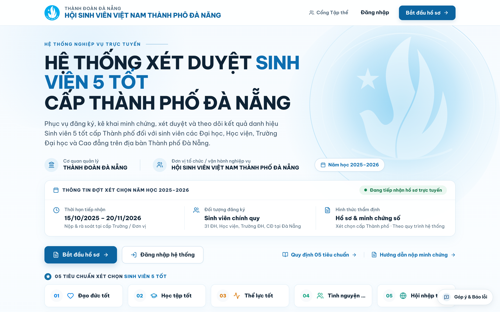

1. Truy cập trang chủ cổng **5TOT Đà Nẵng**, bấm nút **Đăng nhập** hoặc **Bắt đầu hồ sơ** ở góc trên bên phải, sau đó chọn **Đăng ký tài khoản mới**.
2. Điền đầy đủ thông tin trên biểu mẫu đăng ký tài khoản sinh viên:
   - **Họ và tên:** Nhập đúng họ tên tiếng Việt có dấu theo căn cước công dân / thẻ sinh viên.
   - **Mã số sinh viên (MSSV):** Nhập chính xác mã sinh viên tại trường đang theo học.
   - **Trường đào tạo:** Chọn đúng **01 trong 31 trường Đại học, Học viện, Cao đẳng** trên địa bàn TP. Đà Nẵng.
   - **Địa chỉ Email:** Ưu tiên email sinh viên do nhà trường cấp hoặc email cá nhân đang sử dụng thường xuyên (dùng để nhận mã OTP và thông báo bổ sung hồ sơ).
   - **Mật khẩu & Xác nhận mật khẩu:** Tối thiểu **08 ký tự** (khuyến khích kết hợp chữ hoa, chữ thường và chữ số).
3. Bấm **Tạo tài khoản** để vào thẳng không gian làm việc.

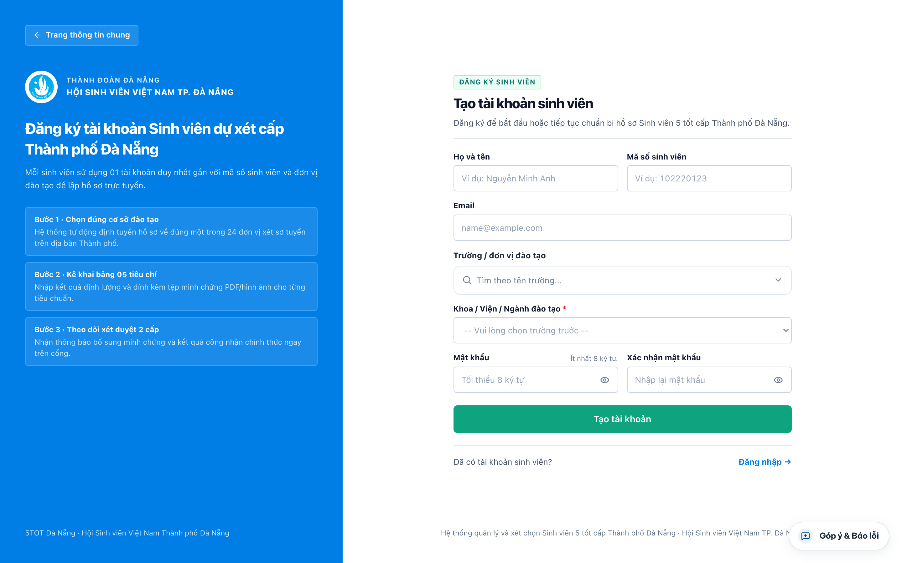

> **Lưu ý quan trọng về phân tuyến đơn vị sơ tuyển tự động:**
> - Nếu bạn thuộc **08 trường/viện thành viên Đại học Đà Nẵng** (*ĐH Bách khoa, ĐH Kinh tế, ĐH Sư phạm, ĐH Ngoại ngữ, ĐH Sư phạm Kỹ thuật, ĐH CNTT & TT Việt – Hàn VKU, Trường Y Dược, Viện Nghiên cứu & Đào tạo Việt – Anh VNUK*), hệ thống tự động chuyển hồ sơ cá nhân về đầu mối sơ tuyển **Đại học Đà Nẵng** nhưng **vẫn giữ nguyên tên trường đào tạo gốc** của bạn trên hồ sơ và Bằng khen.
> - Nếu bạn thuộc **23 trường Đại học, Học viện, Cao đẳng độc lập** khác tại TP. Đà Nẵng (*ĐH Duy Tân, ĐH Đông Á, ĐH Kiến trúc Đà Nẵng, ĐH Kỹ thuật Y – Dược Đà Nẵng, CĐ Thương mại, CĐ Nghề Đà Nẵng...*), hồ sơ sẽ chuyển trực tiếp về Hội Sinh viên / Đoàn Thanh niên trường bạn để sơ tuyển.

### 1.2. Đăng nhập, Đổi mật khẩu & Khôi phục mật khẩu khi quên
- **Đăng nhập:** Nhập *Địa chỉ Email* và *Mật khẩu* tại màn hình Đăng nhập hệ thống.
- **Đổi mật khẩu chủ động:** Sau khi đăng nhập, bấm nút **Đổi mật khẩu** ở góc dưới thanh menu trái (hoặc trong menu tài khoản góc phải trên cùng) -> nhập *Mật khẩu hiện tại*, *Mật khẩu mới* và bấm **Cập nhật mật khẩu**.
- **Quên mật khẩu:** Tại màn hình **Đăng nhập**, bấm **Quên mật khẩu?** -> nhập địa chỉ Email đã đăng ký -> kiểm tra hộp thư để lấy **mã xác thực OTP gồm 6 chữ số** -> nhập mã OTP và đặt lại mật khẩu mới.

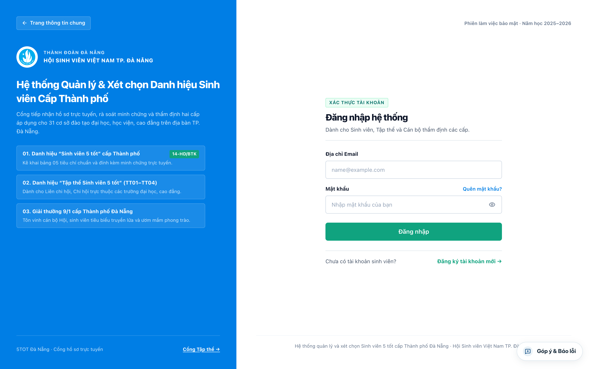

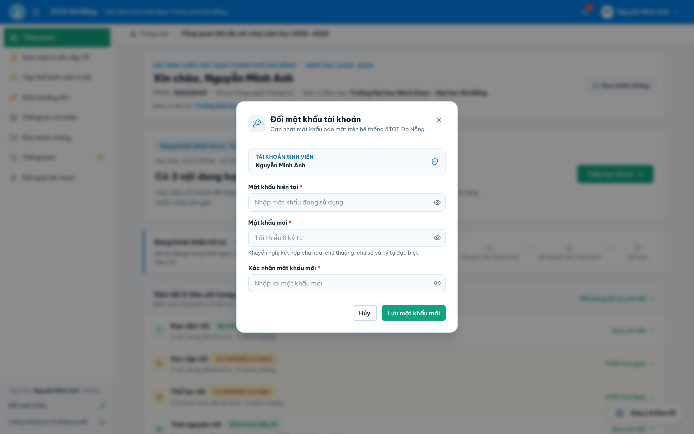

---

## 2. Cập nhật Thông tin cá nhân & Ảnh thẻ 3×4 (Bắt buộc)

Sau khi đăng nhập, màn hình **Tổng quan** hiển thị trạng thái hoàn thiện hồ sơ và đơn vị tiếp nhận sơ tuyển của bạn. Trước khi gửi bất kỳ hồ sơ xét chọn nào, sinh viên **bắt buộc hoàn thiện 100% hồ sơ lý lịch trích ngang**:

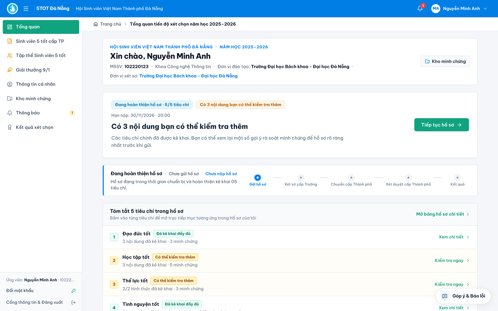

1. Trên thanh menu dọc bên trái, chọn mục **`Thông tin cá nhân`**.
2. Tải lên **Ảnh thẻ chân dung cỡ 3×4**:
   - Định dạng `.jpg`, `.jpeg` hoặc `.png`, ảnh chụp rõ nét chính diện trên nền xanh hoặc trắng (sử dụng cho phôi tổng hợp trình Hội đồng và ấn phẩm tuyên dương).
3. Kiểm tra và điền đủ **13 trường thông tin bắt buộc**:
   - Họ và tên, Mã số sinh viên, Ngày tháng năm sinh, Giới tính, Dân tộc.
   - Số CCCD/Định danh cá nhân, Số điện thoại di động, Email nhận thông báo, Địa chỉ liên hệ.
   - Trường đào tạo, Khoa/Viện quản lý, Lớp sinh hoạt, Hệ đào tạo & Niên khóa.
4. Bấm **Lưu thông tin cá nhân**.

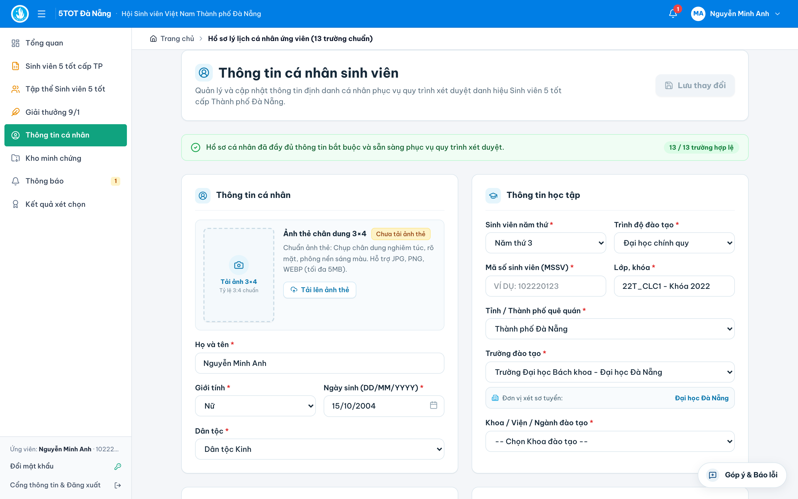

> **Cơ chế đóng băng dữ liệu (Snapshot):** Ngay thời điểm bạn bấm nộp hồ sơ chính thức, hệ thống sẽ chụp cố định thông tin cá nhân và ảnh thẻ vào hồ sơ năm học để bảo đảm tính pháp lý trong suốt quá trình sơ tuyển và thẩm định.

---

## 3. Lập & Nộp Hồ sơ Cá nhân "Sinh viên 5 tốt" cấp Thành phố

*(Căn cứ Hướng dẫn số **14-HD/BTK-HSVTP** của Ban Thư ký Hội Sinh viên Việt Nam Thành phố Đà Nẵng)*

### 3.1. Giao diện Bảng kê khai phẳng 5 cột chuẩn Trung ương Hội
Mở menu **`Sinh viên 5 tốt cấp TP`** ở cột trái. Màn hình gồm khung thông tin ứng viên phía trên và **Bảng kê khai phẳng 5 cột** phía dưới giúp sinh viên theo dõi toàn bộ 5 tiêu chí trên một trang duy nhất:

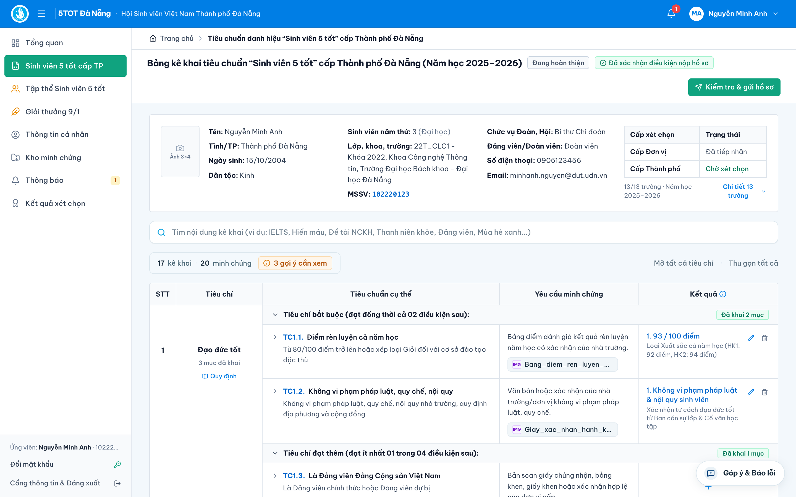

| Cột | Tên cột trên màn hình | Ý nghĩa & Thao tác của sinh viên |
| :--- | :--- | :--- |
| **1** | **STT** | Số thứ tự nhóm tiêu chí từ `1` đến `5`. |
| **2** | **Tiêu chí** | Tên tiêu chí (*Đạo đức tốt, Học tập tốt, Thể lực tốt, Tình nguyện tốt, Hội nhập tốt*) kèm nhãn trạng thái (`Đã kê khai` / `Chưa đủ`). |
| **3** | **Tiêu chuẩn cụ thể** | Nội dung chi tiết của từng điều kiện cứng và điều kiện tự chọn theo Hướng dẫn `14-HD/BTK-HSVTP`. |
| **4** | **Yêu cầu minh chứng** | Quy định rõ loại giấy tờ, bảng điểm, chứng chỉ, quyết định hoặc xác nhận hợp lệ cần đính kèm. |
| **5** | **Kết quả** | Nơi sinh viên bấm nút **`+` (Thêm kê khai)** để nhập số liệu/mô tả thành tích và tải tệp minh chứng lên hệ thống. |

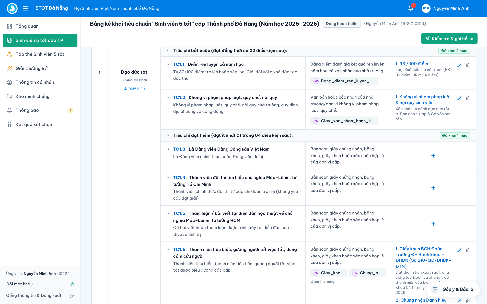

### 3.2. Cách kê khai và tải tệp minh chứng ở Cột 5
1. Tại dòng tiêu chuẩn tương ứng với thành tích của bạn, bấm nút **`+`** ở cột **Kết quả**.
2. Nhập đầy đủ thông tin kê khai theo biểu mẫu mở ra:
   - Với chỉ số định lượng: nhập chính xác **Điểm rèn luyện** (thang 100), **Điểm trung bình học tập GPA** (thang 4.0 và/hoặc thang 10), **Số ngày tình nguyện**, hoặc **Điểm chứng chỉ ngoại ngữ**.
   - Với giấy chứng nhận / quyết định khen thưởng: ghi rõ *Tên thành tích/hoạt động, Cấp ban hành, Số quyết định (nếu có), Ngày ban hành*.
3. Đính kèm tệp minh chứng:
   - Chấp nhận định dạng **`.pdf`, `.jpg`, `.jpeg`, `.png`** (dung lượng tối đa **100 MB/tệp**).
   - Khuyến khích gộp bảng điểm 2 học kỳ hoặc bộ minh chứng của cùng 1 hoạt động thành **01 tệp `.PDF` rõ nét**, có đầy đủ chữ ký và dấu xác nhận theo quy định.
4. Bấm **Lưu mục kê khai**. Bạn có thể sửa hoặc xóa mục kê khai bất cứ lúc nào khi hồ sơ còn ở trạng thái **Bản nháp**.

### 3.3. Tóm tắt điều kiện đạt chuẩn 05 tiêu chí bắt buộc
Để hồ sơ hợp lệ khi đối soát tự động, sinh viên cần đảm bảo đủ cả **05 tiêu chí**:

1. **Tiêu chí 1 — Đạo đức tốt:**
   - **Điều kiện cứng:** Điểm rèn luyện trung bình cả năm học đạt từ **80/100 điểm trở lên**; không vi phạm pháp luật và các quy chế, nội quy của nhà trường, địa phương.
   - **Điều kiện tự chọn (đạt ít nhất 01 nội dung):** Tham gia cuộc thi tìm hiểu chủ nghĩa Mác – Lênin, tư tưởng Hồ Chí Minh; đạt danh hiệu *"Thanh niên tiên tiến làm theo lời Bác"*; là thành viên đội thi Olympic các môn khoa học Mác – Lênin; hoặc có hành động dũng cảm được biểu dương, khen thưởng.
2. **Tiêu chí 2 — Học tập tốt:**
   - **Điều kiện cứng về điểm GPA năm học:**
     - Đối với sinh viên hệ **Đại học / Học viện**: Điểm trung bình chung học tập cả năm đạt từ **3.2/4.0** (hoặc **8.0/10**) trở lên.
     - Đối với sinh viên hệ **Cao đẳng**: Điểm trung bình chung học tập cả năm đạt từ **3.0/4.0** (hoặc **7.5/10**) trở lên.
   - **Điều kiện nghiên cứu khoa học / học thuật (đạt ít nhất 01 nội dung):** Có đề tài NCKH sinh viên nghiệm thu đạt từ cấp Khoa/Trường trở lên; có bài báo đăng trên tạp chí/kỷ yếu hội thảo khoa học; hoặc đạt giải thưởng trong các cuộc thi học thuật, khởi nghiệp, sáng tạo chuyên ngành.
3. **Tiêu chí 3 — Thể lực tốt** *(đạt ít nhất 01 trong 02 điều kiện)*:
   - Đạt danh hiệu **"Thanh niên khỏe"** từ cấp Trường trở lên trong năm học xét chọn; **HOẶC**
   - Đạt giải tại các giải thể thao phong trào từ cấp Khoa/Trường trở lên hoặc là thành viên đội tuyển thể thao của Trường/Thành phố/Quốc gia. *(Trường hợp sinh viên khuyết tật áp dụng theo hướng dẫn riêng kèm giấy xác nhận y tế hợp lệ).*
4. **Tiêu chí 4 — Tình nguyện tốt** *(đạt ít nhất 01 trong 02 điều kiện)*:
   - Tham gia ít nhất **05 ngày tình nguyện/năm** (hệ thống tự động cộng dồn tổng số ngày từ các chiến dịch/hoạt động tình nguyện có xác nhận mà bạn kê khai); **HOẶC**
   - Được nhận Giấy khen / Bằng khen về hoạt động tình nguyện (*Mùa hè xanh, Tiếp sức mùa thi, Xuân tình nguyện, Chủ nhật xanh...*) từ cấp Khoa/Trường trở lên.
5. **Tiêu chí 5 — Hội nhập tốt:**
   - **Ngoại ngữ:** Đạt chứng chỉ ngoại ngữ tối thiểu tương đương **Bậc 3/6 (chuẩn B1)** theo Khung năng lực ngoại ngữ 6 bậc dùng cho Việt Nam (ví dụ: IELTS $\ge 4.5$, VSTEP B1, TOEIC hoặc chứng chỉ ngoại ngữ quốc tế/đầu ra tương đương còn hiệu lực theo quy định của Hướng dẫn `14-HD/BTK-HSVTP`).
   - **Kỹ năng thực hành xã hội / Hội nhập:** Hoàn thành khóa trang bị kỹ năng thực hành xã hội hoặc tham gia hoạt động giao lưu quốc tế, hội thảo/cuộc thi bằng ngoại ngữ, công tác Hội từ cấp Trường trở lên.

*(Ngoài 5 tiêu chí chính, sinh viên có Bằng khen cấp Thành phố, Trung ương, Đảng viên trẻ tiêu biểu... nên kê khai thêm vào mục **Tiêu chuẩn ưu tiên / Thành tích tiêu biểu khác** ở cuối bảng để Hội đồng cộng điểm ưu tiên).*

### 3.4. Kiểm tra điều kiện tự động & Gửi hồ sơ chính thức
1. Trong quá trình làm hồ sơ, bấm **Lưu nháp** để lưu tạm thời.
2. Khi cả 5 tiêu chí đều có dữ liệu kê khai và đã hoàn tất **Thông tin cá nhân**, bấm nút **`Kiểm tra & gửi hồ sơ`** (màu xanh trên thanh tác vụ).
3. Hệ thống hiển thị bảng **Đối soát sơ bộ 5 tiêu chí**:
   - Nếu còn mục thiếu minh chứng hoặc điểm số chưa đạt ngưỡng quy định, hệ thống sẽ cảnh báo rõ từng mục để bạn kiểm tra lại.
   - Bấm **Xác nhận gửi hồ sơ** để chuyển hồ sơ chính thức sang trạng thái **Chờ xét sơ tuyển cấp Đơn vị**.

---

## 4. Lập & Nộp Hồ sơ "Tập thể Sinh viên 5 tốt" cấp Thành phố

*(Căn cứ Quyết định số **86/QĐ-HSVTP** của Ban Thư ký Hội Sinh viên Việt Nam Thành phố Đà Nẵng)*

1. Trên menu trái, chọn **`Tập thể Sinh viên 5 tốt`** -> điền thông tin đơn vị tập thể dự xét (*Liên chi hội, Chi hội, hoặc CLB/Đội/Nhóm trực thuộc Hội Sinh viên*), trường trực thuộc, tổng số sinh viên/hội viên của tập thể và thông tin đại diện Ban Chấp hành liên hệ.
2. Kê khai số liệu và tải tệp minh chứng `.PDF`/ảnh cho đủ **04 tiêu chuẩn bắt buộc (`TT01` – `TT04`)**:
   - **`TT01` — Danh hiệu cấp Trường:** Đạt danh hiệu *"Tập thể Sinh viên 5 tốt"* cấp Trường/Đơn vị trong năm học xét chọn (đính kèm Quyết định công nhận hoặc Giấy khen cấp Trường).
   - **`TT02` — Tỷ lệ đăng ký phong trào:** **100%** sinh viên thuộc tập thể đăng ký tham gia phong trào *"Sinh viên 5 tốt"* (đính kèm bảng tổng hợp đăng ký có xác nhận của Hội Sinh viên đơn vị).
   - **`TT03` — Tỷ lệ đạt danh hiệu SV5T:** Có ít nhất **20%** tổng số sinh viên của tập thể đạt danh hiệu *"Sinh viên 5 tốt"* từ cấp Trường trở lên (nhập danh sách/số lượng và đính kèm Quyết định công nhận SV5T cấp Trường+).
   - **`TT04` — Kỷ luật & Pháp luật:** Không có sinh viên nào trong tập thể vi phạm pháp luật hoặc bị xử lý kỷ luật từ mức **Cảnh cáo** trở lên trong năm học (đính kèm văn bản xác nhận của Khoa/Trường).
3. Kiểm tra toàn bộ tệp minh chứng và bấm **Nộp hồ sơ Tập thể**.

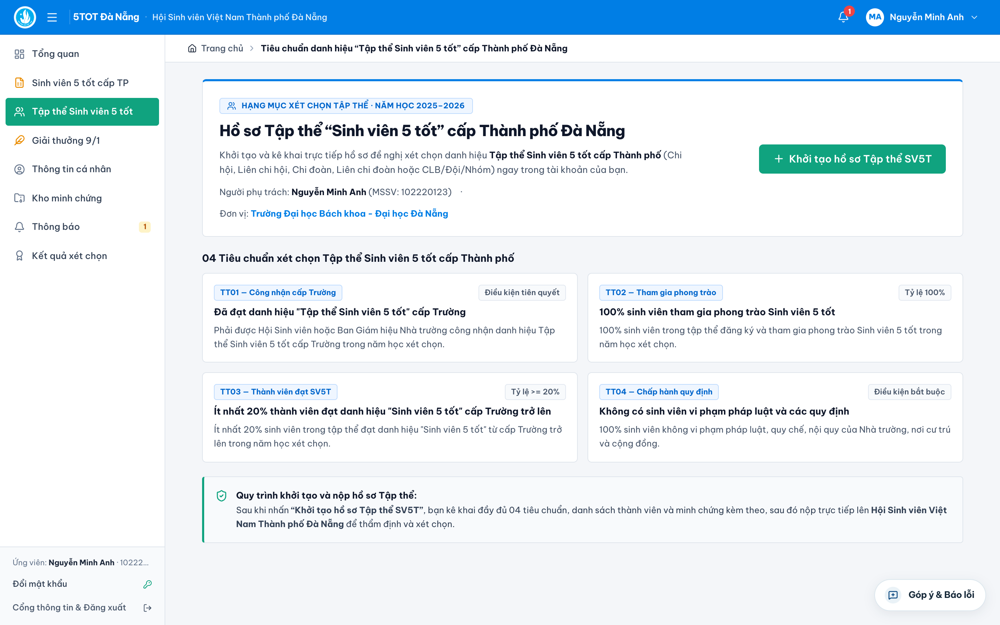

> **Lưu ý luồng tiếp nhận:** Hồ sơ **Tập thể Sinh viên 5 tốt** sau khi nộp sẽ được chuyển **trực tiếp về Hội Sinh viên Thành phố Đà Nẵng** để thẩm định (không nằm trong đợt gom danh sách sơ tuyển cá nhân của đơn vị).

---

## 5. Lập & Nộp Hồ sơ "Giải thưởng 9/1" cấp Thành phố

*(Căn cứ Quy chế Giải thưởng 9/1 ban hành kèm Quyết định số **09/QĐ-HSVTP** của Ban Thư ký Hội Sinh viên Việt Nam TP. Đà Nẵng)*

1. Trên menu trái, chọn **`Giải thưởng 9/1`** và lựa chọn chính xác **01 trong 02 hạng mục xét trao chính thức**:
   - **Hạng mục 1 — Cán bộ Hội, Đoàn tiêu biểu:**
     - Dành cho cán bộ Hội Sinh viên, cán bộ Đoàn trực tiếp làm công tác sinh viên có thành tích xuất sắc.
     - **Bắt buộc kê khai đủ 03 nhóm tiêu chuẩn:** `WB01` (Phẩm chất đạo đức, uy tín và kết quả học tập, rèn luyện), `WB02` (Thời gian giữ chức vụ cán bộ Hội/Đoàn tích lũy tối thiểu **24 tháng** và đóng góp thực tế), `WB03` (Thành tích khen thưởng tối thiểu **02 năm học liên tiếp**).
   - **Hạng mục 2 — Mô hình, giải pháp, sáng kiến công tác Hội hiệu quả:**
     - Dành cho cá nhân hoặc tập thể tác giả có mô hình, công trình, giải pháp sáng tạo đã áp dụng thực tế trong công tác Hội và phong trào sinh viên tại Đà Nẵng.
     - **Yêu cầu kê khai:** `WB01` *(Bắt buộc — Thuyết minh tính mới, sáng tạo)*, `WB02` *(Bắt buộc — Minh chứng kết quả triển khai thực tế và xác nhận đơn vị)*, `WB03` *(Khuyến khích — Giấy khen, truyền thông, nhân rộng mô hình)*.
2. Tải đầy đủ báo cáo thành tích / thuyết minh mô hình và minh chứng kèm theo, sau đó bấm **Nộp hồ sơ Giải thưởng 9/1** (hồ sơ chuyển **trực tiếp lên Hội Sinh viên Thành phố Đà Nẵng**).

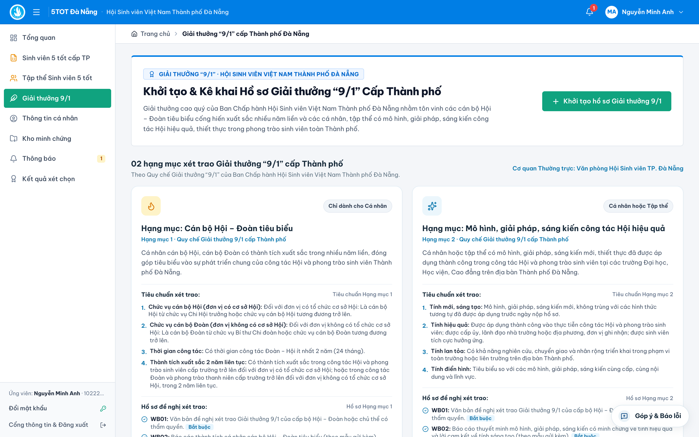

---

## 6. Xử lý Yêu cầu bổ sung minh chứng & Tra cứu Kết quả

### 6.1. Khi nhận được thông báo "Yêu cầu bổ sung"
Trong quá trình sơ tuyển tại Đơn vị hoặc thẩm định tại Thành phố, nếu minh chứng bị mờ, thiếu dấu xác nhận hoặc kê khai chưa khớp số liệu, cán bộ xét duyệt sẽ gửi **Yêu cầu bổ sung**:

1. Hệ thống gửi thông báo đồng thời qua **biểu tượng Chuông thông báo** trên góc phải cổng **5TOT Đà Nẵng** và qua **Email đăng ký** của bạn.
2. Đăng nhập vào hệ thống -> mở hồ sơ đang có cảnh báo màu vàng **`Cần bổ sung minh chứng`**.
3. Đọc kỹ **Nội dung hướng dẫn của cán bộ** và **Hạn chót bổ sung** hiển thị ngay trên hộp thông báo đầu trang và tại đúng tiêu chí cần chỉnh sửa -> tải lại tệp minh chứng mới -> bấm **`Gửi bổ sung hồ sơ`** trước hạn chót.

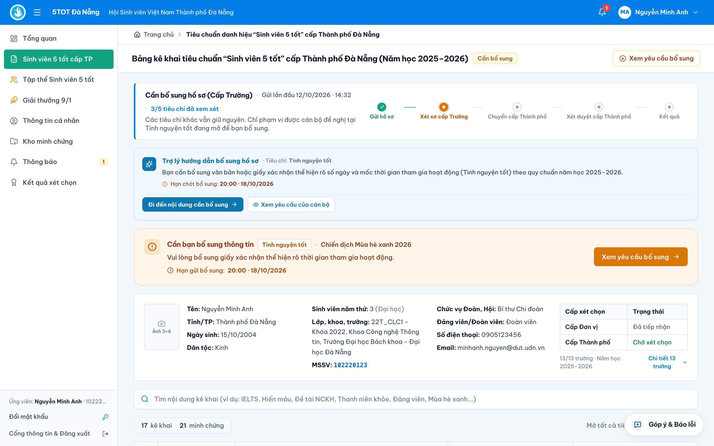

### 6.2. Theo dõi tiến độ & Nhận kết quả công nhận
Sinh viên theo dõi trực tiếp trạng thái xử lý hồ sơ theo thời gian thực tại màn hình **Tổng quan**:
- `Bản nháp` -> `Chờ sơ tuyển cấp Đơn vị` -> `Đơn vị đã trình cấp Thành phố` -> `Đang thẩm định cấp Thành phố` -> `Chờ Hội đồng xét chọn` -> `Đã công bố kết quả`.
- Sau khi Ban Thư ký Hội Sinh viên Việt Nam Thành phố Đà Nẵng ban hành Quyết định công nhận chính thức, sinh viên mở mục **`Kết quả xét chọn`** trên menu trái để xem số hiệu Quyết định và tải về chứng nhận điện tử / thông tin tuyên dương.
