# HƯỚNG DẪN SỬ DỤNG HỆ THỐNG XÉT CHỌN SINH VIÊN 5 TỐT
**Dành cho Sinh viên đăng ký xét chọn danh hiệu cấp Thành phố Đà Nẵng · Năm học 2025–2026**
**Đơn vị chủ trì:** Ban Thư ký Hội Sinh viên Việt Nam Thành phố Đà Nẵng

---

## 01. Hướng dẫn sử dụng Hệ thống xét chọn Sinh viên 5 tốt

- **Đối tượng áp dụng:** Dành cho sinh viên các trường Đại học, Học viện, Cao đẳng trên địa bàn Thành phố Đà Nẵng (bao gồm khu vực Quảng Nam sau hợp nhất) đăng ký xét chọn danh hiệu **“Sinh viên 5 tốt” cấp Thành phố Đà Nẵng**.
- **Chức năng chính:** Khởi tạo hồ sơ trực tuyến, kê khai thành tích theo 05 tiêu chí, đính kèm minh chứng điện tử, hỗ trợ trích xuất thông tin minh chứng bằng AI (OCR), theo dõi tiến độ xét duyệt 02 cấp (Đơn vị & Thành phố) và tra cứu kết quả công nhận chính thức.

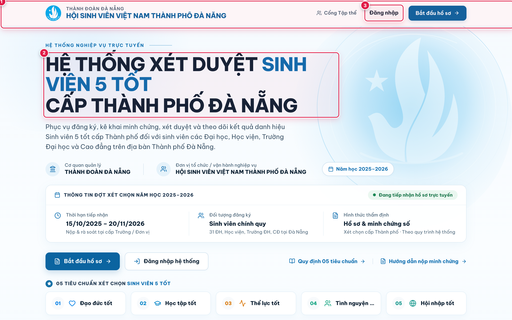
*Trang chủ Hệ thống xét chọn Sinh viên 5 tốt cấp Thành phố Đà Nẵng.*

---

## 02. Đăng ký và đăng nhập tài khoản

1. **Truy cập địa chỉ hệ thống** xét chọn trực tuyến của Hội Sinh viên Việt Nam Thành phố Đà Nẵng.
2. **Đăng ký tài khoản và điền thông tin sinh viên** `(1)` -> `(2)`: Nhấn **Đăng ký tài khoản mới**, nhập đầy đủ Họ và tên, Mã số sinh viên (MSSV), chọn Trường/Viện đào tạo trong danh mục các trường Đại học, Học viện, Cao đẳng tại Đà Nẵng, nhập Email và mật khẩu.
3. **Đăng nhập để bắt đầu sử dụng** `(3)`: Sau khi hoàn tất tạo tài khoản, đăng nhập bằng Email và mật khẩu đã đăng ký để vào không gian hồ sơ cá nhân.

| (A) Màn hình Đăng nhập hệ thống | (B) Biểu mẫu Đăng ký tài khoản sinh viên |
| :---: | :---: |
| 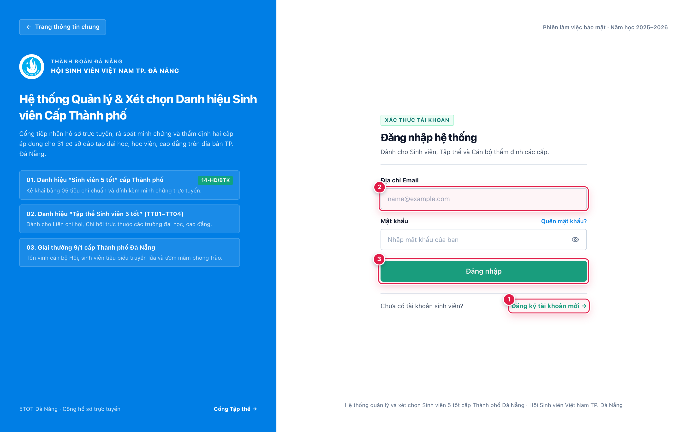 | 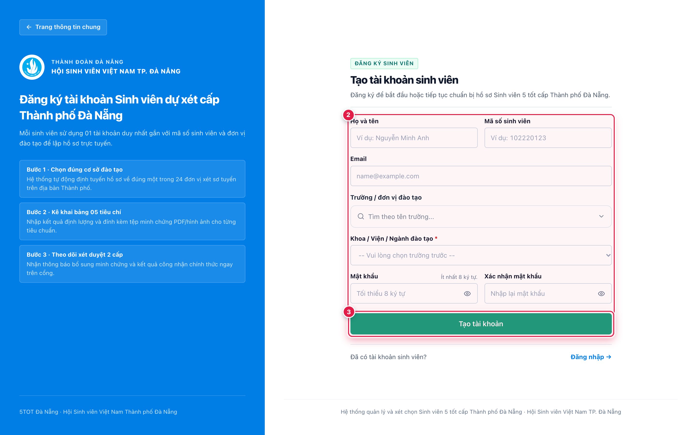 |

*Đăng ký tài khoản và đăng nhập hệ thống.*

---

## 03. Làm quen với trang Tổng quan

1. **Xem mùa xét và thời hạn nộp hồ sơ** `(1)`: Kiểm tra thông tin đợt xét chọn hiện hành và thời hạn tiếp nhận hồ sơ trực tuyến.
2. **Kiểm tra điều kiện đăng ký** `(2)`: Xác nhận trạng thái đủ điều kiện tham gia xét chọn danh hiệu cấp Thành phố.
3. **Theo dõi tiến độ hoàn thiện 5 tiêu chí** `(3)`: Quan sát thanh tiến độ tổng hợp số tiêu chí đã kê khai đầy đủ minh chứng trên tổng số 05 tiêu chí.
4. **Chọn Hồ sơ & minh chứng để bắt đầu** `(4)`: Nhấn vào mục **Hồ sơ & minh chứng** trên thanh điều hướng bên trái để bắt đầu kê khai chi tiết.

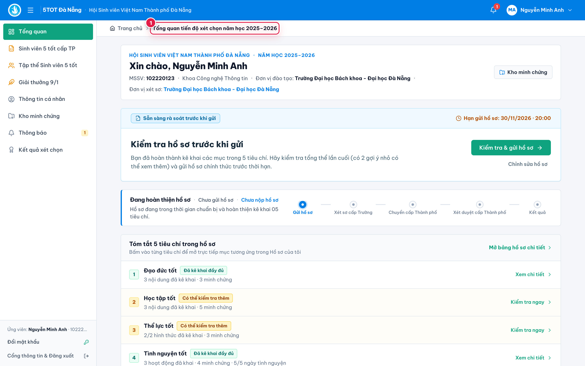
*Trang Tổng quan hiển thị tiến độ và tình trạng hồ sơ.*

---

## 04. Tìm hiểu 5 tiêu chí xét chọn

- Bộ tiêu chí xét chọn danh hiệu **Sinh viên 5 tốt cấp Thành phố Đà Nẵng** gồm 05 nhóm tiêu chí bắt buộc:
  1. **Đạo đức tốt** — Điểm rèn luyện từ 80 điểm trở lên, chấp hành tốt pháp luật và quy chế kèm tiêu chuẩn tự chọn.
  2. **Học tập tốt** — Điểm trung bình chung học tập (GPA) đạt ngưỡng quy định (≥ 3.2/4.0 đối với hệ Đại học; ≥ 3.0/4.0 đối với hệ Cao đẳng) kèm hoạt động nghiên cứu khoa học / thi học thuật.
  3. **Thể lực tốt** — Đạt danh hiệu “Sinh viên khỏe” hoặc đạt giải tại các giải thể thao, kiểm tra thể lực theo quy định.
  4. **Tình nguyện tốt** — Tham gia ít nhất 05 ngày tình nguyện/năm học hoặc được khen thưởng trong hoạt động tình nguyện.
  5. **Hội nhập tốt** — Đạt chuẩn ngoại ngữ (B1 hoặc tương đương trở lên) và tham gia hoạt động hội nhập quốc tế / kỹ năng thực hành xã hội.
- **Thao tác:** Chọn từng tiêu chí để mở xem yêu cầu chi tiết và kê khai minh chứng phù hợp.

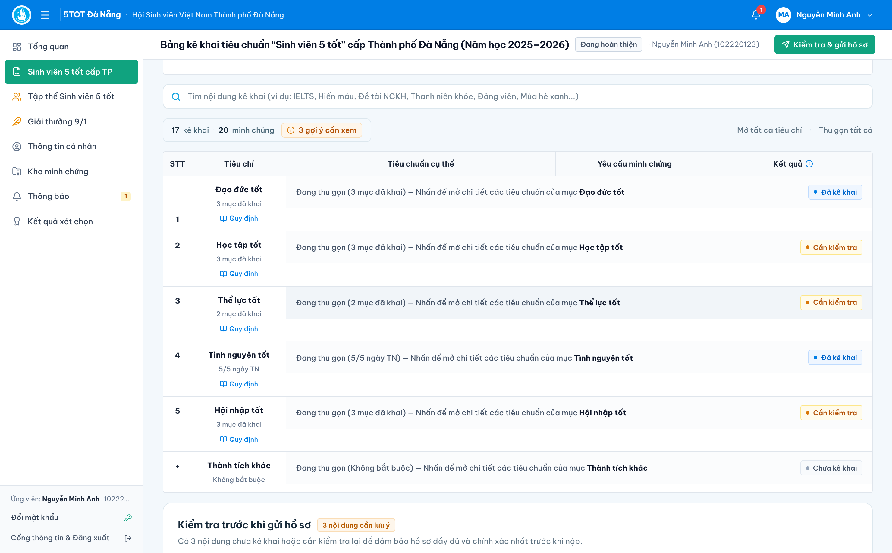
*Năm tiêu chí xét chọn danh hiệu Sinh viên 5 tốt.*

---

## 05. Kê khai thành tích và hoạt động

1. **Chọn tiêu chí cần kê khai** trong bảng 05 tiêu chí.
2. **Nhấn Thêm kê khai** `(1)` tại dòng yêu cầu cụ thể muốn bổ sung thành tích.
3. **Chọn hình thức hoặc nội dung phù hợp** `(1)` trong hộp thoại kê khai.
4. **Điền thông tin và lưu kê khai** `(2)` -> `(3)`: Nhập tên hoạt động/thành tích, kết quả đạt được, ngày cấp/thời gian tham gia, đơn vị tổ chức và nhấn **Lưu kê khai**.

| (Trước) Chọn tiêu chí và nhấn Thêm kê khai | (Sau) Điền thông tin trong khung Thêm kê khai |
| :---: | :---: |
| 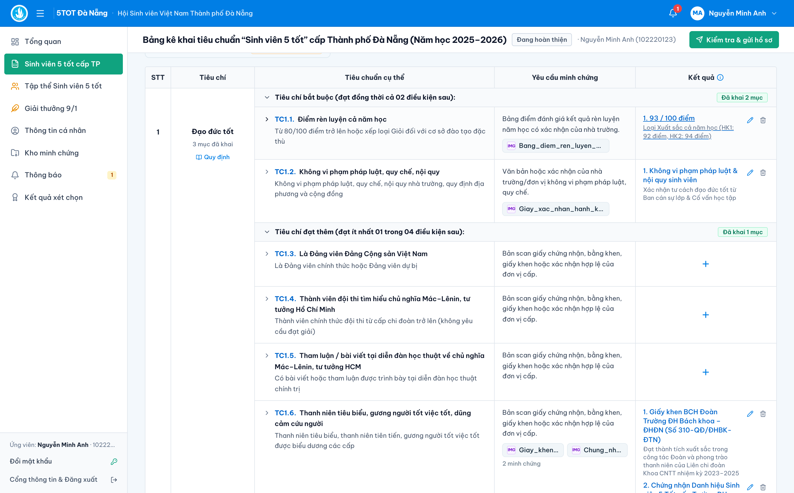 |  |

*Kê khai thành tích theo từng tiêu chí.*

---

## 06. Tải lên minh chứng

1. **Chọn Thêm minh chứng** cho nội dung đã kê khai.
2. **Đặt tên minh chứng rõ ràng** `(1)` (ví dụ: *Bảng điểm học tập năm học 2025–2026*, *Giấy chứng nhận Chiến dịch Mùa hè xanh 2026*).
3. **Tải lên giấy chứng nhận, quyết định hoặc tài liệu phù hợp** `(2)`: Chọn tệp `.PDF`, `.JPG` hoặc `.PNG` rõ nét, đầy đủ chữ ký và dấu xác nhận.
4. **Kiểm tra tệp đã đính kèm và lưu** `(3)`: Kiểm tra danh sách tệp đã tải lên và nhấn **Lưu minh chứng**.

*Đính kèm tài liệu minh chứng cho nội dung đã kê khai.*

---

## 07. Kiểm tra thông tin minh chứng

1. **Mở minh chứng vừa tải lên** `(1)` bằng cách nhấn trực tiếp vào tên tệp minh chứng trên dòng kê khai.
2. **Kiểm tra tên, thời gian, đơn vị tổ chức và nội dung** đối chiếu song song với bản xem trước tài liệu (hệ thống hỗ trợ nhận diện OCR tự động để gợi ý đối soát nhanh).
3. **Chỉnh sửa thông tin nếu chưa chính xác** ngay trên khung thông tin bên cạnh tài liệu.
4. **Xác nhận và lưu thông tin** `(2)` để hoàn tất rà soát minh chứng.

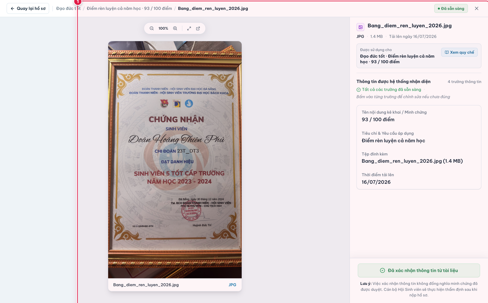
*Kiểm tra và xác nhận thông tin minh chứng.*

---

## 08. Quản lý và rà soát minh chứng

1. **Xem các kê khai và minh chứng đã lưu** `(1)` trên toàn bộ bảng hồ sơ.
2. **Bổ sung thêm minh chứng khi cần** `(3)` cho các hoạt động có nhiều giấy xác nhận hoặc quyết định kèm theo.
3. **Chỉnh sửa hoặc xóa thông tin chưa đúng** `(2)` khi hồ sơ còn ở trạng thái bản nháp cho phép chỉnh sửa.
4. **Kiểm tra đủ cả 5 tiêu chí** đều đạt trạng thái đã kê khai và đính kèm đầy đủ minh chứng hợp lệ.

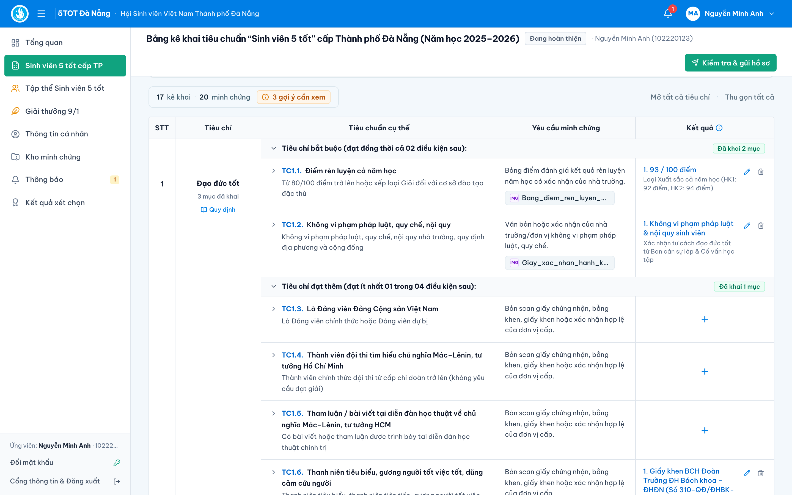
*Rà soát các nội dung đã kê khai trước khi nộp.*

---

## 09. Kiểm tra hồ sơ trước khi nộp

1. **Nhấn Kiểm tra & Nộp hồ sơ** (`Kiểm tra & gửi hồ sơ`) `(1)` ở góc phải phía trên màn hình hồ sơ.
2. **Xem tổng quan 5 tiêu chí và số minh chứng** `(2)` -> `(3)` trên ngăn rà soát bên phải.
3. **Đọc các khuyến nghị rà soát**: Kiểm tra kỹ các lưu ý tự động (nếu có) về thời hạn cấp minh chứng hoặc thông tin cần xác nhận.
4. **Quay lại chỉnh sửa nếu cần** hoặc nhấn **Gửi hồ sơ** `(4)` khi đã sẵn sàng.

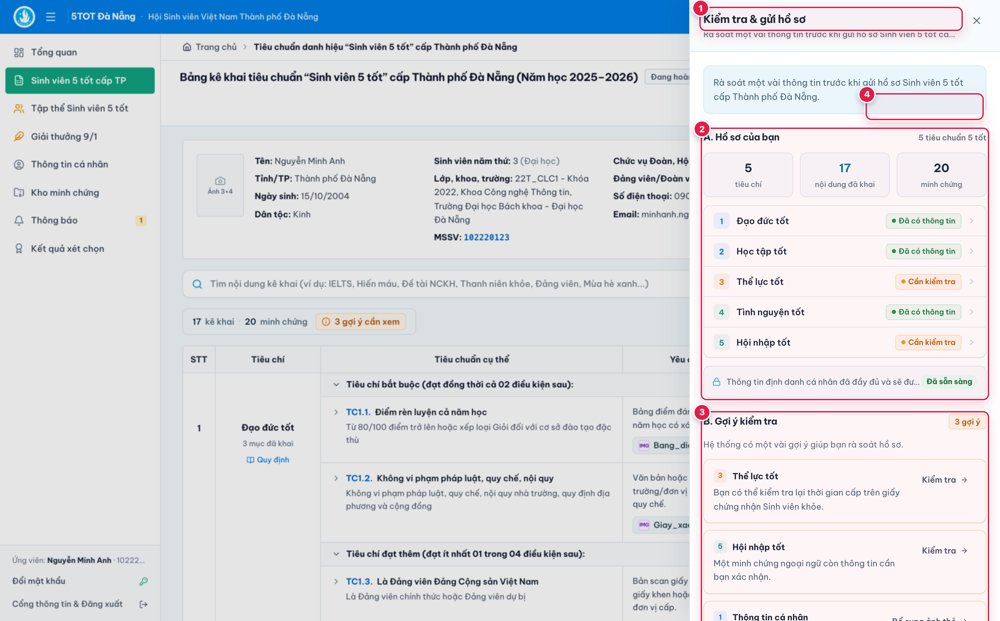
*Rà soát hồ sơ và các khuyến nghị trước khi gửi.*

---

## 10. Nộp hồ sơ xét chọn

1. **Kiểm tra điều kiện nộp cấp Thành phố** `(1)` trong hộp thoại xác nhận gửi hồ sơ.
2. **Xác nhận thông tin đã kê khai** là trung thực, chính xác và đầy đủ minh chứng.
3. **Nhấn Nộp hồ sơ** (`Xác nhận gửi hồ sơ`) `(2)`.
4. **Kiểm tra thông báo nộp thành công** `(3)`: Hồ sơ chuyển sang trạng thái **Đã gửi hồ sơ / Đang được xét** và được chuyển tới đơn vị đào tạo để xét sơ tuyển.

| (Trước) Xác nhận điều kiện và nhấn Gửi hồ sơ | (Sau) Trạng thái hồ sơ đã gửi thành công |
| :---: | :---: |
| 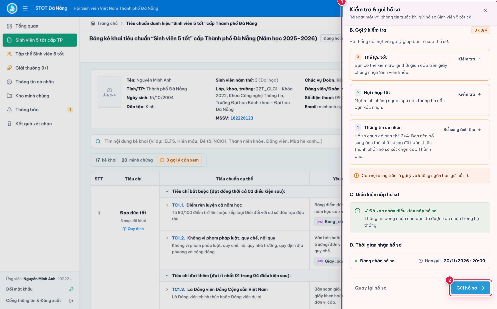 | 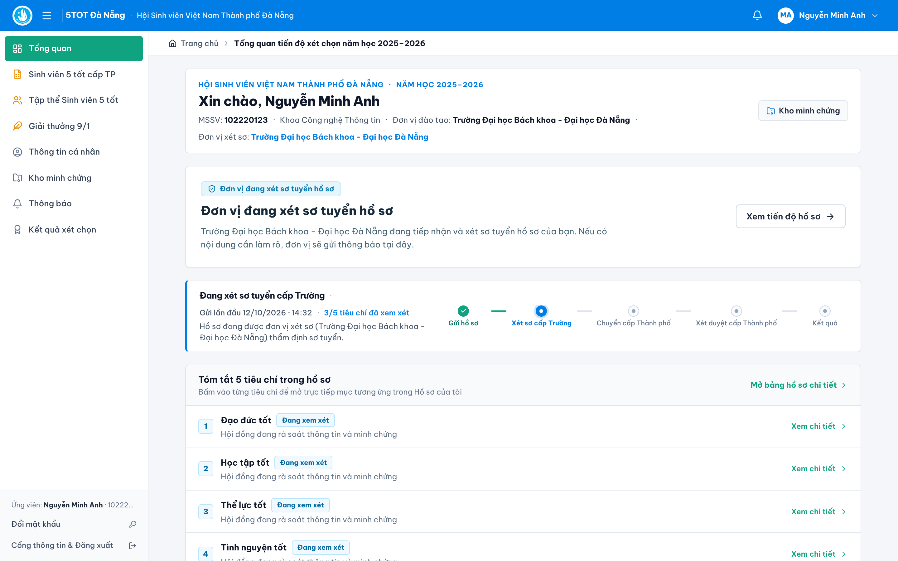 |

*Xác nhận và gửi hồ sơ xét chọn cấp Thành phố.*

---

## 11. Theo dõi trạng thái và bổ sung hồ sơ

1. **Theo dõi trạng thái tại trang Tổng quan hoặc Kết quả** `(1)`.
2. **Kiểm tra thông báo và email** khi cán bộ xét duyệt cấp Đơn vị hoặc cấp Thành phố gửi yêu cầu làm rõ minh chứng.
3. **Nếu được yêu cầu bổ sung, mở đúng nội dung cần sửa** `(2)` theo đường dẫn trên thông báo.
4. **Cập nhật minh chứng và Gửi lại hồ sơ** `(3)`: Tải lên tệp minh chứng bổ sung, nhập ghi chú giải trình (nếu có) và nhấn **Gửi bổ sung / Gửi lại hồ sơ**.

| (A) Thông báo và trạng thái cần bổ sung | (B) Màn hình tải minh chứng bổ sung và gửi lại |
| :---: | :---: |
| 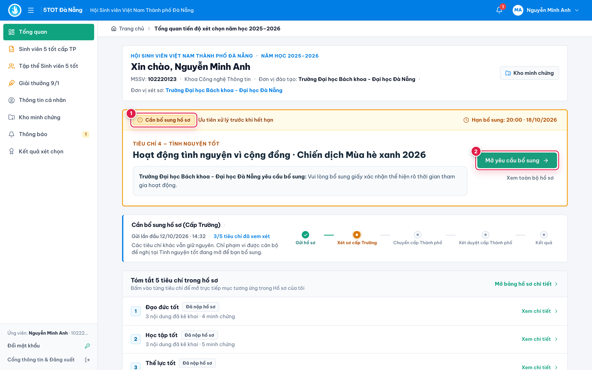 | 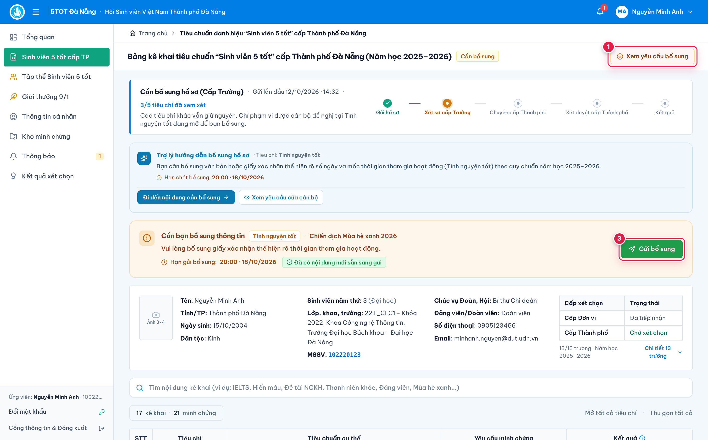 |

*Theo dõi yêu cầu bổ sung và gửi lại hồ sơ.*

---

## 12. Xem kết quả xét chọn

1. **Truy cập mục Kết quả** `(1)` trên thanh điều hướng bên trái.
2. **Xem kết quả chính thức khi được công bố** `(2)` sau khi Hội đồng xét chọn cấp Thành phố ban hành Quyết định công nhận.
3. **Theo dõi thông báo hoặc phản hồi từ đơn vị xét chọn** và tải Giấy chứng nhận điện tử (nếu được công nhận).
4. **Thông điệp:** *Hoàn thiện hồ sơ đầy đủ – Nộp đúng thời hạn – Chủ động theo dõi kết quả.*

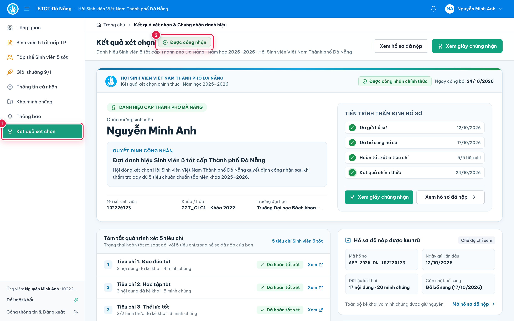
*Tra cứu kết quả xét chọn và phản hồi liên quan.*
