# HƯỚNG DẪN CÁN BỘ XÉT DUYỆT CẤP ĐƠN VỊ
**Quy trình sơ tuyển hồ sơ cá nhân và trình danh sách đề nghị cấp Thành phố Đà Nẵng · Năm học 2025–2026**
**Cơ quan chủ trì:** Ban Thư ký Hội Sinh viên Việt Nam Thành phố Đà Nẵng

---

## SLIDE 01 | Hướng dẫn cán bộ xét duyệt cấp đơn vị
*Quy trình sơ tuyển hồ sơ cá nhân và trình danh sách đề nghị cấp Thành phố*

- **Đối tượng:** Cán bộ đầu mối đơn vị tham gia sơ tuyển hồ sơ cá nhân Sinh viên 5 tốt tại các trường Đại học, Học viện, Cao đẳng trên địa bàn Thành phố Đà Nẵng (bao gồm khu vực Quảng Nam sau hợp nhất).
- **Các nội dung chính:** Quản lý hồ sơ, đối chiếu minh chứng, kết luận sơ tuyển và trình danh sách đề nghị lên Thành phố.

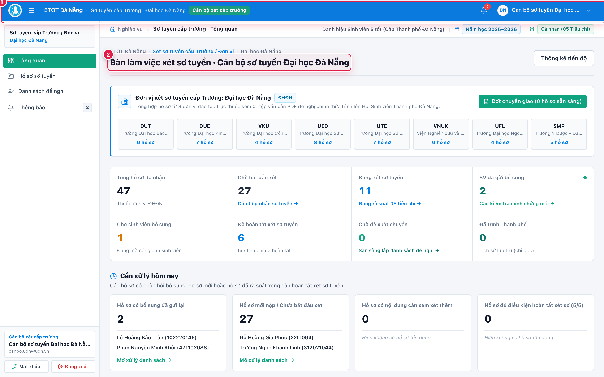
*Giao diện Tổng quan xét sơ tuyển cấp đơn vị — Hệ thống xét chọn Sinh viên 5 tốt TP. Đà Nẵng.*

---

## SLIDE 02 | Phạm vi xử lý hồ sơ theo đơn vị
*Mỗi tài khoản làm việc trong phạm vi hồ sơ được phân quyền*

- **Đầu mối Đại học Đà Nẵng (`unit-udn`):** Tổng hợp và xét sơ tuyển hồ sơ sinh viên từ **08 trường/viện thành viên** (`DUT`, `DUE`, `UED`, `UFL`, `UTE`, `VKU`, `SMP`, `VNUK`); trang bị bộ lọc riêng theo từng trường thành viên.
- **Các trường Đại học, Học viện, Cao đẳng độc lập (Đà Nẵng & Quảng Nam):** Rà soát sơ tuyển và lập danh sách đề nghị của chính đơn vị mình.
- **Lưu ý phạm vi:** Hồ sơ **Tập thể Sinh viên 5 tốt** (`TT01–TT04`) được nộp trực tiếp về Hội Sinh viên Thành phố, không thuộc hàng đợi sơ tuyển cá nhân cấp đơn vị.

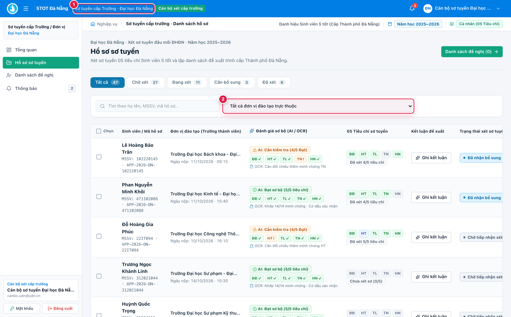
*Phạm vi phân quyền xử lý hồ sơ theo đơn vị và bộ lọc 08 trường/viện thành viên Đại học Đà Nẵng.*

---

## SLIDE 03 | Đăng nhập và đổi mật khẩu
*Đảm bảo bảo mật tài khoản cán bộ trước khi xử lý hồ sơ*

1. **Đăng nhập** bằng email công vụ và mật khẩu khởi tạo được bàn giao `(1)` -> `(3)`.
2. **Mở chức năng Đổi mật khẩu** từ menu tài khoản hoặc thanh điều hướng bên trái `(2)`.
3. **Nhập mật khẩu hiện tại, mật khẩu mới và xác nhận** để cập nhật `(3)`.

> **Lưu ý:** Mật khẩu mới bắt buộc tối thiểu **08 ký tự** để bảo mật dữ liệu xét duyệt.

| (Hình 2.1) Màn hình Đăng nhập hệ thống | (Hình 2.2) Hộp thoại Đổi mật khẩu tài khoản |
| :---: | :---: |
| 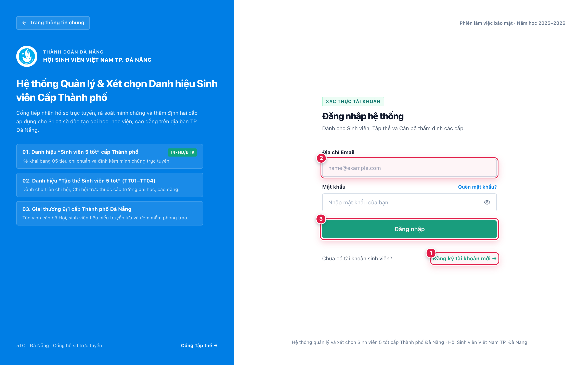 | 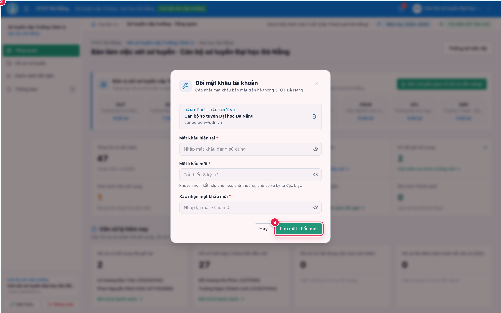 |

*Đăng nhập hệ thống và đổi mật khẩu bảo mật trong lần sử dụng đầu tiên.*

---

## SLIDE 04 | Theo dõi tiến độ tại Tổng quan
*Nắm nhanh tình hình hồ sơ của đơn vị*

1. **Xem số hồ sơ đã nộp về đơn vị** `(1)` (*Tổng hồ sơ đã nhận*).
2. **Theo dõi hồ sơ chờ xét, đang xét và đang chờ bổ sung** `(2)` -> `(3)`.
3. **Kiểm tra số hồ sơ đủ điều kiện đề nghị lên Thành phố** `(4)` (*Đã hoàn tất xét sơ tuyển*).

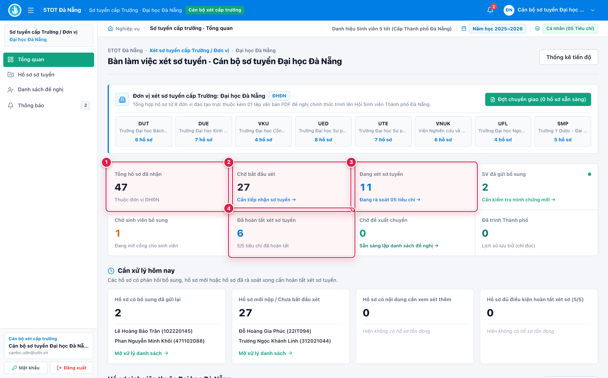
*Bảng điều khiển Tổng quan tiến độ sơ tuyển của Cán bộ cấp Đơn vị.*

---

## SLIDE 05 | Tìm và mở hồ sơ sơ tuyển
*Lọc đúng hồ sơ cần xử lý*

1. **Chọn menu Hồ sơ sơ tuyển** `(1)` ở thanh điều hướng bên trái.
2. **Tìm kiếm theo họ tên hoặc mã số sinh viên (MSSV)** `(2)`.
3. **Lọc theo trạng thái**; tài khoản Đại học Đà Nẵng có thêm **bộ lọc trường thành viên** `(3)`.
4. **Nhấn Mở xét sơ / Xét sơ tuyển** `(4)` tại dòng hồ sơ cần xử lý.

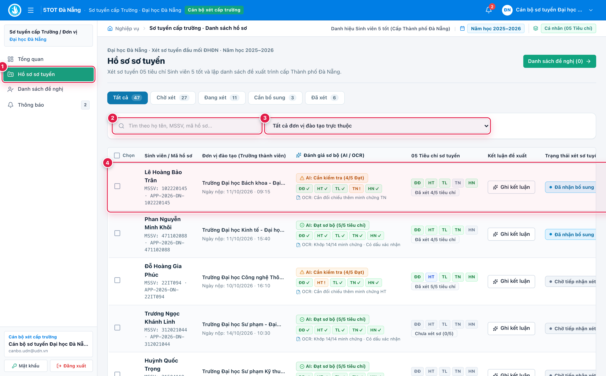
*Danh sách hồ sơ sơ tuyển — hỗ trợ tìm kiếm, lọc trạng thái và lọc theo trường thành viên.*

---

# PHẦN II — XÉT CHI TIẾT HỒ SƠ

## SLIDE 06 | Kiểm tra thông tin và bắt đầu xét
*Đối chiếu thông tin sinh viên trước khi đánh giá*

1. **Mở hồ sơ và kiểm tra họ tên, MSSV, trường, khoa, lớp** `(1)`.
2. **Đối chiếu GPA, điểm rèn luyện và ảnh thẻ 3×4** trên thanh thông tin trích ngang đầu hồ sơ.
3. **Nhấn Bắt đầu xét duyệt** `(2)` nếu hệ thống yêu cầu kích hoạt phiên xét để mở khóa các nút chấm điểm.

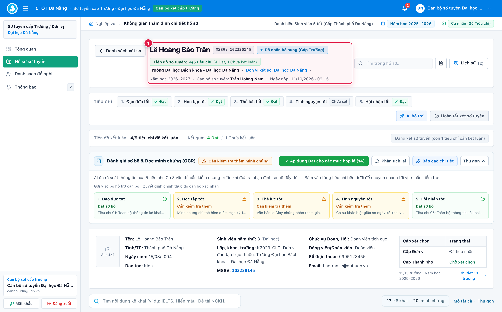
*Thanh thông tin trích ngang ứng viên và nút Bắt đầu xét duyệt.*

---

## SLIDE 07 | Đọc bảng thẩm định 5 tiêu chí
*Xem yêu cầu và minh chứng theo từng tiêu chí*

1. **Lần lượt rà soát 5 tiêu chí** `(1)`: *1. Đạo đức tốt*, *2. Học tập tốt*, *3. Thể lực tốt*, *4. Tình nguyện tốt* và *5. Hội nhập tốt*.
2. **Đọc yêu cầu của từng mục** trên bảng thẩm định 5 cột.
3. **Đối chiếu với các minh chứng** sinh viên đã cung cấp tại cột **Yêu cầu minh chứng** `(2)` và ghi nhận tại cột **Kết quả & Đánh giá** `(3)`.

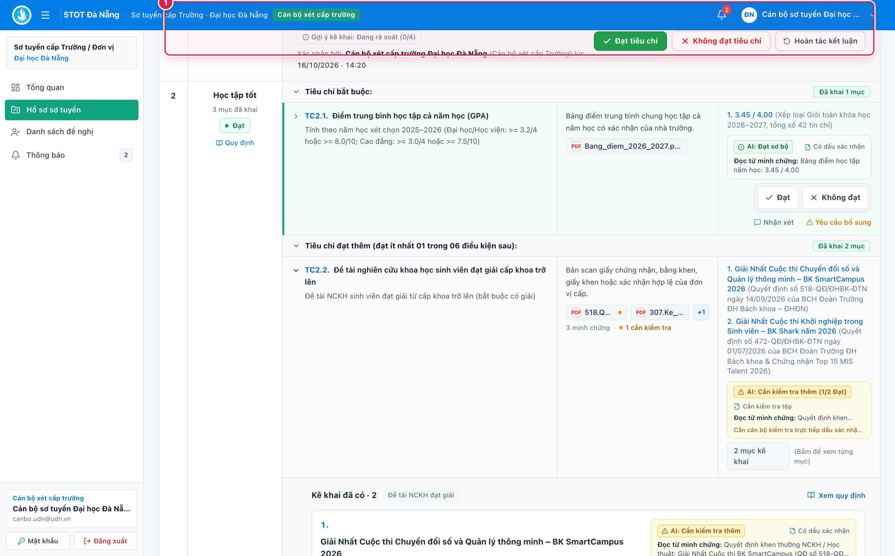
*Toàn cảnh bảng thẩm định 5 cột theo từng nhóm tiêu chí.*

---

## SLIDE 08 | Xem minh chứng và ghi kết quả
*Đánh giá từng mục kê khai dựa trên tài liệu thực tế*

1. **Nhấn tên tệp PDF hoặc ảnh** để mở cửa sổ xem trực tiếp minh chứng kèm kết quả bóc tách OCR `(1)`.
2. **Chọn Đạt** `(2)` khi nội dung kê khai và minh chứng hợp lệ.
3. **Chọn Không đạt** `(3)` nếu chưa đáp ứng yêu cầu; thêm **Nhận xét** khi cần ghi rõ căn cứ chuyên môn.

> **Lưu ý:** Đối chiếu kỹ cả **thời gian cấp minh chứng** với niên hạn năm học xét chọn.

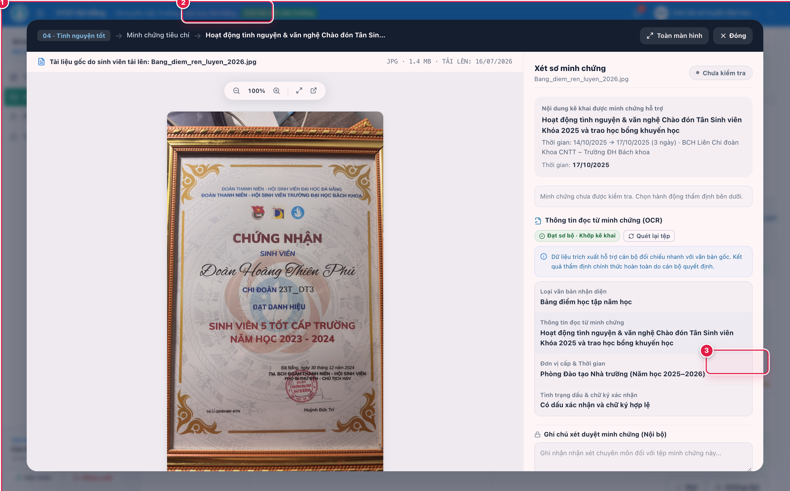
*Xem trực tiếp minh chứng trên trình duyệt và ghi kết quả Đạt / Không đạt / Nhận xét.*

---

## SLIDE 09 | Sử dụng AI hỗ trợ rà soát
*Xem gợi ý đối chiếu, không thay quyết định chuyên môn*

1. **Nhấn AI hỗ trợ** `(1)` để đọc báo cáo kiểm tra tự động và quan sát nhãn đánh giá sơ bộ của AI trên từng dòng yêu cầu `(3)` (*Đạt sơ bộ*, *Cần kiểm tra thêm*, *Chưa đạt sơ bộ*).
2. **Đối chiếu các cảnh báo, ngưỡng điểm và thông tin còn thiếu** `(2)` do AI bóc tách từ minh chứng.
3. **Tự kiểm chứng minh chứng gốc** trước khi đưa ra kết luận chính thức.

> **Lưu ý:** **AI chỉ hỗ trợ tham khảo; cán bộ xét duyệt là người đưa ra quyết định chuyên môn cuối cùng.**

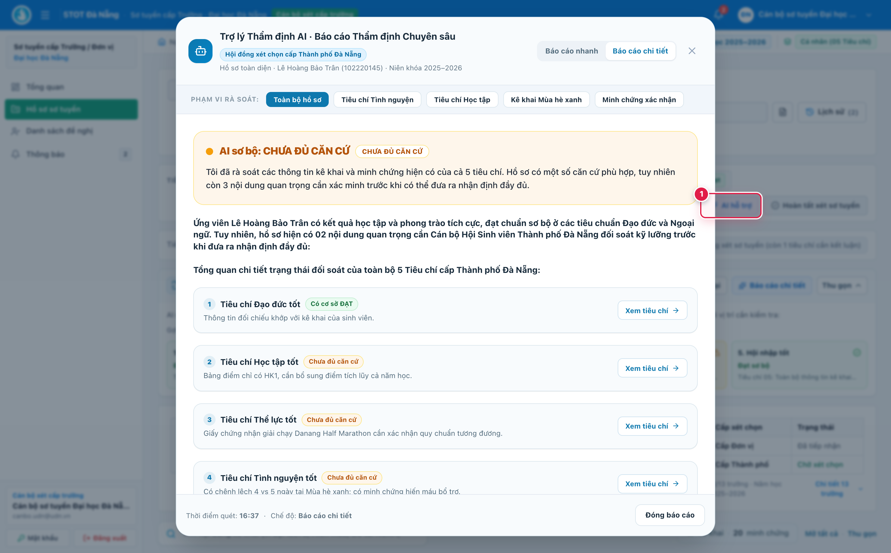
*Sử dụng AI hỗ trợ rà soát ngưỡng điểm, đọc OCR minh chứng và gợi ý trạng thái sơ bộ trên từng hàng.*

---

## SLIDE 10 | Yêu cầu sinh viên bổ sung minh chứng
*Làm rõ các mục còn thiếu hoặc chưa hợp lệ*

1. **Chọn Yêu cầu bổ sung** tại mục tiêu chí cần xử lý.
2. **Ghi cụ thể nội dung phải chỉnh sửa hoặc bổ sung** `(1)`.
3. **Đặt hạn chót** `(2)` và nhấn **Gửi yêu cầu** `(3)`.
4. **Theo dõi hồ sơ chờ bổ sung** và xét tiếp ngay khi sinh viên nộp lại minh chứng.

> **Lưu ý:** Nêu rõ loại giấy tờ, con dấu xác nhận hoặc thông tin cần sinh viên bổ sung.

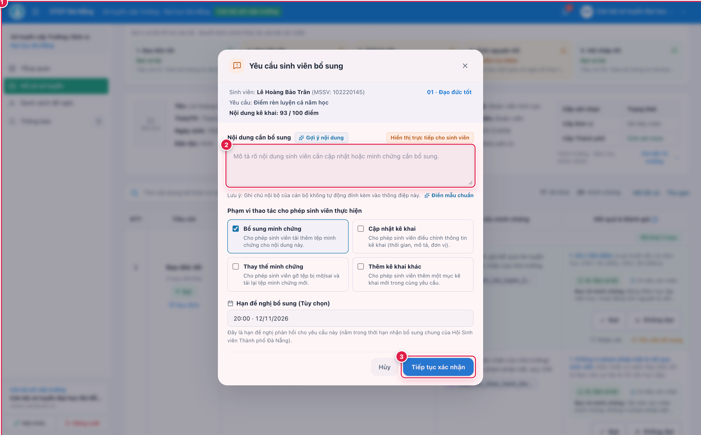
*Gửi yêu cầu bổ sung minh chứng kèm hạn chót phản hồi cho sinh viên.*

---

## SLIDE 11 | Kết luận 5 tiêu chí và hoàn tất sơ tuyển
*Hoàn thành đánh giá trước khi chọn đề xuất của đơn vị*

1. **Kết luận Đạt / Không đạt** cho cả 05 nhóm tiêu chí.
2. **Kiểm tra thanh tiến độ** đã kết luận đủ **5/5 tiêu chí** `(1)`.
3. **Nhấn Hoàn tất xét sơ tuyển** `(2)` và chọn **Đề nghị xét cấp Thành phố** hoặc **Không đề nghị** `(3)`.
4. **Nếu không đề nghị**, nhập lý do đầy đủ để lưu biên bản sơ tuyển.

> **Lưu ý:** Có thể **Hoàn tác / Xét lại** khi đơn vị chưa trình danh sách chính thức lên Thành phố.

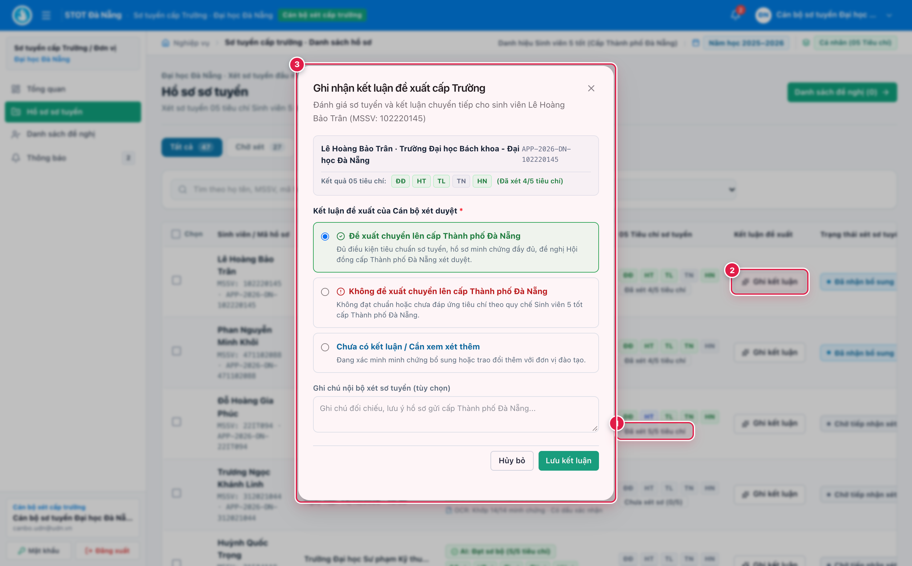
*Kiểm tra tiến độ 5/5 tiêu chí và xác nhận Hoàn tất xét sơ tuyển.*

---

# PHẦN III — LẬP VÀ TRÌNH DANH SÁCH

## SLIDE 12 | Kiểm tra danh sách sinh viên đề nghị
*Chọn đúng hồ sơ đủ điều kiện để đưa vào danh sách*

1. **Mở menu Danh sách đề nghị** `(1)`.
2. **Chọn các hồ sơ đủ điều kiện** đề nghị xét cấp Thành phố `(2)` -> `(3)` (có thể nhấn *Chọn tất cả đạt 5/5*).
3. **Rà soát các hồ sơ còn đang xét hoặc chờ bổ sung** trên thanh cảnh báo.
4. **Đối chiếu danh sách trên hệ thống** trùng khớp với danh sách trích ngang trình ký văn bản giấy.

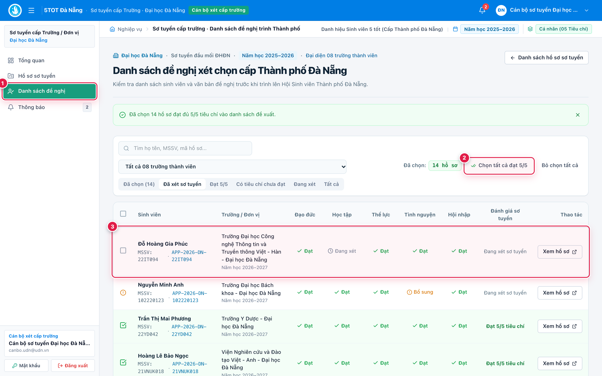
*Màn hình Danh sách đề nghị — kiểm tra và tích chọn các hồ sơ sinh viên đủ điều kiện trình Thành phố.*

---

## SLIDE 13 | Tải lên văn bản đề nghị PDF
*Đính kèm văn bản chính thức của đơn vị trước khi trình*

1. **Chọn Tải lên văn bản (.PDF)** tại khung *Văn bản đề nghị xét chọn (.PDF)* `(1)`.
2. **Đính kèm tờ trình/quyết định/công văn** đã ký và đóng dấu hoặc ký số hợp lệ.
3. **Nhấn Xem văn bản** `(2)` để kiểm tra nội dung; nhấn **Đổi tệp** `(3)` nếu tải nhầm file.

> **Lưu ý:** Chỉ nhận định dạng **PDF**, dung lượng tối đa **20 MB**; đây là thành phần **bắt buộc** trước khi trình Thành phố.

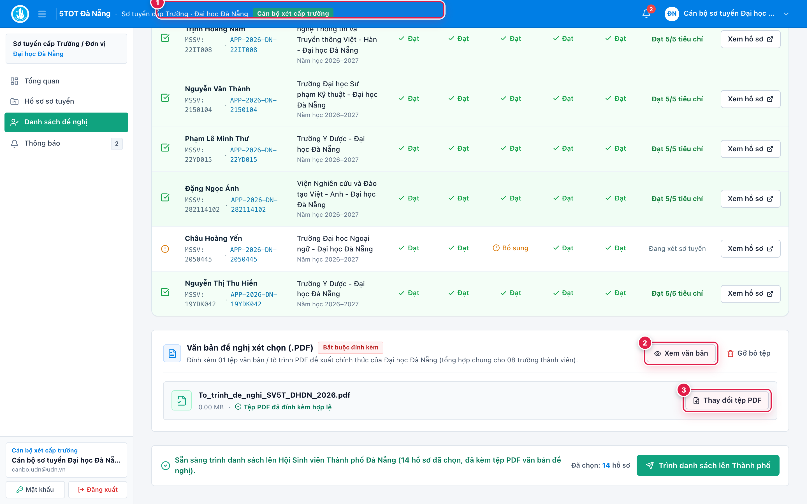
*Đính kèm tệp văn bản đề nghị (.PDF) chính thức của đơn vị.*

---

## SLIDE 14 | Xác nhận trình danh sách lên Thành phố
*Chỉ trình chính thức sau khi đủ điều kiện*

1. **Kiểm tra đã chọn ít nhất 01 hồ sơ** trong danh sách đề nghị `(1)`.
2. **Kiểm tra đã tải lên văn bản PDF hợp lệ** `(1)`.
3. **Nhấn Trình danh sách lên Thành phố**.
4. **Đọc thông báo xác nhận và chọn Xác nhận trình chính thức** `(2)`.

> **Lưu ý:** Mỗi đơn vị chỉ thực hiện **01 đợt trình chính thức** trong 01 mùa xét.

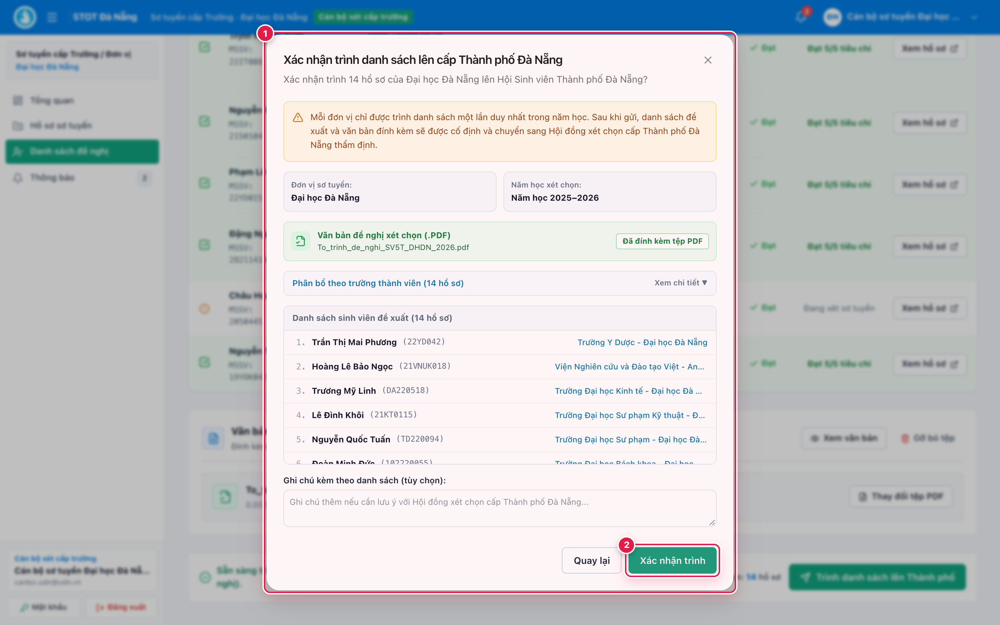
*Kiểm tra điều kiện hợp lệ và xác nhận trình danh sách chính thức lên Thành phố.*

---

## SLIDE 15 | Kiểm tra trạng thái sau khi trình
*Đảm bảo danh sách đã được gửi thành công*

1. **Kiểm tra nhãn Đã trình lên Thành phố** và thời gian gửi xác nhận `(1)`.
2. **Xem lại danh sách, văn bản PDF đã trình** ở chế độ chỉ đọc `(2)` -> `(3)`.
3. **Đợi đơn vị cấp Thành phố** (Ban Thư ký Hội Sinh viên TP. Đà Nẵng) thực hiện thẩm định tiếp theo.

> **Lưu ý:** Sau khi trình thành công, toàn bộ danh sách đã trình và tệp PDF chuyển sang **chế độ chỉ đọc (bất biến)** để đảm bảo tính minh bạch.

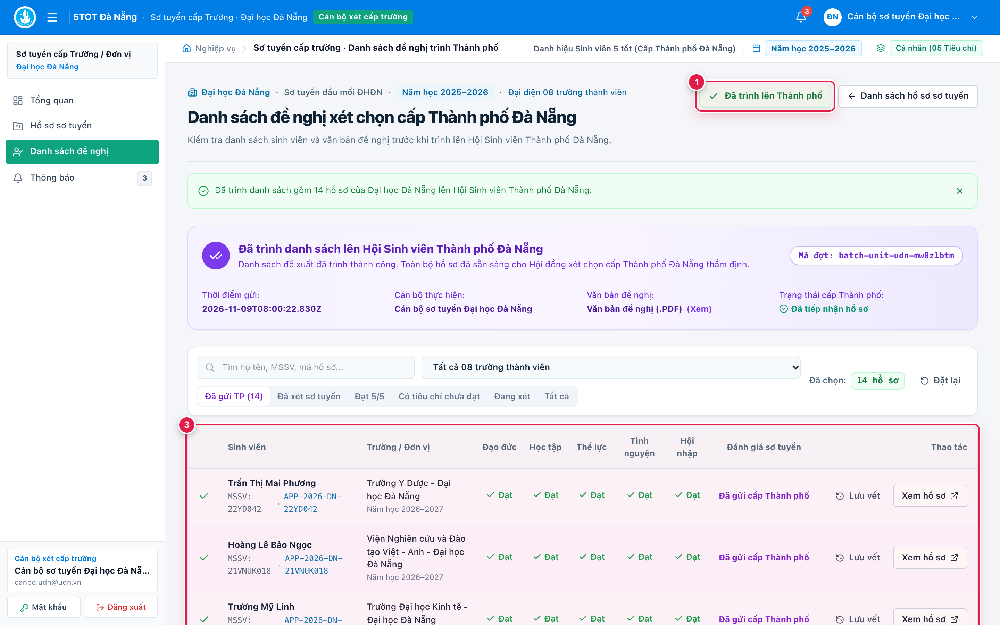
*Trạng thái Đã trình lên Thành phố kèm thời gian gửi và danh sách lưu trữ chỉ đọc.*
