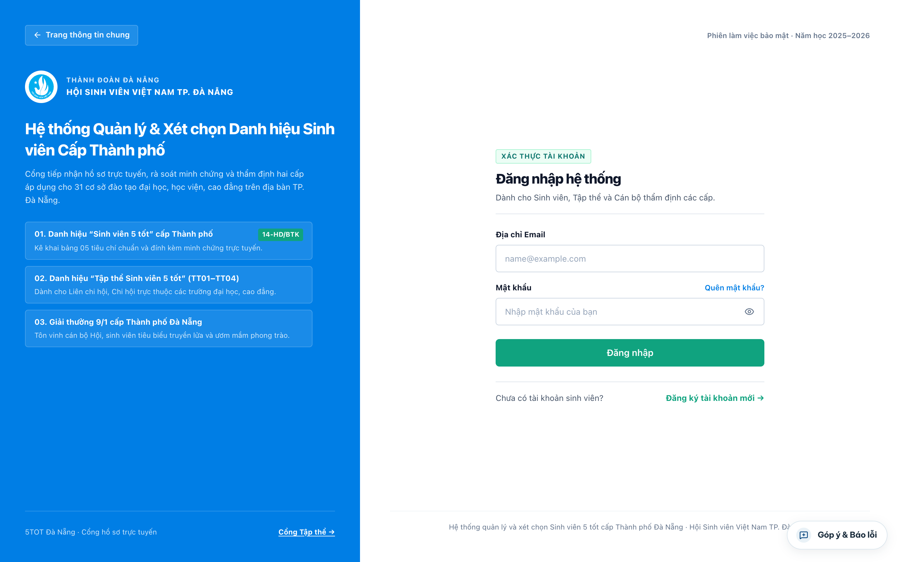
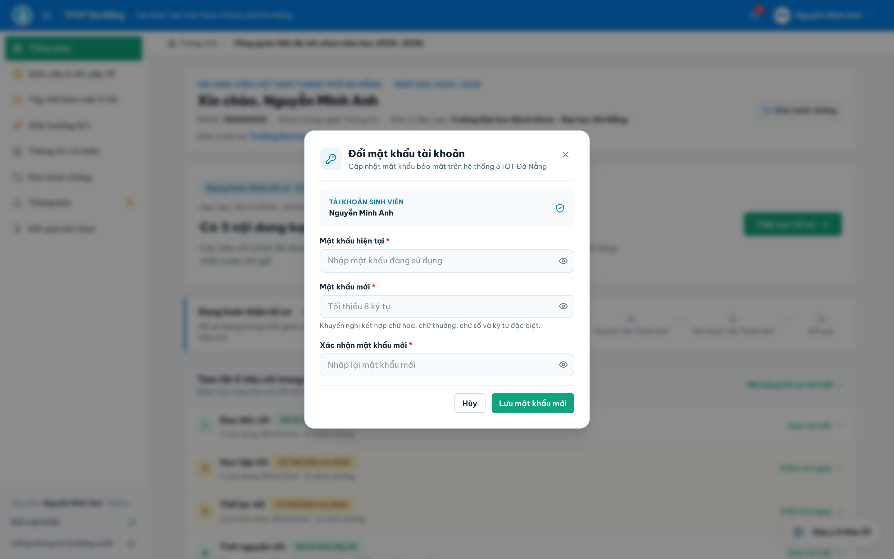
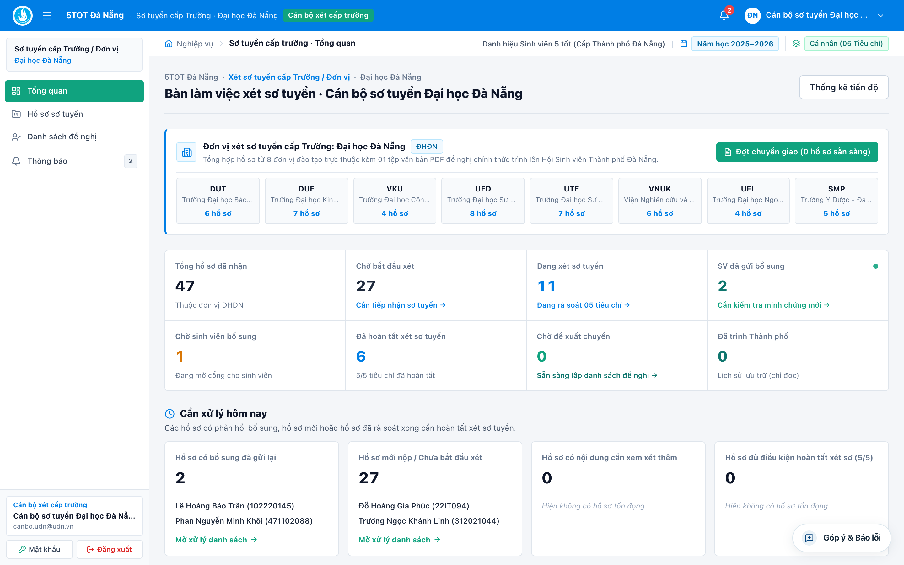
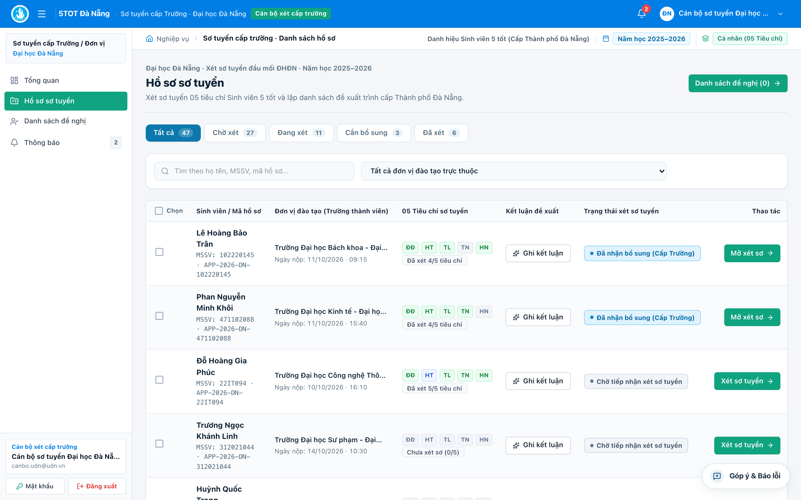
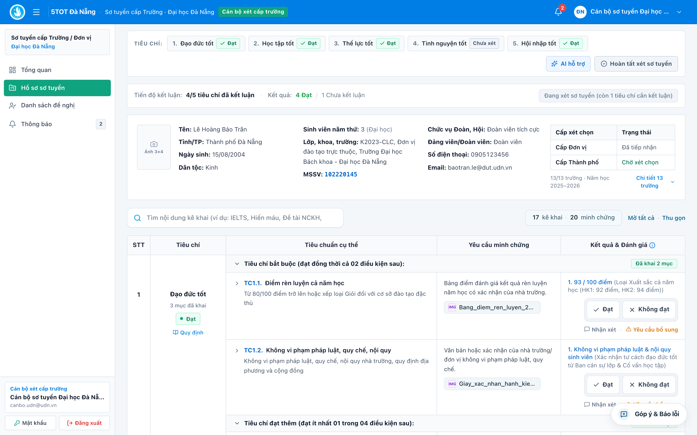
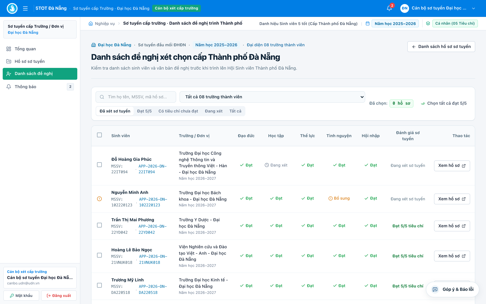
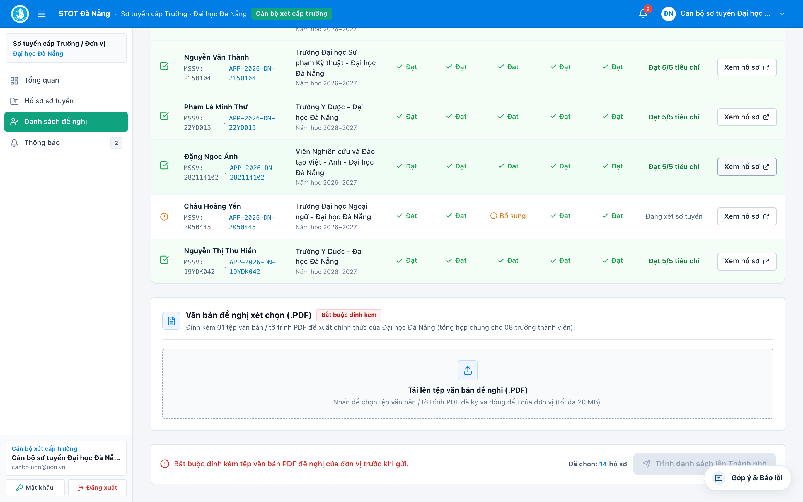

# HƯỚNG DẪN SỬ DỤNG HỆ THỐNG 5TOT ĐÀ NẴNG
## Dành cho Cán bộ Xét duyệt Cấp Đơn vị (`SCHOOL_OFFICER`)

**Hệ thống:** Cổng thông tin xét chọn Danh hiệu *"Sinh viên 5 tốt"*, *"Tập thể Sinh viên 5 tốt"* và *"Giải thưởng 9/1"* cấp Thành phố Đà Nẵng  
**Cơ quan chủ trì:** Ban Thư ký Hội Sinh viên Việt Nam Thành phố Đà Nẵng  
**Đối tượng áp dụng:** Ban Thư ký Hội Sinh viên / Ban Thường vụ Đoàn Thanh niên phụ trách công tác xét sơ tuyển tại **24 đầu mối đơn vị trực thuộc** trên địa bàn TP. Đà Nẵng.

---

## MỤC LỤC NHANH
1. [Phạm vi phân quyền 24 Đầu mối Sơ tuyển & Lưu ý nghiệp vụ](#1-phạm-vi-phân-quyền-24-đầu-mối-sơ-tuyển--lưu-ý-nghiệp-vụ)
2. [Đăng nhập lần đầu & Đổi mật khẩu bàn giao](#2-đăng-nhập-lần-đầu--đổi-mật-khẩu-bàn-giao)
3. [Quản lý Tổng quan & Danh sách Hồ sơ Sơ tuyển](#3-quản-lý-tổng-quan--danh-sách-hồ-sơ-sơ-tuyển)
4. [Quy trình Chấm Sơ tuyển Chi tiết Hồ sơ trên Bảng 5 Cột](#4-quy-trình-chấm-sơ-tuyển-chi-tiết-hồ-sơ-trên-bảng-5-cột)
5. [Lập Danh sách Đề nghị & Đính kèm Văn bản PDF Trình Thành phố (Bắt buộc)](#5-lập-danh-sách-đề-nghị--đính-kèm-văn-bản-pdf-trình-thành-phố-bắt-buộc)

---

## 1. Phạm vi phân quyền 24 Đầu mối Sơ tuyển & Lưu ý nghiệp vụ

Hệ thống **5TOT Đà Nẵng** tổ chức phân quyền sơ tuyển cấp Đơn vị đối với **Hồ sơ Cá nhân "Sinh viên 5 tốt"** theo đúng mô hình tổ chức thực tế của Hội Sinh viên TP. Đà Nẵng (gồm **31 cơ sở đào tạo** quy về **24 đầu mối xét sơ tuyển**):

1. **Đầu mối Đại học Đà Nẵng (`unit-udn`):**
   - Tài khoản cán bộ Hội Sinh viên Đại học Đà Nẵng tiếp nhận, rà soát sơ tuyển và tổng hợp chung cho toàn bộ **08 trường/viện thành viên ĐHĐN**:
     1. Trường Đại học Bách khoa – ĐHĐN (`DUT`)
     2. Trường Đại học Kinh tế – ĐHĐN (`DUE`)
     3. Trường Đại học Sư phạm – ĐHĐN (`UED`)
     4. Trường Đại học Ngoại ngữ – ĐHĐN (`UFL`)
     5. Trường Đại học Sư phạm Kỹ thuật – ĐHĐN (`UTE`)
     6. Trường Đại học Công nghệ Thông tin và Truyền thông Việt – Hàn – ĐHĐN (`VKU`)
     7. Trường Y Dược – ĐHĐN (`SMP`)
     8. Viện Nghiên cứu và Đào tạo Việt – Anh – ĐHĐN (`VNUK`)
   - Trên màn hình danh sách hồ sơ của `unit-udn`, hệ thống hiển thị rõ tên trường thành viên của từng sinh viên và trang bị **bộ lọc riêng theo từng trường thành viên** để thuận tiện phân công chuyên viên rà soát. Khi trình lên Thành phố, Đại học Đà Nẵng lập **01 danh sách tổng hợp chung kèm 01 văn bản đề nghị (.PDF) chung**.
2. **23 Đầu mối Trường Đại học, Học viện, Cao đẳng độc lập:**
   - Mỗi trường (*ĐH Duy Tân, ĐH Đông Á, ĐH Kiến trúc Đà Nẵng, ĐH Kỹ thuật Y – Dược Đà Nẵng, ĐH Thể dục Thể thao Đà Nẵng, Học viện Chính trị Khu vực III, CĐ Thương mại, CĐ Nghề Đà Nẵng, CĐ Lương thực – Thực phẩm...*) được cấp tài khoản riêng, chỉ nhìn thấy và xét sơ tuyển sinh viên của chính trường mình, đồng thời trình **01 danh sách đề nghị kèm 01 văn bản (.PDF)** của đơn vị lên Hội Sinh viên Thành phố.

> **Lưu ý về Hồ sơ Tập thể SV5T & Giải thưởng 9/1:** Theo quy trình nghiệp vụ Thành phố, hồ sơ **Tập thể Sinh viên 5 tốt** (`TT01–TT04`) và **Giải thưởng 9/1** được nộp trực tiếp về Hội Sinh viên Thành phố Đà Nẵng thẩm định, không nằm trong hàng đợi sơ tuyển của tài khoản cấp Đơn vị.

---

## 2. Đăng nhập lần đầu & Đổi mật khẩu bàn giao

1. Truy cập cổng **5TOT Đà Nẵng**, nhập **Địa chỉ Email công vụ** và **Mật khẩu khởi tạo** theo phiếu bàn giao tài khoản của Ban Thư ký Hội Sinh viên TP. Đà Nẵng.
2. **Đổi mật khẩu ngay lần đầu sử dụng (Bắt buộc để bảo mật dữ liệu xét duyệt):**
   - Sau khi vào hệ thống, bấm nút **`Đổi mật khẩu`** ở góc dưới thanh menu trái (hoặc trong menu tài khoản góc phải trên cùng).
   - Nhập *Mật khẩu hiện tại* -> nhập *Mật khẩu mới* (tối thiểu 08 ký tự) -> *Xác nhận mật khẩu mới* -> bấm **Cập nhật mật khẩu**.

---

## 3. Quản lý Tổng quan & Danh sách Hồ sơ Sơ tuyển

### 3.1. Màn hình Tổng quan (`Tổng quan`)
Giúp Thường trực đơn vị nắm nhanh tiến độ sơ tuyển theo thời gian thực thông qua các chỉ số: *Tổng hồ sơ đã nộp về đơn vị*, *Hồ sơ chờ xét / đang xét*, *Hồ sơ đang yêu cầu sinh viên bổ sung*, và *Hồ sơ đủ điều kiện đề nghị lên Thành phố*.

### 3.2. Màn hình Hồ sơ sơ tuyển (`Hồ sơ sơ tuyển`)
1. Chọn menu **`Hồ sơ sơ tuyển`** ở thanh bên trái.
2. Sử dụng thanh công cụ lọc phía trên bảng:
   - **Tìm kiếm nhanh:** Nhập Họ tên hoặc Mã số sinh viên (MSSV).
   - **Lọc trạng thái sơ tuyển:** *Tất cả*, *Chờ xét*, *Đang xét*, *Đang chờ bổ sung*, *Đã hoàn tất xét*.
   - **Lọc Trường thành viên** *(hiển thị riêng cho tài khoản Đại học Đà Nẵng)*: Chọn nhanh 1 trong 8 trường thành viên để rà soát theo đơn vị.
3. Tại cột **Thao tác** ngoài cùng bên phải của mỗi dòng sinh viên, bấm nút **`Mở xét sơ`** / **`Xét sơ tuyển`** để đi vào không gian chấm chi tiết.

---

## 4. Quy trình Chấm Sơ tuyển Chi tiết Hồ sơ trên Bảng 5 Cột

Khi mở một hồ sơ sinh viên, giao diện xét sơ tuyển gồm **Thanh thông tin ứng viên phẳng** ở trên và **Bảng thẩm định 5 cột** ở dưới:

### Bước 1: Kiểm tra thông tin trích ngang & Bắt đầu xét duyệt
- Đối chiếu nhanh thông tin sinh viên trên thanh tóm tắt đầu trang (Họ tên, MSSV, Trường, Khoa, Lớp, Điểm GPA, Điểm rèn luyện, Ảnh thẻ 3×4).
- Nếu hồ sơ mới mở lần đầu, bấm nút **`Bắt đầu xét duyệt`** trên thanh thông báo màu xanh nhạt để mở khóa các nút chấm điểm.

### Bước 2: Tham khảo trợ lý đối soát tự động (`AI hỗ trợ`)
- Bấm nút **`AI hỗ trợ`** trên thanh công cụ đầu hồ sơ để xem báo cáo kiểm tra tự động đối với các ngưỡng cứng của *Hướng dẫn 14-HD/BTK-HSVTP* (*ĐRL $\ge 80$, GPA $\ge 3.2$ ĐH hoặc $\ge 3.0$ CĐ, tổng ngày tình nguyện $\ge 5$ ngày hoặc khen thưởng tình nguyện, chứng chỉ ngoại ngữ chuẩn B1...*).
- *Lưu ý:* Kết quả từ `AI hỗ trợ` chỉ mang tính chất **tham khảo hỗ trợ rà soát nhanh**, không tự động thay thế quyết định chuyên môn của cán bộ đơn vị.

### Bước 3: Xem minh chứng & Đánh giá từng mục tại Cột 5
Tại cột **Kết quả** (cột thứ 5 của bảng tiêu chí):
1. **Xem trực tiếp tệp minh chứng:** Bấm vào tên tệp `.PDF` hoặc hình ảnh minh chứng để mở cửa sổ xem trực tiếp ngay trên màn hình (hỗ trợ phóng to, thu nhỏ, xoay ngang/dọc bảng điểm, chứng chỉ mà không cần tải tệp về máy tính).
2. **Đánh giá từng mục kê khai của sinh viên:**
   - Bấm **`✓ Đạt`** nếu thông tin kê khai chính xác và minh chứng hợp lệ, đúng niên hạn năm học xét chọn.
   - Bấm **`✕ Không đạt`** nếu minh chứng không đúng quy định hoặc chưa đủ ngưỡng điểm/thời lượng.
   - Bấm **`Nhận xét`** để ghi chú chuyên môn cho từng mục (lưu vết phục vụ tổng hợp và đối chiếu cấp Thành phố).
3. **Yêu cầu sinh viên bổ sung minh chứng (nếu thiếu / mờ / thiếu dấu xác nhận):**
   - Bấm nút **`Yêu cầu bổ sung`** ngay tại tiêu chí cần làm rõ (hoặc trên thanh tác vụ).
   - Nhập rõ **Nội dung yêu cầu chỉnh sửa/bổ sung** (ví dụ: *"Đề nghị bổ sung bản scan bảng điểm năm học có đóng dấu xác nhận của Phòng Đào tạo"*) và chọn **Hạn chót nộp lại**.
   - Bấm **Gửi yêu cầu**: Hệ thống tự động chuyển hồ sơ sang trạng thái `Chờ sinh viên bổ sung` và gửi thông báo kèm Email đến sinh viên. Khi sinh viên nộp lại, hồ sơ sẽ báo cập nhật mới để cán bộ kiểm tra tiếp.

### Bước 4: Chốt kết luận đủ 5/5 tiêu chí & Đề xuất của Đơn vị
1. Tại mỗi nhóm tiêu chí (*1. Đạo đức tốt -> 2. Học tập tốt -> 3. Thể lực tốt -> 4. Tình nguyện tốt -> 5. Hội nhập tốt*), chọn **Kết luận tiêu chí** (`Đạt` hoặc `Không đạt`) cho đến khi thanh tiến độ đầu trang báo đủ **`5/5 tiêu chí đã kết luận`**.
2. Bấm nút **`Hoàn tất xét sơ tuyển`** ở góc phải phía trên hồ sơ.
3. Trong hộp thoại xác nhận hoàn tất sơ tuyển, chọn **Đề xuất chính thức của Đơn vị**:
   - Chọn **`Đề nghị xét cấp Thành phố`**: Áp dụng cho hồ sơ đạt chuẩn; hồ sơ sẽ tự động đưa vào danh sách chờ trình tại mục **Danh sách đề nghị**.
   - Chọn **`Không đề nghị`**: Áp dụng cho hồ sơ không đạt tiêu chuẩn; **bắt buộc nhập rõ lý do không đề nghị** để lưu biên bản sơ tuyển.

> **Mẹo thao tác — Hoàn tác khi chưa trình Thành phố:** Nếu phát hiện chấm nhầm một hồ sơ sau khi đã bấm hoàn tất sơ tuyển (nhưng đơn vị **chưa** bấm trình danh sách chính thức lên Thành phố), cán bộ có thể mở lại hồ sơ đó và bấm nút **`Hoàn tác / Xét lại`** để điều chỉnh kết luận.

---

## 5. Lập Danh sách Đề nghị & Đính kèm Văn bản PDF Trình Thành phố (Bắt buộc)

Sau khi đã rà soát xong toàn bộ hồ sơ sinh viên của đơn vị, cán bộ thực hiện bước **trình danh sách chính thức kèm văn bản có dấu xác nhận lên Hội Sinh viên Thành phố Đà Nẵng**.

### 5.1. Nguyên tắc nghiệp vụ bắt buộc cần nắm rõ
- **01 Đơn vị sơ tuyển + 01 Mùa giải = 01 Đợt trình danh sách duy nhất + 01 Tệp văn bản đề nghị (`.PDF`) bắt buộc.**
- Hệ thống **KHÔNG cho phép gửi danh sách lên Thành phố nếu chưa đính kèm tệp `.PDF` văn bản đề nghị chính thức**.
- Đối với **Đầu mối Đại học Đà Nẵng (`unit-udn`)**: Thực hiện chọn toàn bộ sinh viên đủ điều kiện của cả **08 trường thành viên** vào chung 01 đợt trình và đính kèm **01 Văn bản đề nghị tổng hợp của Hội Sinh viên Đại học Đà Nẵng** (hệ thống vẫn bảo toàn thông tin trường đào tạo gốc của từng sinh viên khi lên cấp Thành phố và Hội đồng).
- Đối với **23 trường ĐH, HV, CĐ độc lập**: Mỗi đơn vị đính kèm **01 Tờ trình / Quyết định / Công văn đề nghị** có chữ ký và đóng dấu hợp lệ của Ban Thư ký Hội Sinh viên Trường (hoặc Ban Thường vụ Đoàn Trường đối với nơi chưa có tổ chức Hội).

### 5.2. Hướng dẫn chi tiết 03 bước trình danh sách lên Thành phố

Mở menu **`Danh sách đề nghị`** ở thanh điều hướng bên trái (màn hình *Danh sách đề nghị xét chọn cấp Thành phố Đà Nẵng*):

#### Bước 1: Kiểm tra & Tích chọn danh sách sinh viên đề nghị
1. Kiểm tra bảng **Danh sách hồ sơ đủ điều kiện đề nghị của đơn vị**:
   - Đánh dấu tích (`☑`) vào các hồ sơ sinh viên chính thức đưa vào danh sách trình Thành phố (có thể bấm chọn nhanh tất cả các hồ sơ đã đạt đủ 5/5 tiêu chí).
   - Nếu phát hiện còn hồ sơ sinh viên đang xét dở hoặc chờ bổ sung ở mục cảnh báo phía trên, hãy quay lại xử lý dứt điểm trước khi chốt danh sách trình.
2. Đơn vị nên đối chiếu kỹ danh sách trên màn hình trùng khớp 100% với danh sách trích ngang đính kèm trong văn bản giấy trình lãnh đạo ký đóng dấu.

#### Bước 2: Tải lên Văn bản đề nghị xét chọn (`.PDF`) — **[BẮT BUỘC]**
1. Kéo xuống khung **`Văn bản đề nghị xét chọn (.PDF)`** (có gắn nhãn cam **`Bắt buộc đính kèm`**).
2. Bấm nút **`Tải lên văn bản (.PDF)`** và chọn tệp văn bản đề nghị đã ký, đóng dấu (scan màu/đen trắng rõ nét hoặc văn bản ký số hợp lệ):
   - **Định dạng bắt buộc:** Chỉ nhận tệp **`.pdf`** (không nhận file `.doc/.docx` hoặc ảnh rời).
   - **Dung lượng tối đa:** **20 MB**.
3. Ngay sau khi tải lên thành công:
   - Khung văn bản chuyển sang nền xanh lá xác nhận đã nhận tệp, hiển thị tên tệp và dung lượng.
   - Bấm nút **`Xem văn bản`** để mở kiểm tra trực tiếp nội dung, trang ký đóng dấu và danh sách sinh viên ngay trên trình duyệt (hoặc bấm **`Đổi tệp`** nếu chọn nhầm file bản nháp).

#### Bước 3: Kiểm tra thanh xác thực & Bấm "Trình danh sách lên Thành phố"
1. Quan sát **Thanh kiểm tra điều kiện gửi** ở cuối trang:
   - Điều kiện 1: Đã chọn tối thiểu **01 hồ sơ sinh viên** trong danh sách đề nghị (`✓`).
   - Điều kiện 2: Đã đính kèm **Văn bản đề nghị `.PDF`** hợp lệ (`✓`).
   - *(Khi thiếu 1 trong 2 điều kiện trên, nút gửi sẽ tự động khóa màu xám và báo rõ mục còn thiếu).*
2. Khi cả hai điều kiện đều hợp lệ, bấm nút **`Trình danh sách lên Thành phố`** -> đọc hộp thoại xác nhận cuối cùng -> bấm **`Xác nhận trình chính thức`**.

### 5.3. Trạng thái sau khi trình danh sách thành công
- Màn hình hiển thị nhãn xanh **`Đã trình lên Thành phố`** kèm thông báo xác nhận thời gian gửi.
- Toàn bộ danh sách hồ sơ đã trình và tệp văn bản `.PDF` chuyển sang chế độ **Lưu trữ bất biến (Chỉ đọc — không thể tự ý xóa hoặc sửa đổi)** nhằm đảm bảo tính minh bạch giữa bản dấu đỏ của đơn vị và dữ liệu thẩm định tại Thành phố.
- Ngay lập tức, toàn bộ hồ sơ trong đợt trình cùng tệp văn bản `.PDF` đính kèm sẽ xuất hiện trên hàng đợi thẩm định của **Ban Thư ký Hội Sinh viên Việt Nam Thành phố Đà Nẵng**.
