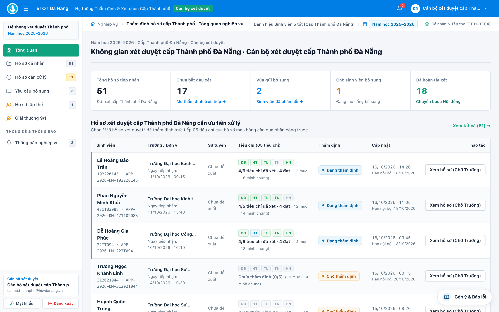
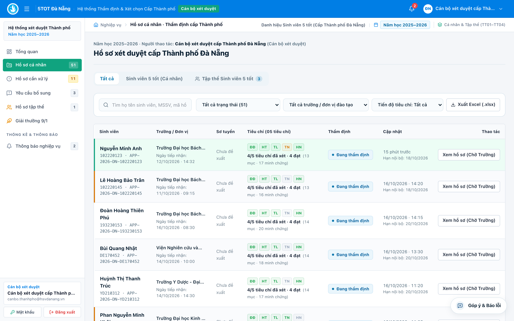
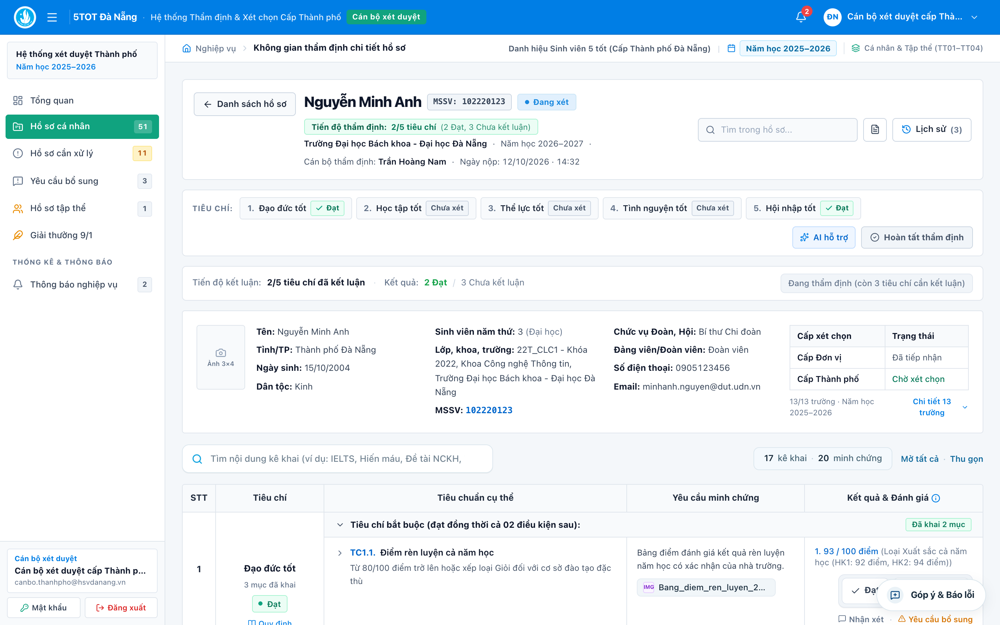
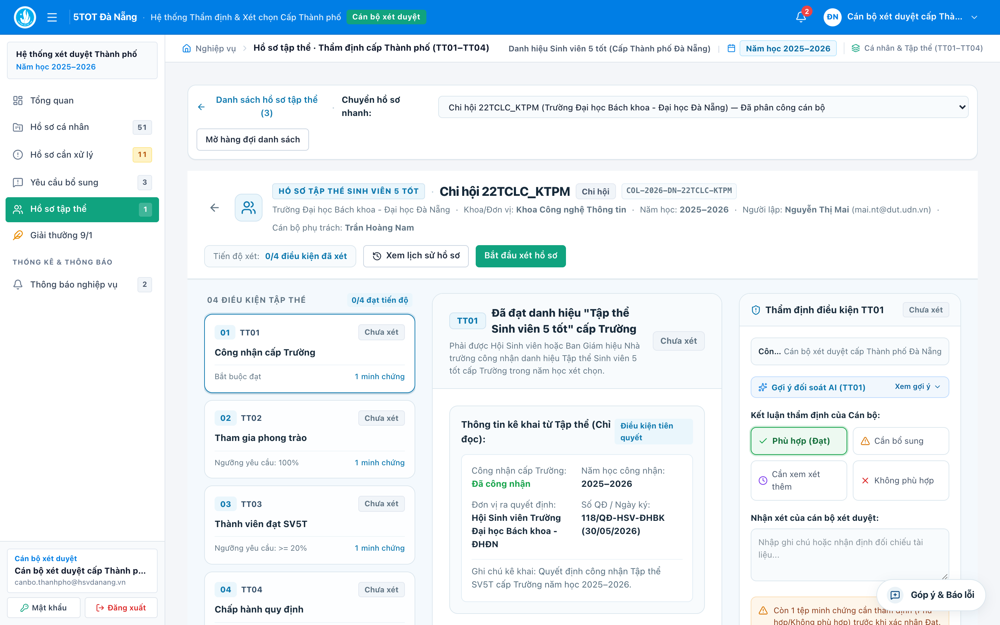
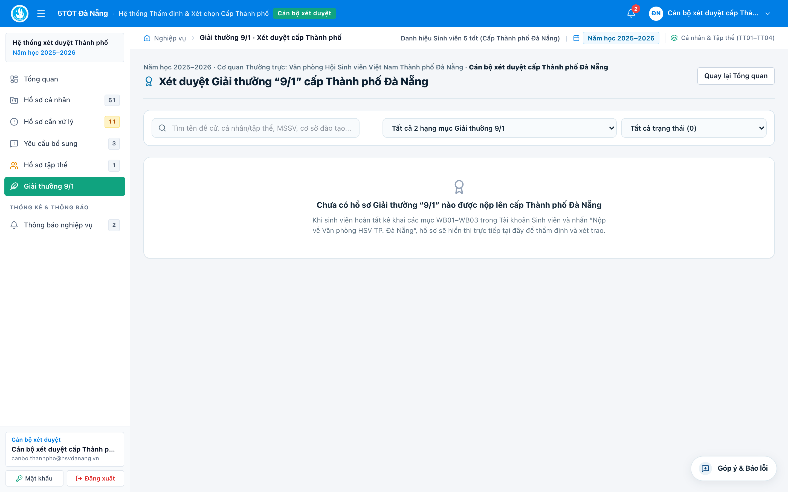
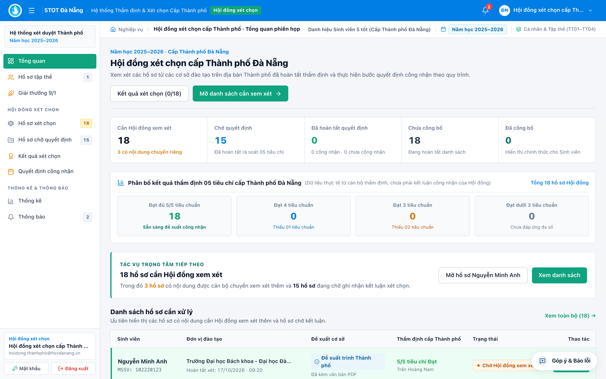
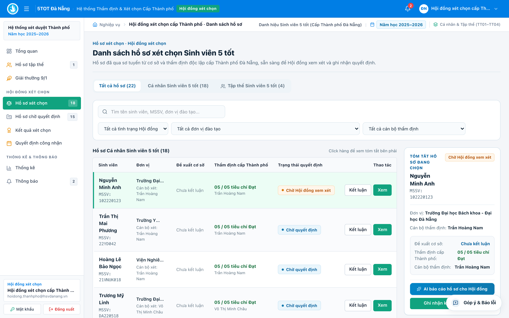
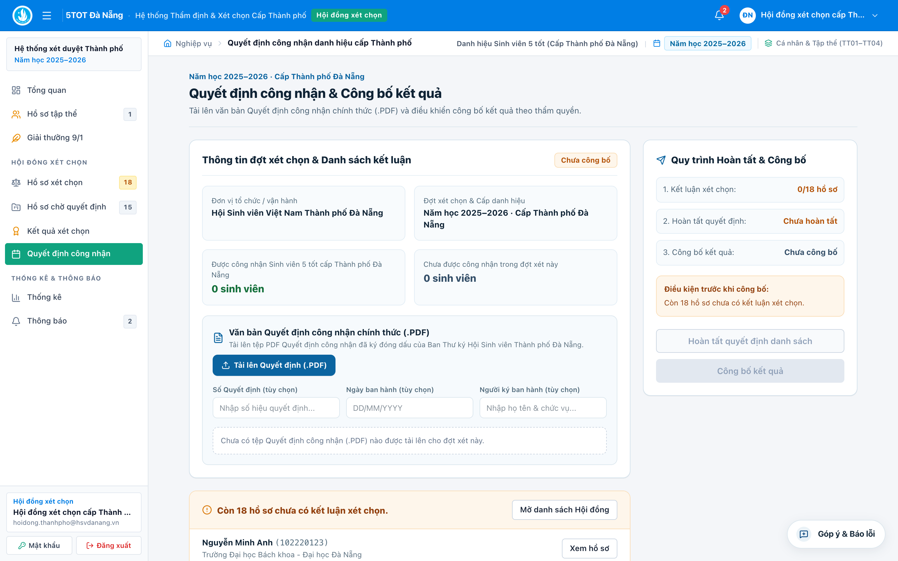
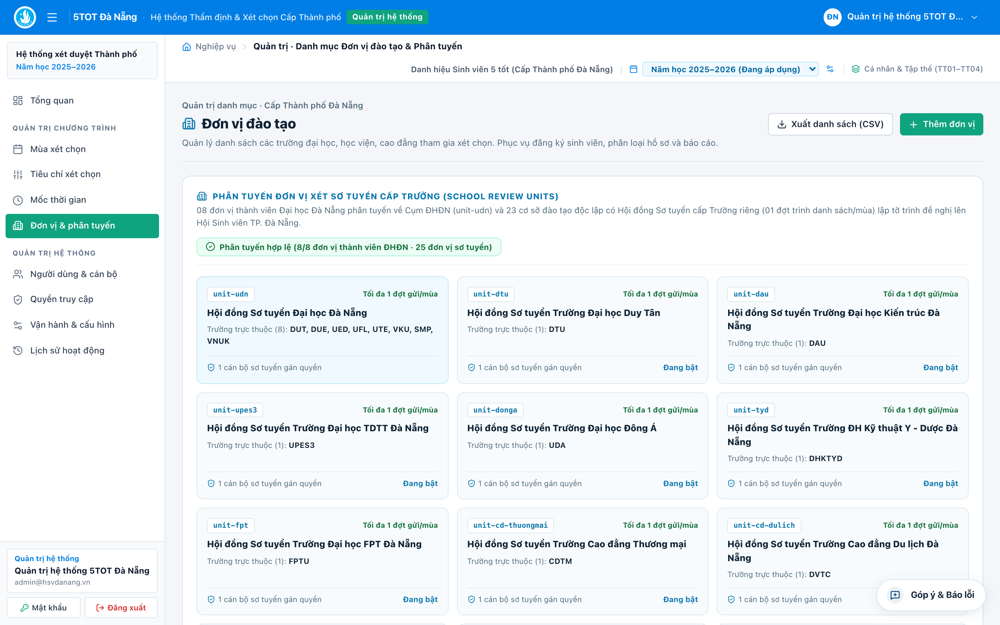

# HƯỚNG DẪN SỬ DỤNG HỆ THỐNG 5TOT ĐÀ NẴNG
## Dành cho Cán bộ Thẩm định Cấp Thành phố & Hội đồng Xét chọn Cấp Thành phố

**Hệ thống:** Cổng thông tin xét chọn Danh hiệu *"Sinh viên 5 tốt"*, *"Tập thể Sinh viên 5 tốt"* và *"Giải thưởng 9/1"* cấp Thành phố Đà Nẵng  
**Cơ quan chủ trì:** Ban Thư ký Hội Sinh viên Việt Nam Thành phố Đà Nẵng (Chỉ đạo: Thành Đoàn Đà Nẵng)  
**Đối tượng áp dụng:**
- **Phần I:** Cán bộ thẩm định & Quản lý nghiệp vụ cấp Thành phố (`CITY_OFFICER` / `CITY_MANAGER`).
- **Phần II:** Thành viên & Thường trực Hội đồng xét chọn cấp Thành phố (`CITY_COMMITTEE`).
- **Phụ lục:** Quản trị viên hệ thống (`ADMIN`).

---

## MỤC LỤC NHANH
- [Nguyên tắc phân quyền độc lập & Đổi mật khẩu lần đầu](#nguyên-tắc-phân-quyền-độc-lập--đổi-mật-khẩu-lần-đầu)
- [PHẦN I — HƯỚNG DẪN CÁN BỘ THẨM ĐỊNH CẤP THÀNH PHỐ](#phần-i--hướng-dẫn-cán-bộ-thẩm-định-cấp-thành-phố)
  1. [Điều phối Tổng quan & 03 Hàng đợi Giải thưởng](#1-điều-phối-tổng-quan--03-hàng-đợi-giải-thưởng)
  2. [Thẩm định Hồ sơ Cá nhân "Sinh viên 5 tốt" & Xem PDF Đơn vị](#2-thẩm-định-hồ-sơ-cá-nhân-sinh-viên-5-tốt--xem-pdf-đơn-vị)
  3. [Thẩm định Hồ sơ "Tập thể Sinh viên 5 tốt" (`TT01–TT04`)](#3-thẩm-định-hồ-sơ-tập-thể-sinh-viên-5-tốt-tt01tt04)
  4. [Thẩm định Hồ sơ "Giải thưởng 9/1" (`09/QĐ-HSVTP`)](#4-thẩm-định-hồ-sơ-giải-thưởng-91-09qđ-hsvtp)
- [PHẦN II — HƯỚNG DẪN HỘI ĐỒNG XÉT CHỌN CẤP THÀNH PHỐ](#phần-ii--hướng-dẫn-hội-đồng-xét-chọn-cấp-thành-phố)
  1. [Không gian làm việc của Hội đồng & Đối chiếu 2 cấp](#1-không-gian-làm-việc-của-hội-đồng--đối-chiếu-2-cấp)
  2. [Ghi nhận Kết luận Hội đồng cho 03 Luồng Giải thưởng](#2-ghi-nhận-kết-luận-hội-đồng-cho-03-luồng-giải-thưởng)
  3. [Ban hành Quyết định Công nhận, Công bố & Xuất Báo cáo](#3-ban-hành-quyết-định-công-nhận-công-bố--xuất-báo-cáo)
- [PHỤ LỤC — Quản trị Hệ thống & Cấp lại Mật khẩu (`ADMIN`)](#phụ-lục--quản-trị-hệ-thống--cấp-lại-mật-khẩu-admin)

---

## Nguyên tắc phân quyền độc lập & Đổi mật khẩu lần đầu

### 1. Cơ chế tách bạch thẩm định chuyên môn và quyết định công nhận
Để bảo đảm tính khách quan, minh bạch theo quy chế xét chọn cấp Thành phố, hệ thống tách riêng **02 nhóm vai trò độc lập**:

| Vai trò trên hệ thống | Thẩm quyền chính | Giới hạn kiểm soát chéo |
| :--- | :--- | :--- |
| **Cán bộ Thẩm định Thành phố** (`CITY_OFFICER` / `CITY_MANAGER`) | Kiểm tra chi tiết minh chứng từng tiêu chí, gửi yêu cầu bổ sung cho sinh viên/tập thể, chốt kết quả thẩm định chuyên môn để trình Hội đồng. | **Không** có quyền tự phê duyệt công nhận danh hiệu cuối cùng thay Hội đồng. |
| **Hội đồng Xét chọn Thành phố** (`CITY_COMMITTEE`) | Thẩm tra độc lập hồ sơ đã hoàn tất thẩm định, xem văn bản PDF đề nghị của đơn vị, ghi nhận **Kết luận Hội đồng** (*Công nhận / Không công nhận*) và phát hành **Quyết định công nhận**. | Hồ sơ ở chế độ **khóa chỉnh sửa chi tiết chuyên viên**, giữ nguyên vẹn lịch sử chấm của Đơn vị và Tổ thẩm định Thành phố. |

### 2. Đổi mật khẩu ngay lần đầu nhận tài khoản
- Sau khi đăng nhập tại cổng **5TOT Đà Nẵng**, bấm nút **`Đổi mật khẩu`** ở thanh menu trái (hoặc góc phải thanh điều hướng trên cùng) -> nhập *Mật khẩu hiện tại* và *Mật khẩu mới* ($\ge 8$ ký tự) -> bấm **Cập nhật mật khẩu**.

---

# PHẦN I — HƯỚNG DẪN CÁN BỘ THẨM ĐỊNH CẤP THÀNH PHỐ

## 1. Điều phối Tổng quan & 03 Hàng đợi Giải thưởng

Trên thanh menu dọc bên trái của tài khoản Cán bộ Thành phố gồm các phân khu chính:
- **`Tổng quan`:** Bảng theo dõi trực quan số lượng hồ sơ từ **24 đầu mối đơn vị sơ tuyển** (đại diện **31 trường ĐH, HV, CĐ** tại TP. Đà Nẵng), tiến độ thẩm định, số hồ sơ đang chờ bổ sung và số hồ sơ đã chuyển sang Hội đồng.
- **`Hồ sơ cá nhân`:** Hàng đợi thẩm định danh hiệu *"Sinh viên 5 tốt"* cấp Thành phố (các hồ sơ đã được đơn vị sơ tuyển trình chính thức kèm văn bản `.PDF`).
- **`Hồ sơ tập thể`:** Hàng đợi thẩm định danh hiệu *"Tập thể Sinh viên 5 tốt"* cấp Thành phố (nộp trực tiếp lên Thành phố).
- **`Giải thưởng 9/1`:** Hàng đợi thẩm định *"Giải thưởng 9/1"* cấp Thành phố (nộp trực tiếp lên Thành phố).

---

## 2. Thẩm định Hồ sơ Cá nhân "Sinh viên 5 tốt" & Xem PDF Đơn vị

*(Căn cứ tiêu chuẩn tại Hướng dẫn số **14-HD/BTK-HSVTP**)*

### Bước 1: Lọc hàng đợi & Mở hồ sơ thẩm định
1. Mở menu **`Hồ sơ cá nhân`**.
2. Sử dụng bộ lọc trên đầu bảng để phân loại công việc:
   - Lọc theo **Đơn vị sơ tuyển** (*Đại học Đà Nẵng* hoặc một trong *23 trường ĐH/HV/CĐ độc lập*) hoặc lọc chi tiết theo **Trường đào tạo gốc** (31 trường).
   - Lọc theo **Trạng thái thẩm định** (*Chờ thẩm định*, *Đang thẩm định*, *Chờ sinh viên bổ sung*, *Đã hoàn tất thẩm định*).
3. Bấm nút **`Thẩm định`** / **`Mở thẩm định`** tại cột **Thao tác** bên phải dòng sinh viên.

### Bước 2: Kiểm tra Văn bản đề nghị (`.PDF`) & Kết quả sơ tuyển của Đơn vị
- Ngay tại khung thông tin màu xanh phía trên đầu hồ sơ (hiển thị kết quả *Đơn vị đã đề xuất chuyển cấp Thành phố*), bấm nút **`Xem văn bản đề nghị (.PDF) & sơ tuyển`**.
- Cửa sổ xem trực tiếp mở ra tệp **Văn bản / Tờ trình / Quyết định đề nghị (`.PDF`) có chữ ký và dấu xác nhận** mà đơn vị sơ tuyển đã đính kèm khi trình danh sách, giúp chuyên viên Thành phố đối chiếu tính pháp lý ngay trên màn hình mà không cần tra cứu hồ sơ giấy.

### Bước 3: Chấm thẩm định độc lập trên Bảng 5 Cột
1. Nếu mới mở hồ sơ lần đầu, bấm **`Bắt đầu xét duyệt`**.
2. Có thể bấm nút **`AI hỗ trợ`** trên thanh tác vụ đầu hồ sơ để xem nhanh kết quả kiểm tra tự động các chỉ số cứng (*ĐRL $\ge 80$; GPA $\ge 3.2/4.0$ đối với ĐH/HV hoặc $\ge 3.0/4.0$ đối với CĐ; tổng ngày tình nguyện $\ge 5$ ngày hoặc giấy khen tình nguyện cấp Khoa/Trường+; ngoại ngữ chuẩn B1*).
3. Tại cột **Kết quả** của Bảng 5 cột:
   - Mở xem trực tiếp từng minh chứng (bảng điểm, chứng chỉ ngoại ngữ, giấy xác nhận tình nguyện, giấy khen...).
   - Đánh giá độc lập cấp Thành phố bằng nút **`✓ Đạt`**, **`✕ Không đạt`** hoặc ghi **`Nhận xét`** thẩm định cho từng mục.
   - Chọn **Kết luận thẩm định** (`Đạt` / `Không đạt`) cho đủ cả **5/5 nhóm tiêu chí**.

### Bước 4: Gửi Yêu cầu bổ sung minh chứng (khi cần làm rõ)
1. Nếu phát hiện minh chứng thiếu trang, chưa có dấu mộc hợp lệ hoặc cần giải trình thêm:
   - Bấm nút **`Yêu cầu bổ sung`** trên thanh công cụ hoặc ngay tại tiêu chí tương ứng.
   - Nhập nội dung hướng dẫn cụ thể những giấy tờ sinh viên cần cung cấp thêm và chọn **Hạn chót bổ sung**.
2. Khi bấm **Xác nhận gửi yêu cầu**:
   - Hệ thống tự động gửi thông báo đẩy trên cổng sinh viên **đồng thời gửi Email thông báo** tới hộp thư của sinh viên (cán bộ cũng có thể dùng nút *Sao chép nội dung email* nếu cần gửi nhắc qua kênh liên lạc đơn vị).
   - Ngay khi sinh viên tải bổ sung minh chứng và gửi lại, trạng thái hồ sơ tự động báo cập nhật mới để chuyên viên vào kiểm tra tiếp.

### Bước 5: Hoàn tất thẩm định chuyển Hội đồng Xét chọn
- Khi thanh tiến độ đầu trang đạt đủ **`5/5 tiêu chí đã kết luận`** và không còn yêu cầu bổ sung đang mở, bấm nút **`Hoàn tất thẩm định`**.
- Xác nhận kết quả thẩm định của Tổ chuyên viên (*Đủ điều kiện trình Hội đồng công nhận* hoặc *Không đủ điều kiện trình công nhận* kèm lý do chuyên môn). Hồ sơ lập tức chuyển sang hàng đợi của **Hội đồng xét chọn cấp Thành phố**.

---

## 3. Thẩm định Hồ sơ "Tập thể Sinh viên 5 tốt" (`TT01–TT04`)

*(Căn cứ Quyết định số **86/QĐ-HSVTP** — Hồ sơ nộp thẳng lên Thành phố)*

1. Mở menu **`Hồ sơ tập thể`**, lọc theo trường đào tạo, loại hình tập thể (*Liên chi hội, Chi hội, CLB/Đội/Nhóm*) hoặc trạng thái xử lý -> bấm mở chi tiết tập thể.
2. Kiểm tra lần lượt minh chứng của **04 tiêu chuẩn bắt buộc**:
   - **`TT01`:** Quyết định công nhận danh hiệu *"Tập thể Sinh viên 5 tốt"* cấp Trường/Đơn vị trong năm học.
   - **`TT02`:** Minh chứng **100%** sinh viên của tập thể đăng ký tham gia phong trào *"Sinh viên 5 tốt"*.
   - **`TT03`:** Đối chiếu tỷ lệ tối thiểu **20%** sinh viên thuộc tập thể đạt danh hiệu *"Sinh viên 5 tốt"* từ cấp Trường trở lên (kiểm tra khớp số lượng thực tế trên Quyết định công nhận đính kèm).
   - **`TT04`:** Văn bản xác nhận tập thể không có sinh viên vi phạm pháp luật hoặc bị kỷ luật từ mức Cảnh cáo trở lên.
3. Nếu thiếu xác nhận, bấm **`Yêu cầu bổ sung`** để đại diện tập thể hoàn thiện; khi đã rà soát đủ 4/4 tiêu chuẩn, ghi nhận nhận xét thẩm định và bấm **`Hoàn tất thẩm định`** để chuyển sang Hội đồng.

---

## 4. Thẩm định Hồ sơ "Giải thưởng 9/1" (`09/QĐ-HSVTP`)

*(Căn cứ Quyết định số **09/QĐ-HSVTP** — Hồ sơ nộp thẳng lên Thành phố)*

1. Mở menu **`Giải thưởng 9/1`**, sử dụng bộ lọc để xem theo **02 hạng mục xét trao chính thức**:
   - **Hạng mục 1 — Cán bộ Hội, Đoàn tiêu biểu (`TRUYEN_LUA`):** Kiểm tra đủ 03 nhóm tiêu chuẩn bắt buộc gồm `WB01` (Đạo đức, học tập, rèn luyện), `WB02` (Thời gian giữ chức vụ cán bộ Hội/Đoàn tích lũy $\ge 24$ tháng & đóng góp thực tế), `WB03` (Thành tích khen thưởng tối thiểu 02 năm học liên tiếp).
   - **Hạng mục 2 — Mô hình, giải pháp, sáng kiến công tác Hội hiệu quả (`UOM_MAM`):** Kiểm tra bắt buộc `WB01` (Thuyết minh tính mới, sáng tạo của mô hình/giải pháp) và `WB02` (Minh chứng kết quả áp dụng thực tiễn, độ lan tỏa, xác nhận của đơn vị); xem xét cộng điểm đối với `WB03` (Bằng khen/giấy khen, nhân rộng mô hình nếu có).
2. Thực hiện chấm thẩm định từng tiêu chuẩn, gửi yêu cầu bổ sung nếu cần, và bấm **`Hoàn tất thẩm định`** để trình lên Hội đồng xét chọn.

---

# PHẦN II — HƯỚNG DẪN HỘI ĐỒNG XÉT CHỌN CẤP THÀNH PHỐ

## 1. Không gian làm việc của Hội đồng & Đối chiếu 2 cấp

1. Sau khi đăng nhập bằng tài khoản Hội đồng (`CITY_COMMITTEE`), mở:
   - **`Tổng quan`:** Xem toàn cảnh số lượng hồ sơ đã qua thẩm định sẵn sàng họp Hội đồng ở cả 03 luồng (*Cá nhân SV5T, Tập thể SV5T, Giải thưởng 9/1*), tỷ lệ đề xuất đạt và thống kê phân bổ theo 24 đơn vị / 31 trường đào tạo.
   - **`Hồ sơ xét chọn`:** Màn hình làm việc trung tâm phục vụ phiên họp Hội đồng, gồm **03 tab chuyển đổi nhanh** tương ứng với 3 giải thưởng.

2. Cách tra cứu và thẩm tra nhanh một hồ sơ trong phiên họp:
   - Bấm vào bất kỳ dòng hồ sơ nào trong bảng để xem **Thẻ tóm tắt thẩm định bên phải**, hoặc bấm mở **Không gian chi tiết hồ sơ Hội đồng**.
   - **Đối chiếu song song 2 cấp:** Hệ thống hiển thị rõ kết quả **Sơ tuyển cấp Đơn vị** đặt cạnh kết quả **Thẩm định chuyên viên Thành phố** trên từng tiêu chí (những hồ sơ có ý kiến khác nhau giữa 2 cấp hoặc trường hợp sát ngưỡng được làm nổi bật để Hội đồng thảo luận kỹ).
   - **Kiểm tra Văn bản PDF đề nghị của Đơn vị:** Tại khu vực *Lịch sử & Văn bản pháp lý*, bấm nút **`Xem văn bản đính kèm`** để xem trực tiếp tệp `.PDF` Tờ trình / Quyết định đề nghị có dấu đỏ của đơn vị sơ tuyển.
   - **Báo cáo tóm tắt nhanh:** Bấm **`AI báo cáo hồ sơ`** để xem bản tổng hợp ngắn gọn các thành tích tiêu biểu, điểm ưu tiên và các lưu ý chuyên môn của ứng viên.

---

## 2. Ghi nhận Kết luận Hội đồng cho 03 Luồng Giải thưởng

Tại màn hình **`Hồ sơ xét chọn`** (áp dụng thống nhất cho cả 3 tab *Cá nhân SV5T*, *Tập thể SV5T* và *Giải thưởng 9/1*):

1. Tại dòng hồ sơ cần chốt kết quả (hoặc bên trong màn hình chi tiết hồ sơ), bấm nút **`Kết luận`** ở cột **Thao tác**.
2. Trong hộp thoại **Ghi nhận Kết luận Hội đồng**:
   - Lựa chọn quyết định chính thức của Hội đồng:
     - **`Công nhận`** *(Đạt danh hiệu "Sinh viên 5 tốt" cấp Thành phố / "Tập thể Sinh viên 5 tốt" cấp Thành phố / Đạt "Giải thưởng 9/1" cấp Thành phố)*.
     - **`Không công nhận`** *(Không đạt — bắt buộc nhập rõ lý do chuyên môn theo biên bản họp Hội đồng)*.
   - Nhập **Ghi chú biên bản Hội đồng** (số phiếu biểu quyết hoặc ý kiến thống nhất của Hội đồng nếu có).
3. Bấm **`Lưu kết luận Hội đồng`**. Trạng thái dòng hồ sơ chuyển ngay sang nhãn đã có kết luận Hội đồng để Thường trực dễ dàng kiểm đếm số lượng công nhận theo thời gian thực ngay trong cuộc họp.

---

## 3. Ban hành Quyết định Công nhận, Công bố & Xuất Báo cáo

Sau khi Hội đồng hoàn tất kết luận cho các hồ sơ trong đợt xét chọn:

### 3.1. Lập & Công bố Quyết định công nhận (`Quyết định công nhận`)
1. Mở menu **`Quyết định công nhận`** ở thanh bên trái.
2. Kiểm tra danh sách tổng hợp các cá nhân, tập thể và mô hình đã được Hội đồng kết luận **Công nhận**.
3. Nhập thông tin pháp lý của Quyết định khen thưởng:
   - **Số hiệu Quyết định:** Ví dụ `.../QĐ-HSVTP`.
   - **Ngày ký ban hành** và **Chức danh / Họ tên người ký** (*Chủ tịch Hội Sinh viên Việt Nam Thành phố Đà Nẵng* / *TM. Ban Thư ký Hội Sinh viên Việt Nam TP. Đà Nẵng*).
   - Đính kèm tệp `.PDF` Quyết định công nhận chính thức đã ký đóng dấu (nếu có).
4. Bấm **`Ban hành & Công bố kết quả`** để đồng bộ kết quả chính thức sang cổng tra cứu của sinh viên, tập thể và các đơn vị trực thuộc.

### 3.2. Xuất Danh sách khen thưởng, Phôi Bằng khen & Báo cáo (`Kết quả xét chọn` & `Thống kê`)
- Tại menu **`Kết quả xét chọn`** và **`Thống kê`**, Thường trực Hội đồng và Tổ thư ký có thể:
  - Xuất danh sách sinh viên, tập thể đạt danh hiệu và Giải thưởng 9/1 ra tệp **Excel / CSV** chuẩn hóa (tách rõ *Họ tên, MSSV, Khoa, Trường đào tạo gốc, Đơn vị đầu mối, Điểm GPA, ĐRL, Hạng mục khen thưởng, Số Quyết định*) để phục vụ in **Bằng khen, Giấy chứng nhận** và làm thủ tục khen thưởng.
  - Xem biểu đồ thống kê tỷ lệ đạt theo từng trường trong 31 cơ sở đào tạo để phục vụ báo cáo tổng kết năm học của Ban Thư ký Hội Sinh viên Việt Nam Thành phố Đà Nẵng.

---

## PHỤ LỤC — Quản trị Hệ thống & Cấp lại Mật khẩu (`ADMIN`)

Dành cho cán bộ kỹ thuật / Văn phòng Hội Sinh viên Thành phố giữ tài khoản **Quản trị viên (`ADMIN`)**:
- **Quản lý Tài khoản Cán bộ (`Người dùng & Phân quyền`):** Tạo mới, khóa/mở khóa hoặc phân quyền lại cho tài khoản Cán bộ Sơ tuyển của 24 đơn vị, Cán bộ Thẩm định Thành phố và Thành viên Hội đồng; hỗ trợ **Đặt lại mật khẩu (Reset Password)** trực tiếp khi cán bộ đơn vị thay đổi nhân sự phụ trách.
- **Quản lý Đợt xét chọn (`Mùa xét chọn`):** Mở/đóng cổng tiếp nhận hồ sơ theo năm học, điều chỉnh mốc thời gian nộp hồ sơ sinh viên, hạn sơ tuyển đơn vị và hạn thẩm định cấp Thành phố.
- **Nhật ký kiểm toán (`Nhật ký kiểm toán`):** Tra cứu toàn bộ lịch sử thao tác nộp hồ sơ, chấm duyệt, đính kèm văn bản `.PDF` trình danh sách và kết luận Hội đồng theo thời gian thực để phục vụ kiểm tra, giám sát.

