# HƯỚNG DẪN CÁN BỘ THÀNH PHỐ & HỘI ĐỒNG
**Hệ thống xét chọn Sinh viên 5 tốt cấp Thành phố Đà Nẵng · Năm học 2025–2026**
**Dành cho Cán bộ thẩm định, Hội đồng xét chọn và Quản trị viên**

---

## SLIDE 01 — HƯỚNG DẪN CÁN BỘ THÀNH PHỐ & HỘI ĐỒNG

- **Hệ thống:** Hệ thống xét chọn Sinh viên 5 tốt cấp Thành phố Đà Nẵng.
- **Đối tượng sử dụng:** Dành cho **Cán bộ thẩm định cấp Thành phố**, **Hội đồng xét chọn** và **Quản trị viên hệ thống**.

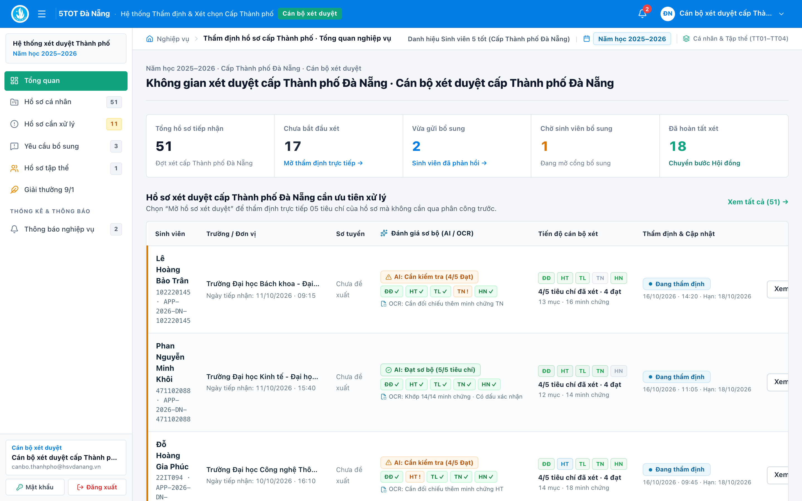
*Giao diện tổng quan công tác thẩm định cấp Thành phố.*

---

## SLIDE 02 — PHÂN QUYỀN TRÊN HỆ THỐNG

| Vai trò | Nhiệm vụ chính trên hệ thống |
| :--- | :--- |
| **1. Cán bộ Thành phố** (`CITY_OFFICER`) | Tiếp nhận danh sách từ các đơn vị, thẩm định hồ sơ cá nhân Sinh viên 5 tốt, hồ sơ Tập thể Sinh viên 5 tốt (`TT01–TT04`) và gửi yêu cầu bổ sung minh chứng. |
| **2. Hội đồng** (`CITY_COMMITTEE`) | Xem xét hồ sơ đã hoàn tất thẩm định, ghi nhận kết luận công nhận / không công nhận, ban hành Quyết định công nhận và công bố kết quả. |
| **3. Quản trị viên** (`ADMIN`) | Quản lý tài khoản người dùng & phân quyền đơn vị, cấu hình mùa xét & bộ tiêu chí, tra cứu nhật ký kiểm toán hệ thống. |

*Ba nhóm vai trò và nhiệm vụ chính trên hệ thống.*

---

## SLIDE 03 — ĐĂNG NHẬP & BẢO MẬT TÀI KHOẢN

1. **Đăng nhập** bằng email và mật khẩu được cấp `①`.
2. **Chọn Đổi mật khẩu** sau lần đăng nhập đầu tiên `②`.
3. **Cập nhật mật khẩu mới** tối thiểu **8 ký tự**.

| ① Màn hình Đăng nhập hệ thống | ② Hộp thoại Đổi mật khẩu tài khoản |
| :---: | :---: |
| 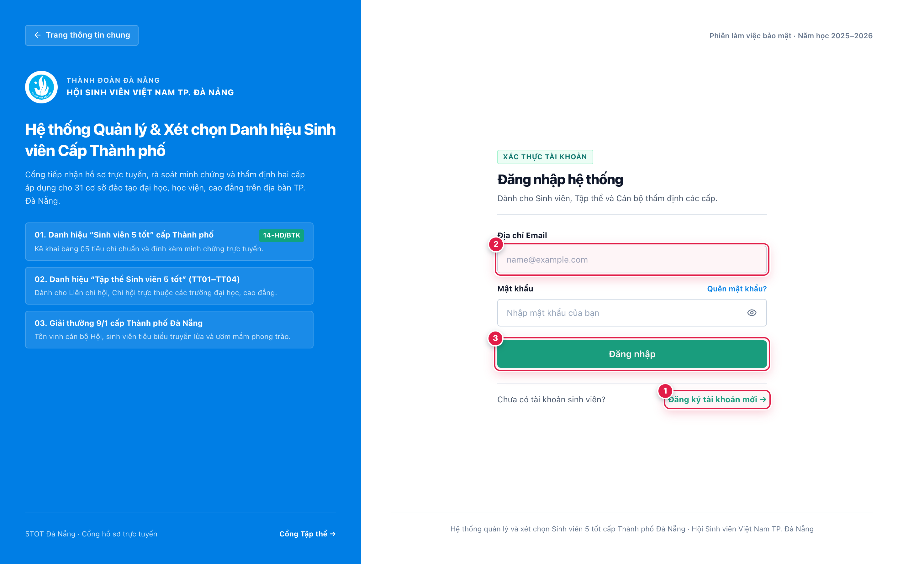 | 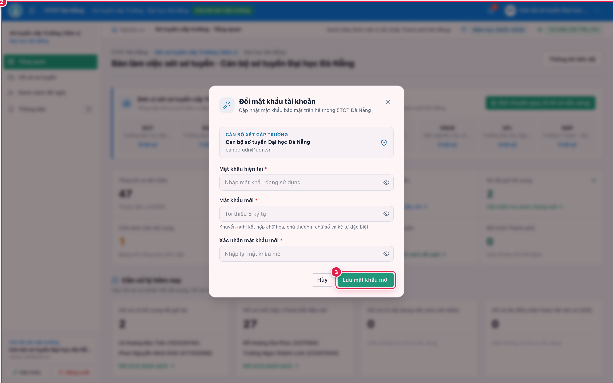 |

*Đăng nhập tài khoản và đổi mật khẩu khi sử dụng lần đầu.*

---

## SLIDE 04 — TỔNG QUAN CÔNG TÁC THẨM ĐỊNH

1. **Theo dõi số lượng và tiến độ xử lý hồ sơ** trên toàn Thành phố `②` -> `③`.
2. **Xem hồ sơ chờ xét, đang xét và chờ bổ sung** theo thời gian thực.
3. **Truy cập các nhóm hồ sơ** theo phân quyền trên thanh điều hướng bên trái `①`.

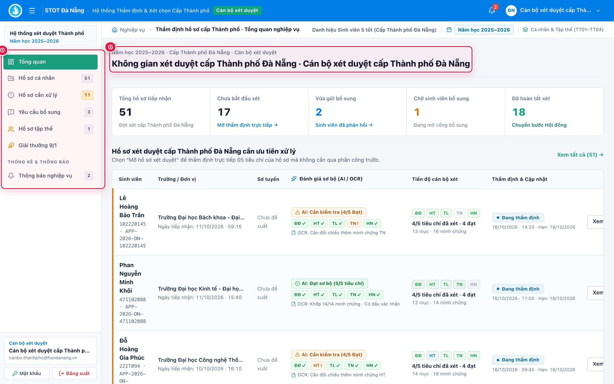
*Tổng quan tiến độ thẩm định hồ sơ cấp Thành phố.*

---

## SLIDE 05 — TIẾP NHẬN HỒ SƠ CÁ NHÂN

1. **Mở Hồ sơ cá nhân** `①` trên thanh menu bên trái.
2. **Lọc theo đơn vị, trường đào tạo hoặc trạng thái** `②` (hỗ trợ đầy đủ các trường Đại học, Học viện, Cao đẳng tại Đà Nẵng và khu vực Quảng Nam).
3. **Chọn Thẩm định / Mở thẩm định** `③` ở từng dòng để xử lý chi tiết.

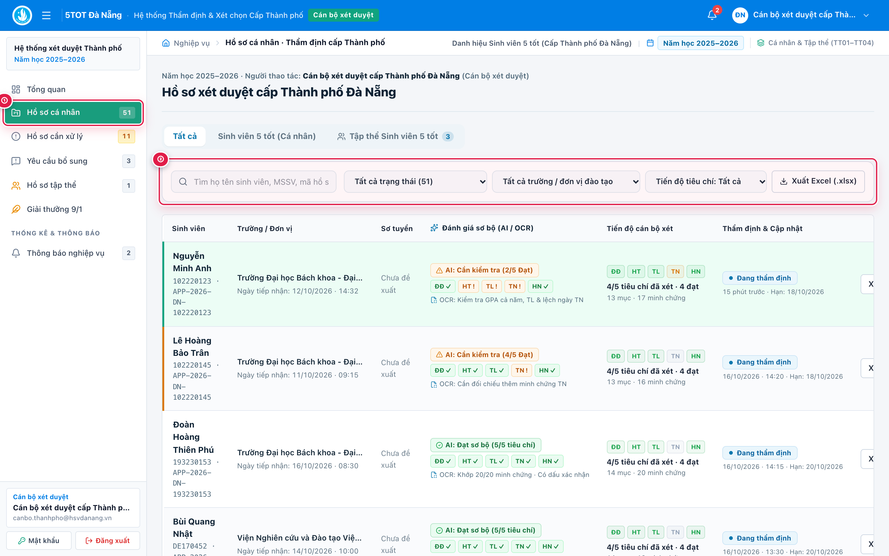
*Tìm kiếm, lọc và mở hồ sơ cá nhân cần thẩm định.*

---

## SLIDE 06 — KIỂM TRA VĂN BẢN ĐỀ NGHỊ

1. **Mở Văn bản đề nghị (.PDF) & sơ tuyển** `①` ở vùng đầu hồ sơ.
2. **Kiểm tra chữ ký, dấu xác nhận và thông tin danh sách** `②` do đơn vị trình lên.
3. **Đối chiếu kết quả đề xuất của đơn vị** trước khi chấm thẩm định cấp Thành phố.

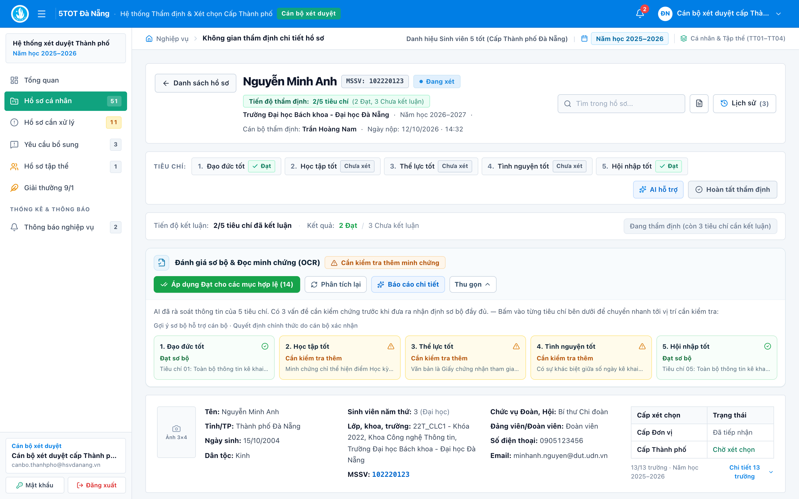
*Kiểm tra văn bản đề nghị và thông tin sơ tuyển của đơn vị.*

---

## SLIDE 07 — THẨM ĐỊNH 5 TIÊU CHÍ

1. **Nhấn Bắt đầu xét duyệt** (nếu hồ sơ mở lần đầu).
2. **Xem minh chứng** `①`, chọn **Đạt / Không đạt** `②` (kết hợp tham khảo nhãn đánh giá sơ bộ của AI trên từng hàng).
3. **Ghi nhận xét và kết luận đủ 5/5 tiêu chí** `③`.
4. **Lưu ý:** *AI hỗ trợ chỉ mang tính tham khảo.*

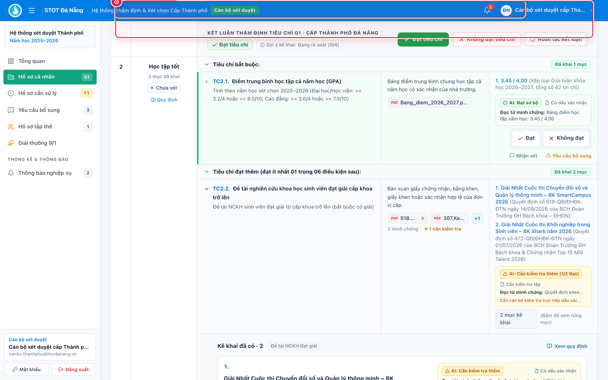
*Đối chiếu minh chứng và đánh giá lần lượt 5 tiêu chí.*

---

## SLIDE 08 — YÊU CẦU BỔ SUNG MINH CHỨNG

1. **Chọn Yêu cầu bổ sung** `①` tại tiêu chí cần làm rõ.
2. **Nhập nội dung** `②` và **hạn chót bổ sung** `③`.
3. **Nhấn Gửi yêu cầu** `④`, sau đó kiểm tra lại khi hồ sơ được sinh viên nộp bổ sung.

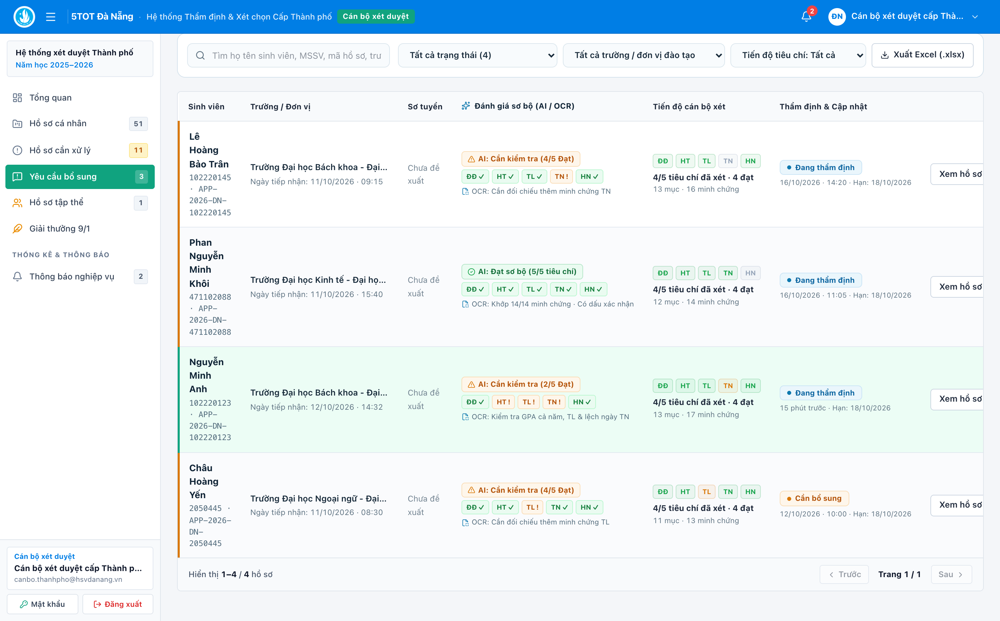
*Gửi yêu cầu bổ sung minh chứng cho sinh viên.*

---

## SLIDE 09 — HOÀN TẤT THẨM ĐỊNH CÁ NHÂN

1. **Kiểm tra đủ 5/5 tiêu chí đã kết luận** `①`.
2. **Đảm bảo không còn yêu cầu bổ sung đang mở**.
3. **Nhấn Hoàn tất thẩm định** `②` và xác nhận kết quả trong hộp thoại `③` để chuyển hồ sơ tới Hội đồng.

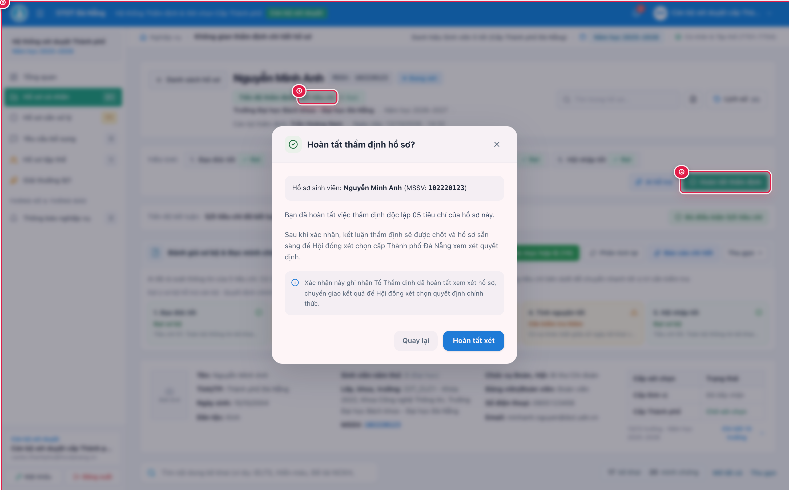
*Hoàn tất thẩm định chuyên môn và chuyển hồ sơ tới Hội đồng.*

---

## SLIDE 10 — THẨM ĐỊNH HỒ SƠ TẬP THỂ

1. **Mở Hồ sơ tập thể** trên thanh điều hướng.
2. **Kiểm tra bốn tiêu chuẩn `TT01–TT04`** `①`:
   - `TT01`: Danh hiệu thi đua / Khen thưởng tập thể.
   - `TT02`: Tỷ lệ sinh viên tham gia phong trào Sinh viên 5 tốt.
   - `TT03`: Số lượng sinh viên đạt danh hiệu Sinh viên 5 tốt cấp Trường trở lên.
   - `TT04`: Không có sinh viên vi phạm pháp luật hoặc kỷ luật từ mức cảnh cáo trở lên.
3. **Yêu cầu bổ sung nếu cần; hoàn tất thẩm định** `②`.

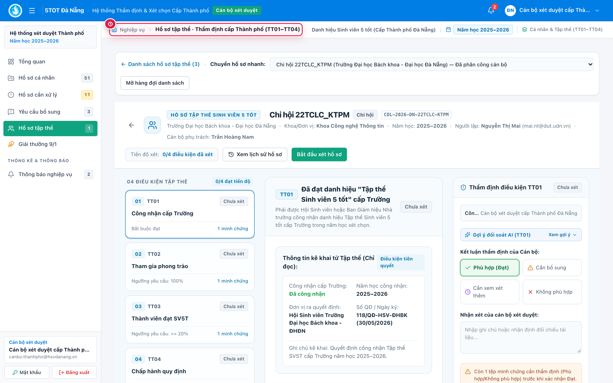
*Thẩm định hồ sơ Tập thể Sinh viên 5 tốt theo TT01–TT04.*

---

## SLIDE 11 — HỘI ĐỒNG TRA CỨU HỒ SƠ

1. **Mở Hồ sơ xét chọn** `①` và chọn nhóm danh hiệu (Cá nhân / Tập thể Sinh viên 5 tốt).
2. **Xem tóm tắt, kết quả thẩm định 02 cấp và minh chứng** `②`.
3. **Kiểm tra văn bản pháp lý trước khi kết luận** `③`.

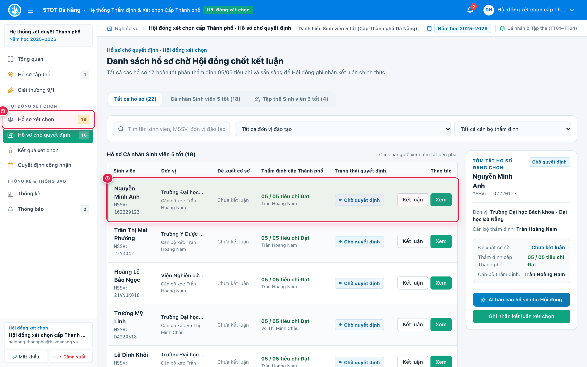
*Hội đồng xem hồ sơ và kết quả thẩm định trước khi kết luận.*

---

## SLIDE 12 — GHI NHẬN KẾT LUẬN HỘI ĐỒNG

1. **Chọn hồ sơ và nhấn Kết luận** (`Ghi nhận kết luận xét chọn`) `①`.
2. **Chọn Công nhận hoặc Không công nhận** `②`.
3. **Nhập lý do, ghi chú khi cần** `③` và nhấn **Lưu kết luận** `④`.

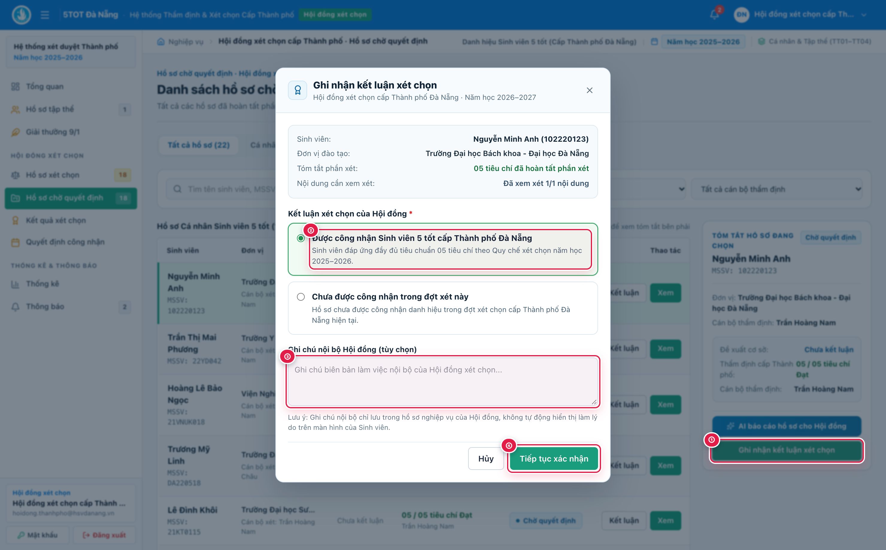
*Ghi nhận kết luận chính thức của Hội đồng xét chọn.*

---

## SLIDE 13 — BAN HÀNH & CÔNG BỐ KẾT QUẢ

1. **Mở Quyết định công nhận** `①` và kiểm tra danh sách được công nhận.
2. **Nhập số quyết định, ngày ký và người ký** `②`.
3. **Đính kèm PDF nếu có** `③`; nhấn **Ban hành & Công bố** `④`.

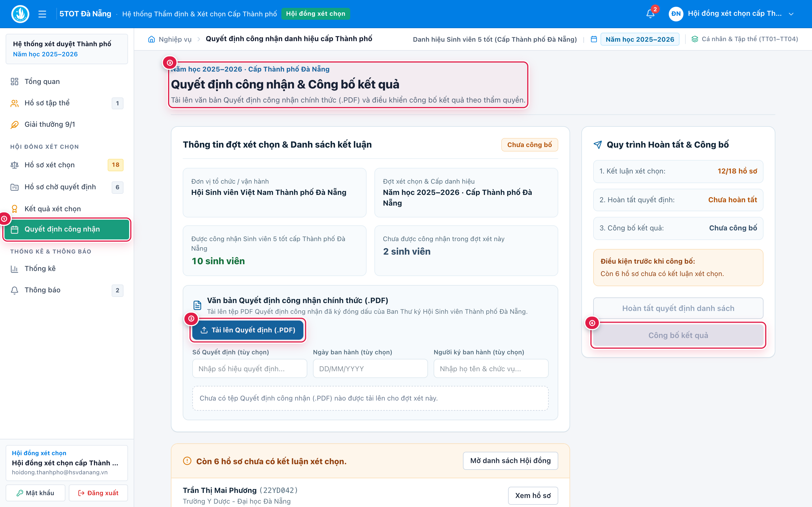
*Lập, ban hành Quyết định công nhận và công bố kết quả.*

---

## SLIDE 14 — XUẤT DANH SÁCH & THỐNG KÊ

1. **Mở Kết quả xét chọn & Thống kê** `①`.
2. **Xuất danh sách khen thưởng Excel / CSV** `②`.
3. **Theo dõi số lượng và tỷ lệ đạt theo đơn vị** `③`.

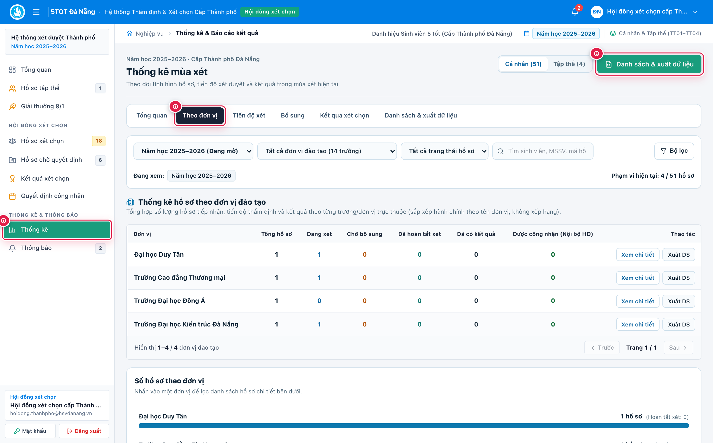
*Xuất danh sách khen thưởng và xem thống kê xét chọn.*

---

## SLIDE 15 — QUẢN TRỊ HỆ THỐNG

1. **Quản lý tài khoản, vai trò và mật khẩu** (`Người dùng & Phân quyền`) `①` -> `②`.
2. **Cấu hình mùa xét và thời gian tiếp nhận** (`Mùa xét & Tiêu chí`).
3. **Tra cứu nhật ký thao tác** (`Nhật ký kiểm toán`) `③`.

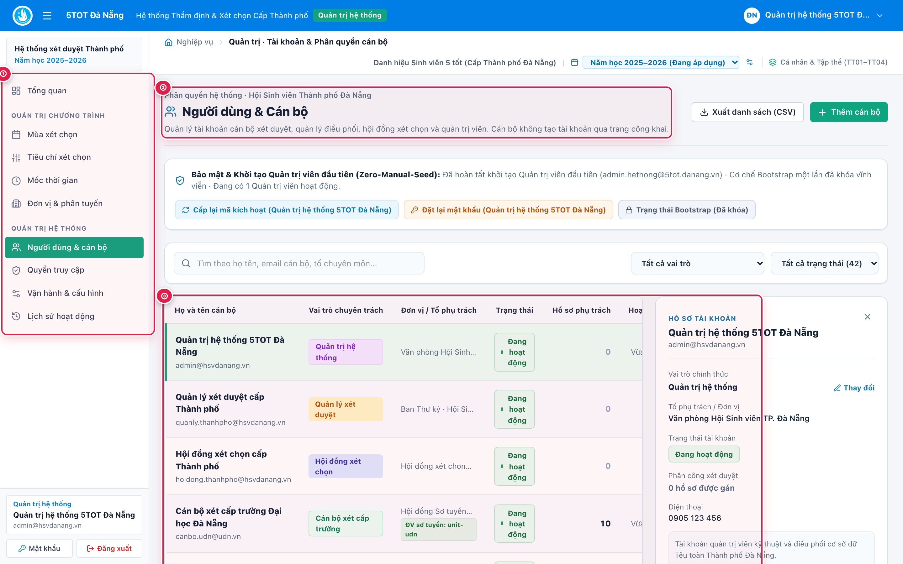
*Quản lý người dùng, mùa xét và nhật ký hệ thống.*
