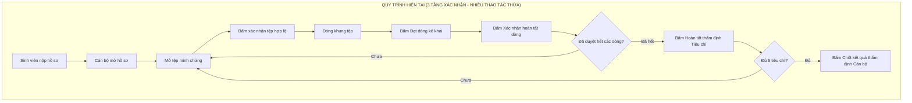
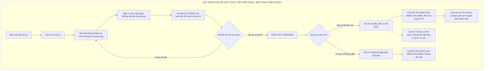
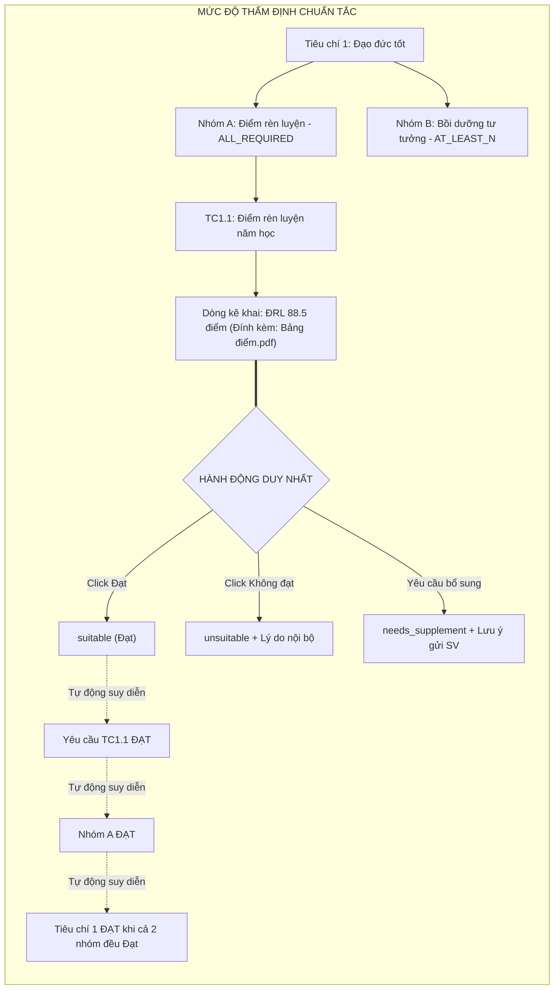
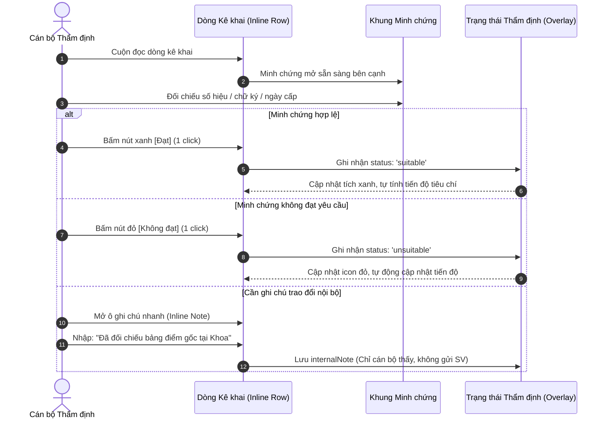
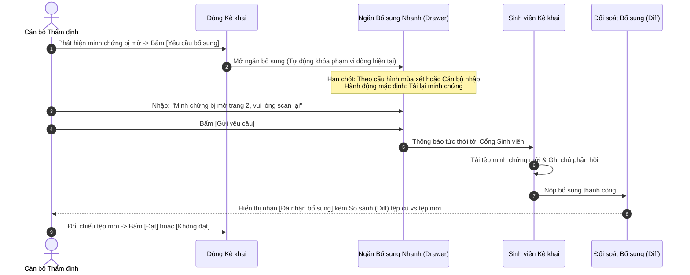
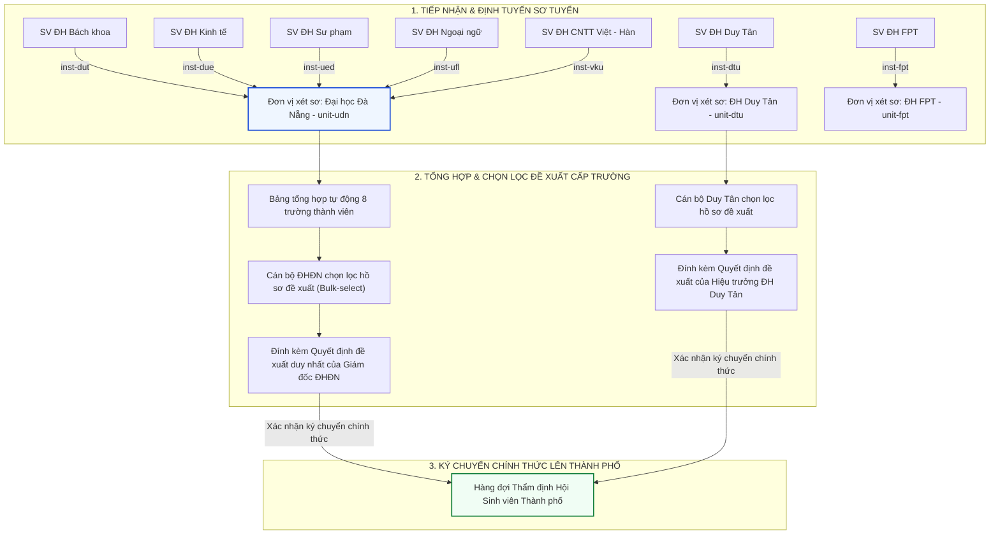
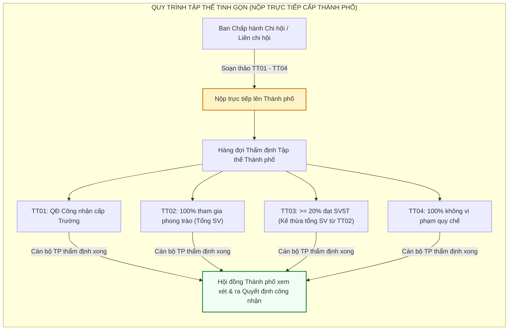
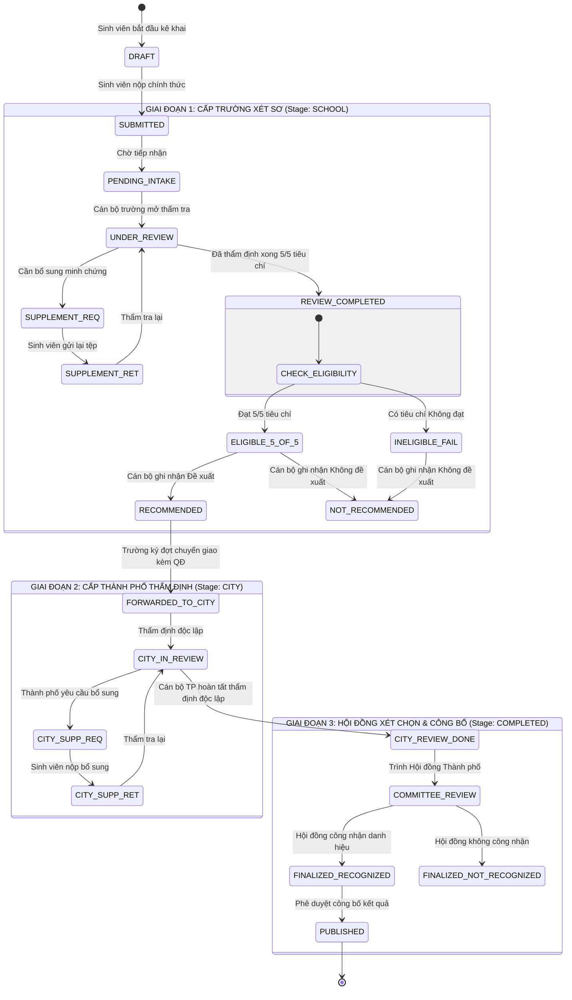
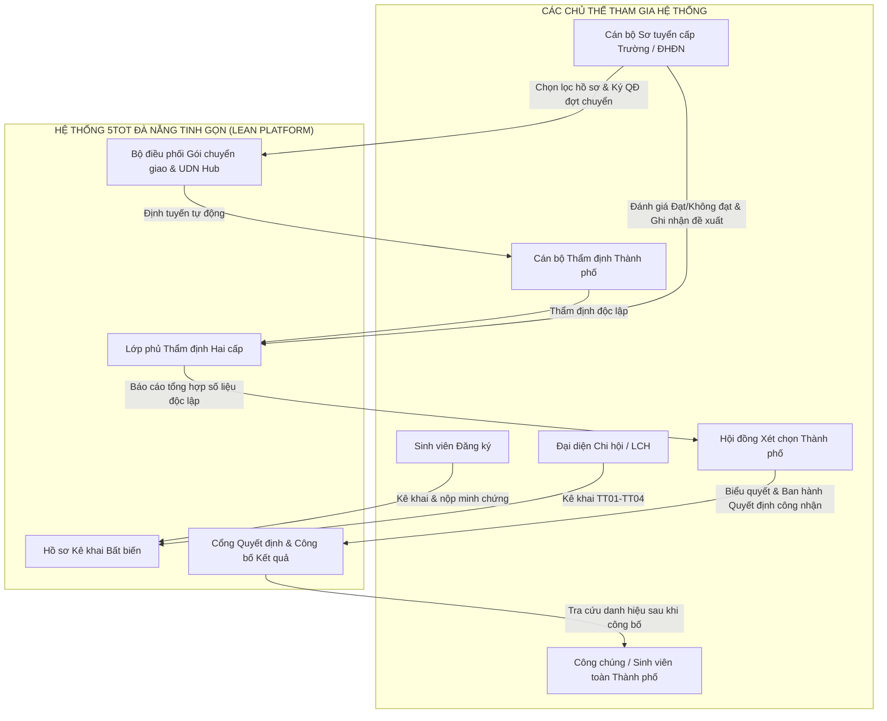

# LEAN-0.1: SƠ ĐỒ QUY TRÌNH TRƯỚC VÀ SAU TINH GIẢN
## (Before/After Business Process Flows: 8 Canonical Mermaid Diagrams — Corrected)

**Cơ quan quản lý:** Thành Đoàn Đà Nẵng  
**Đơn vị tổ chức & vận hành:** Ban Thư ký Hội Sinh viên Việt Nam Thành phố Đà Nẵng  
**Mục tiêu:** Trực quan hóa quy trình tinh gọn Lean UX, bảo đảm phản ánh chính xác sự phân tách giữa Tiến độ thẩm định (Review Completion) và Quyết định hành chính (Administrative Decision), loại bỏ các giả định tự động hóa sai lệch.

---

## SƠ ĐỒ 1: SO SÁNH QUY TRÌNH THẨM ĐỊNH CÁ NHÂN (CURRENT VS LEAN UX)

### A. Quy trình hiện tại (Phân mảnh, 3 tầng xác nhận, ~42 clicks ước tính)

### B. Quy trình Lean đề xuất (Đơn tầng trực tiếp, phân tách Đủ điều kiện và Đề xuất)

---

## SƠ ĐỒ 2: MỨC ĐỘ CHI TIẾT THẨM ĐỊNH (DECLARATION REVIEW GRANULARITY FLOW)

---

## SƠ ĐỒ 3: THẨM ĐỊNH TRỰC TIẾP TRÊN DÒNG & GHI CHÚ NỘI BỘ (INLINE REVIEW FLOW)

---

## SƠ ĐỒ 4: QUY TRÌNH YÊU CẦU BỔ SUNG TRỰC TIẾP (DIRECT SCOPED SUPPLEMENTATION)

---

## SƠ ĐỒ 5: QUY TRÌNH TRƯỜNG TỔNG HỢP VÀ KÝ CHUYỂN GIAO (BẢN ĐỒ ĐHĐN & TRƯỜNG ĐỘC LẬP)

---

## SƠ ĐỒ 6: QUY TRÌNH HỒ SƠ TẬP THỂ (TT01–TT04 NỘP TRỰC TIẾP THÀNH PHỐ)

---

## SƠ ĐỒ 7: VÒNG ĐỜI TRẠNG THÁI HỒ SƠ TOÀN HỆ THỐNG (LIFECYCLE TRANSITIONS)

---

## SƠ ĐỒ 8: KIẾN TRÚC TƯƠNG TÁC ĐA TÁC NHÂN (CROSS-ROLE ARCHITECTURE)

